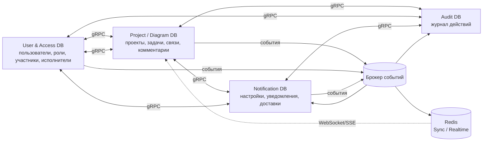
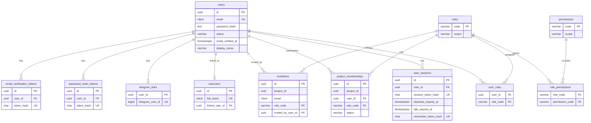
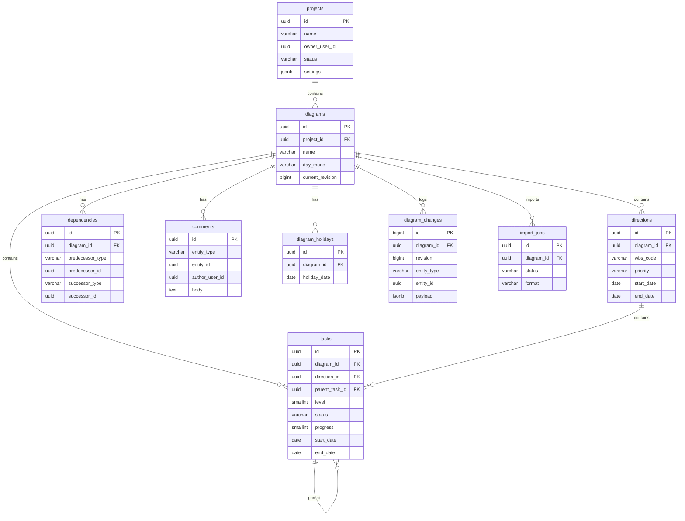
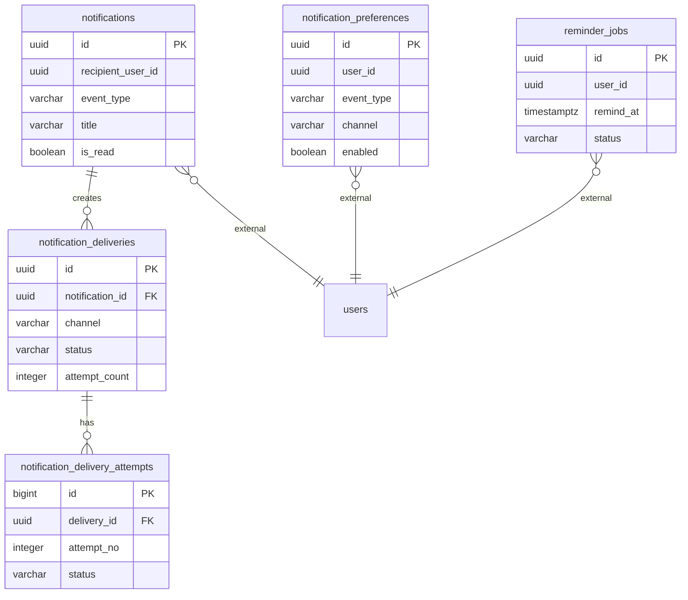
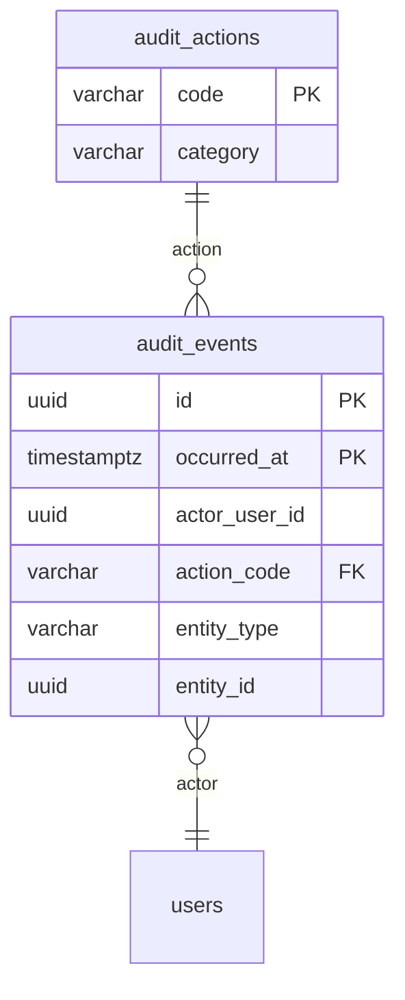

# Архитектура базы данных серверной версии
## «Диаграмма Ганта — проект SMART OATI»

**Версия документа:** 1.7  
**Дата:** 2026-10-28  
**Соответствует плану реализации:** версия 1.6  
**Соответствует бизнес-постановке:** версия 2.3  
**Соответствует User & Access Service:** версия 1.3  
**Соответствует Project / Diagram Service:** версия 1.2  
**Соответствует Sync / Realtime Service:** версия 1.0  
**Соответствует Audit Service:** версия 1.0
**Соответствует Notification Service:** версия 1.1
**Соответствует Telegram Bot:** версия 1.0  
**Базовая версия модели:** PostgreSQL 16<br>
**Текущая local-конфигурация:** PostgreSQL 17 (`postgres:17-alpine`); production-версия в репозитории не зафиксирована.<br>
**Область:** логическая и физическая модель данных микросервисного backend

> **Приняты решения:** один кластер PostgreSQL с отдельными БД и отдельными схемами; полное удаление пользователей; хранение `diagram_changes` и аудита — 2 месяца; хранение уведомлений и журнала доставки — 2 месяца; до двух соисполнителей; состояние сворачивания и фильтры на сервере не хранятся; шаблоны не предусмотрены; проект архивируется перед удалением, хранится 1 год после удаления и может быть восстановлен; хранится только последнее архивное состояние; средний уровень шифрования; read-only аналитика на основном кластере без read replica; материализованные представления и маскирование не требуются.
>
> **Дополнительно для User & Access:** системные настройки хранятся в `settings.system_settings`; auth-письма — в `jobs.auth_email_jobs`; сессии и remember-токены — в одной строке слота; максимум два слота; lockout-поля хранятся в `access.users`.
>
> **Дополнительно для Project / Diagram:** асинхронный импорт хранится в `jobs.import_jobs`; payload — в PostgreSQL и удаляется после обработки; неизвестные исполнители не создаются и попадают в отчёт.
>
> **Дополнительно для Audit:** общий журнал `audit.audit_events` хранится 2 месяца; отдельный журнал действий администраторов `audit.privileged_audit_events` — 2 года; события администраторов дублируются в общий журнал; выгрузка журнала не предусмотрена.
>
> **Статус реализации:** фактические имена БД имеют префикс `rp_gant_`; локальный PostgreSQL см. в метаданных документа. Таблицы и ограничения в этом документе — проектная модель, сверяйте их с `db/migrations/`.

---

## 1. Назначение и принципы

Документ описывает архитектуру баз данных серверной версии приложения: состав баз, модели, поля, ключи, ограничения, индексы, связи внутри сервисов и логические связи между сервисами.

### 1.1. Основные принципы

1. **Database per service в одном кластере.** Каждый backend-сервис владеет своей базой данных; все базы размещаются в одном кластере PostgreSQL.
2. **Отдельные схемы внутри баз.** В каждой базе выделены схемы по доменам, чтобы в будущем можно было разделить сервисы без переписывания модели.
3. **Нет общих таблиц.** Сервисы не читают и не изменяют таблицы друг друга.
4. **Нет прямых SQL-запросов между сервисами.** Синхронное взаимодействие — только gRPC.
5. **Нет внешних ключей между базами.** Ссылки между сервисами логические, по UUID.
6. **Пользовательские данные принадлежат только User & Access Service.** Project / Diagram Service хранит только непрозрачные ID пользователей и исполнителей.
7. **Синхронные вызовы — gRPC**, асинхронные — события через брокер.
8. **Согласованность — eventual consistency.** Для надежной публикации событий используется outbox.
9. **PostgreSQL-совместимый SQL**, UUID, `timestamptz`, `date`, `citext`, `jsonb`; текущий local Compose использует PostgreSQL 17.
10. **Пользователи удаляются полностью.** Проектные сущности и исполнители используют мягкое удаление; проекты — архивирование перед удалением.
11. **Состояние сворачивания, фильтры и шаблоны не хранятся на сервере.**
12. **Все изменения схемы — через миграции** каждой базы отдельно.

### 1.2. Состав баз

| База данных | Владелец | Назначение |
|-------------|----------|------------|
| `rp_gant_user` | User & Access Service | Пользователи, сессии, роли, права, участники проектов, приглашения, исполнители, контакты, системные настройки, auth-письма |
| `rp_gant_project` | Project / Diagram Service | Проекты, диаграммы, направления, задачи, назначения, зависимости, комментарии, праздники, ревизии, импорт |
| `rp_gant_notification` | Notification Service | Настройки уведомлений, уведомления, доставки, попытки, auth-письма, напоминания, Telegram-обновления |
| `rp_gant_audit` | Audit Service | Журнал аудита |
| `rp_gant_sync` | Sync Service | Durable processed-event IDs для idempotent DLQ replay |
| Redis | Sync / Realtime Service | Подключения, подписки, presence; бизнес-данные не хранятся |

Все PostgreSQL-базы размещаются в **одном кластере**. Внутри каждой базы используются отдельные схемы.

> Текущая local-конфигурация Redis есть в Compose, но приложение пока её не использует; Sync хранит активные WebSocket-клиенты в памяти процесса и использует `rp_gant_sync` только для durable event deduplication. Описание Redis в целевой модели не следует трактовать как уже работающий runtime-контур.

| База | Схемы | Содержимое |
|------|-------|------------|
| `rp_gant_user` | `access`, `jobs`, `settings`, `events`, `analytics`, `ext` | Пользователи, роли, участия, исполнители; auth-письма; системные настройки; outbox/idempotency; аналитика; расширения |
| `rp_gant_project` | `project`, `plan`, `jobs`, `events`, `analytics`, `ext` | Проекты и диаграммы; направления, задачи, назначения, зависимости, комментарии, праздники, изменения; импорт; outbox; аналитика |
| `rp_gant_notification` | `notify`, `delivery`, `scheduler`, `bots`, `events`, `analytics`, `ext` | Настройки и уведомления; доставки и попытки; auth-письма; напоминания; Telegram-обновления; outbox; аналитика |
| `rp_gant_audit` | `audit`, `events`, `analytics`, `ext` | Журнал аудита; processed events; аналитика |
| `rp_gant_sync` | `events` | Sync processed events для deduplication по `event_id` |

Имена таблиц ниже указаны без схемы. При реализации они создаются в соответствующей схеме из таблицы выше.

---

## 2. Общая карта данных



### 2.1. Логические связи между базами

| Ссылка | Где хранится | Куда указывает | Тип | Проверка |
|--------|--------------|----------------|-----|----------|
| `project_memberships.project_id` | User DB | `projects.id` | Логическая | gRPC при создании/приглашении |
| `invitations.project_id` | User DB | `projects.id` | Логическая | gRPC |
| `projects.owner_user_id` | Project DB | `users.id` | Логическая | gRPC при создании проекта |
| `projects.created_by_user_id` | Project DB | `users.id` | Логическая | Контекст запроса |
| `projects.updated_by_user_id` | Project DB | `users.id` | Логическая | Контекст запроса |
| `diagrams.created_by_user_id` | Project DB | `users.id` | Логическая | Контекст запроса |
| `assignments.assignee_id` при `assignee_type='user'` | Project DB | `users.id` | Логическая | gRPC |
| `assignments.assignee_id` при `assignee_type='executor'` | Project DB | `executors.id` | Логическая | gRPC |
| `comments.author_user_id` | Project DB | `users.id` | Логическая | Контекст запроса |
| `diagram_changes.actor_user_id` | Project DB | `users.id` | Логическая | Контекст запроса |
| `notifications.recipient_user_id` | Notification DB | `users.id` | Логическая | gRPC |
| `notification_preferences.user_id` | Notification DB | `users.id` | Логическая | gRPC |
| `reminder_jobs.user_id` | Notification DB | `users.id` | Логическая | gRPC |
| `audit_events.actor_user_id` | Audit DB | `users.id` | Логическая | Событие |

### 2.2. Правила ссылочной целостности

- Внутри одной базы используются обычные внешние ключи.
- Между базами внешние ключи **не создаются**, чтобы не связывать сервисы на уровне БД.
- Существование внешней сущности проверяется через gRPC в момент команды.
- Пользователь удаляется полностью; проект и исполнитель используют мягкое удаление/архивирование.
- Для ссылок, которые могут стать «сиротскими», применяется явная политика: удаление ссылки, обнуление или отображение состояния «не найден».
- Полная очистка связанных данных выполняется через события и фоновые сверки, а не через каскад между базами.
- Технические UUID в неизменяемых журналах могут сохраняться после удаления пользователя, но без ФИО, email, Telegram и иных персональных данных.

---

## 3. User & Access Service — `rp_gant_user`

### 3.1. Назначение

Единственный владелец пользовательских данных:

- учетные записи;
- сессии;
- роли и права;
- участники проектов;
- приглашения;
- каталог исполнителей;
- контакты email и Telegram;
- связь пользователя с исполнителем.

Сервис не хранит проекты, диаграммы, задачи, зависимости и комментарии.

### 3.2. ERD



### 3.3. Таблицы

#### 3.3.1. `users`

| Колонка | Тип | Ограничения | Назначение |
|---------|-----|-------------|------------|
| `id` | `uuid` | PK, default `gen_random_uuid()` | Идентификатор пользователя |
| `email` | `citext` | NOT NULL, UNIQUE | Логин и основной email |
| `password_hash` | `text` | NOT NULL | Хеш пароля |
| `status` | `varchar(16)` | NOT NULL, default `active`, CHECK `active/blocked` | Статус учетной записи |
| `email_verified_at` | `timestamptz` | NULL | Подтверждение email |
| `display_name` | `varchar(200)` | NOT NULL | Отображаемое имя |
| `last_name` | `varchar(100)` | NULL | Фамилия |
| `first_name` | `varchar(100)` | NULL | Имя |
| `middle_name` | `varchar(100)` | NULL | Отчество |
| `position` | `varchar(200)` | NULL | Должность |
| `timezone` | `varchar(64)` | NOT NULL, default `Europe/Moscow` | Часовой пояс |
| `locale` | `varchar(16)` | NOT NULL, default `ru-RU` | Язык интерфейса |
| `failed_login_attempts` | `smallint` | NOT NULL, default `0` | Неудачные попытки входа |
| `lockout_level` | `smallint` | NOT NULL, default `0`, CHECK `0..3` | Уровень блокировки |
| `locked_until` | `timestamptz` | NULL | Временная блокировка |
| `last_login_at` | `timestamptz` | NULL | Последний вход |
| `created_at` | `timestamptz` | NOT NULL, default `now()` | Создание |
| `updated_at` | `timestamptz` | NOT NULL, default `now()` | Изменение |

Индексы:

- `UNIQUE (email)`;
- `INDEX (status)`;
- `INDEX (display_name)` для поиска.

Правила:

- `email` приводится к нижнему регистру.
- `password_hash` не хранит открытый пароль.
- Пользователь **удаляется полностью**: запись `users` и связанные пользовательские данные удаляются, а не анонимизируются.
- Перед удалением владение проектами передается другому пользователю; иначе удаление блокируется.
- Технические UUID в неизменяемых журналах могут сохраняться без персональных данных.
- `failed_login_attempts` и `lockout_level` сбрасываются после успешного входа, истечения временной блокировки и административной разблокировки.
- Первая блокировка — 10 минут, вторая — 1 час, третья — `status='blocked'` без автоматического снятия.
- Постоянную блокировку снимает только администратор приложения.
- При блокировке все сессии пользователя отзываются.

#### 3.3.2. `user_sessions`

| Колонка | Тип | Ограничения | Назначение |
|---------|-----|-------------|------------|
| `id` | `uuid` | PK | Идентификатор слота сессии |
| `user_id` | `uuid` | FK → `users.id`, ON DELETE CASCADE | Пользователь |
| `session_token_hash` | `char(64)` | NOT NULL, UNIQUE | Хеш обычного токена |
| `absolute_expires_at` | `timestamptz` | NOT NULL | Абсолютный срок обычной сессии |
| `idle_expires_at` | `timestamptz` | NOT NULL | Idle-срок обычной сессии |
| `remember_token_hash` | `char(64)` | NULL, UNIQUE | Хеш remember-токена |
| `remember_absolute_expires_at` | `timestamptz` | NULL | Абсолютный срок remember |
| `remember_idle_expires_at` | `timestamptz` | NULL | Idle-срок remember |
| `user_agent` | `text` | NULL | Браузер/устройство |
| `ip` | `inet` | NULL | IP-адрес |
| `last_seen_at` | `timestamptz` | NULL | Последняя активность |
| `revoked_at` | `timestamptz` | NULL | Отзыв слота |
| `created_at` | `timestamptz` | NOT NULL, default `now()` | Создание |

Индексы:

- `INDEX (user_id)`;
- `INDEX (absolute_expires_at)`;
- `INDEX (idle_expires_at)`;
- `INDEX (revoked_at)`;
- частичный `UNIQUE (remember_token_hash) WHERE remember_token_hash IS NOT NULL`.

Правила:

- одна строка — один слот; у пользователя не более двух активных слотов;
- лимит проверяется триггером;
- обычная сессия: 1 час абсолютный срок, 10 минут idle;
- remember: 30 дней абсолютный срок, 7 дней idle;
- remember-токен и его обычная сессия относятся к одному слоту;
- `ValidateSession` продлевает `idle_expires_at`, но не `absolute_expires_at`;
- `RestoreSession` ротирует оба токена в том же слоте;
- при отзыве слота обнуляются/помечаются revoked оба токена.

#### 3.3.3. `roles`

| Колонка | Тип | Ограничения | Назначение |
|---------|-----|-------------|------------|
| `code` | `varchar(32)` | PK | Код роли |
| `scope` | `varchar(16)` | NOT NULL, CHECK `app/project` | Область роли |
| `name` | `varchar(100)` | NOT NULL | Название |
| `description` | `text` | NULL | Описание |

Базовые роли:

| Код | Область | Назначение |
|-----|---------|------------|
| `app_admin` | `app` | Администратор приложения |
| `project_owner` | `project` | Владелец проекта |
| `project_manager` | `project` | Руководитель проекта |
| `project_editor` | `project` | Редактор |
| `project_participant` | `project` | Участник |
| `project_viewer` | `project` | Наблюдатель |

#### 3.3.4. `permissions`

| Колонка | Тип | Ограничения | Назначение |
|---------|-----|-------------|------------|
| `code` | `varchar(64)` | PK | Код права |
| `scope` | `varchar(16)` | NOT NULL, CHECK `app/project` | Область права |
| `description` | `text` | NULL | Описание |

Примеры прав:

- `project.view`;
- `project.task.create`;
- `project.task.edit`;
- `project.task.delete`;
- `project.dependency.manage`;
- `project.comment.create`;
- `project.import`;
- `project.export`;
- `project.members.manage`;
- `project.settings.manage`;
- `project.delete`;
- `project.audit.view`;
- `app.users.manage`.

#### 3.3.5. `role_permissions`

| Колонка | Тип | Ограничения | Назначение |
|---------|-----|-------------|------------|
| `role_code` | `varchar(32)` | FK → `roles.code`, ON DELETE CASCADE | Роль |
| `permission_code` | `varchar(64)` | FK → `permissions.code`, ON DELETE CASCADE | Право |

PK: `(role_code, permission_code)`.

#### 3.3.6. `user_roles`

| Колонка | Тип | Ограничения | Назначение |
|---------|-----|-------------|------------|
| `user_id` | `uuid` | FK → `users.id`, ON DELETE CASCADE | Пользователь |
| `role_code` | `varchar(32)` | FK → `roles.code` | Глобальная роль |
| `granted_by_user_id` | `uuid` | FK → `users.id`, NULL | Кто выдал |
| `granted_at` | `timestamptz` | NOT NULL, default `now()` | Когда выдана |

PK: `(user_id, role_code)`.

Правило: здесь хранятся только роли области `app` (например, `app_admin`). Роли проекта хранятся в `project_memberships`.

#### 3.3.7. `project_memberships`

| Колонка | Тип | Ограничения | Назначение |
|---------|-----|-------------|------------|
| `id` | `uuid` | PK | Идентификатор участия |
| `project_id` | `uuid` | NOT NULL | ID проекта (логическая ссылка) |
| `user_id` | `uuid` | FK → `users.id`, ON DELETE CASCADE | Пользователь |
| `role_code` | `varchar(32)` | FK → `roles.code` | Роль в проекте |
| `status` | `varchar(16)` | NOT NULL, default `active`, CHECK `invited/active/revoked` | Статус участия |
| `invited_by_user_id` | `uuid` | FK → `users.id`, NULL, ON DELETE SET NULL | Кто пригласил |
| `invited_at` | `timestamptz` | NULL | Когда приглашен |
| `joined_at` | `timestamptz` | NULL | Когда присоединился |
| `revoked_at` | `timestamptz` | NULL | Когда доступ отозван |
| `revoked_reason` | `varchar(32)` | NULL, CHECK `project_deleted/member_removed` | Причина отзыва |
| `created_at` | `timestamptz` | NOT NULL, default `now()` | Создание |
| `updated_at` | `timestamptz` | NOT NULL, default `now()` | Изменение |

Ограничения и индексы:

- `UNIQUE (project_id, user_id)`;
- `INDEX (user_id)`;
- `INDEX (project_id)`;
- `INDEX (status)`;
- `INDEX (role_code)`;
- `INDEX (revoked_reason)`.

Правила:

- `project_id` не имеет FK на Project DB.
- Существование проекта проверяется через gRPC.
- Роль должна иметь `scope = 'project'`; проверка на уровне приложения и триггера.
- При исключении из проекта статус меняется на `revoked`, причина — `member_removed`; запись сохраняется для аудита.
- При удалении проекта статус меняется на `revoked`, причина — `project_deleted`; запись сохраняется на срок хранения проекта.
- При восстановлении проекта участия с причиной `project_deleted` возвращаются в `active`; участия с причиной `member_removed` не восстанавливаются.
- При окончательной очистке проекта участия и приглашения удаляются.
- Project / Diagram Service не хранит эту таблицу.

#### 3.3.8. `invitations`

| Колонка | Тип | Ограничения | Назначение |
|---------|-----|-------------|------------|
| `id` | `uuid` | PK | Идентификатор приглашения |
| `project_id` | `uuid` | NOT NULL | ID проекта (логическая ссылка) |
| `email` | `citext` | NOT NULL | Email приглашенного |
| `role_code` | `varchar(32)` | FK → `roles.code` | Роль в проекте |
| `invited_by_user_id` | `uuid` | FK → `users.id`, ON DELETE SET NULL | Кто пригласил |
| `token_hash` | `char(64)` | NOT NULL, UNIQUE | Хеш токена приглашения |
| `expires_at` | `timestamptz` | NOT NULL | Срок действия |
| `accepted_at` | `timestamptz` | NULL | Когда принято |
| `revoked_at` | `timestamptz` | NULL | Когда отозвано |
| `created_at` | `timestamptz` | NOT NULL, default `now()` | Создание |

Индексы:

- `INDEX (project_id)`;
- `INDEX (email)`;
- `INDEX (expires_at)`;
- частичный `UNIQUE (project_id, email) WHERE accepted_at IS NULL AND revoked_at IS NULL` — одно активное приглашение на email в проекте.

#### 3.3.9. `password_reset_tokens`

| Колонка | Тип | Ограничения | Назначение |
|---------|-----|-------------|------------|
| `id` | `uuid` | PK | Идентификатор |
| `user_id` | `uuid` | FK → `users.id`, ON DELETE CASCADE | Пользователь |
| `token_hash` | `char(64)` | NOT NULL, UNIQUE | Хеш токена |
| `expires_at` | `timestamptz` | NOT NULL | Срок действия |
| `used_at` | `timestamptz` | NULL | Когда использован |
| `created_at` | `timestamptz` | NOT NULL, default `now()` | Создание |

Индекс: `INDEX (user_id)`, `INDEX (expires_at)`.

#### 3.3.10. `email_verification_tokens`

| Колонка | Тип | Ограничения | Назначение |
|---------|-----|-------------|------------|
| `id` | `uuid` | PK | Идентификатор |
| `user_id` | `uuid` | FK → `users.id`, ON DELETE CASCADE | Пользователь |
| `token_hash` | `char(64)` | NOT NULL, UNIQUE | Хеш токена |
| `expires_at` | `timestamptz` | NOT NULL | Срок действия |
| `used_at` | `timestamptz` | NULL | Когда использован |
| `created_at` | `timestamptz` | NOT NULL, default `now()` | Создание |

Индекс: `INDEX (user_id)`, `INDEX (expires_at)`.

#### 3.3.11. `executors`

| Колонка | Тип | Ограничения | Назначение |
|---------|-----|-------------|------------|
| `id` | `uuid` | PK | Идентификатор исполнителя |
| `last_name` | `varchar(100)` | NOT NULL | Фамилия |
| `first_name` | `varchar(100)` | NOT NULL | Имя |
| `middle_name` | `varchar(100)` | NULL | Отчество |
| `full_name` | `citext` | NOT NULL, UNIQUE | Полное ФИО |
| `position` | `varchar(200)` | NULL | Должность |
| `linked_user_id` | `uuid` | FK → `users.id`, NULL, UNIQUE, ON DELETE SET NULL | Связанный пользователь |
| `is_active` | `boolean` | NOT NULL, default `true` | Активен |
| `created_at` | `timestamptz` | NOT NULL, default `now()` | Создание |
| `updated_at` | `timestamptz` | NOT NULL, default `now()` | Изменение |
| `deleted_at` | `timestamptz` | NULL | Мягкое удаление |

Ограничения:

- `CHECK (length(trim(last_name)) > 0)`;
- `CHECK (length(trim(first_name)) > 0)`;
- `CHECK (length(trim(full_name)) > 0)`;
- `UNIQUE (linked_user_id) WHERE linked_user_id IS NOT NULL` — один пользователь связан не более чем с одним исполнителем.

Индексы:

- `INDEX (is_active)`;
- `INDEX (linked_user_id)`.

Правила:

- Project / Diagram Service хранит только `executor_id`.
- При удалении исполнителя запись помечается удаленной; задачи сохраняют ID.
- При связывании с пользователем уведомления могут адресоваться пользователю.

#### 3.3.12. `telegram_links`

| Колонка | Тип | Ограничения | Назначение |
|---------|-----|-------------|------------|
| `user_id` | `uuid` | PK, FK → `users.id`, ON DELETE CASCADE | Пользователь |
| `telegram_user_id` | `bigint` | NOT NULL, UNIQUE | ID пользователя в Telegram |
| `telegram_username` | `varchar(64)` | NULL | Username |
| `linked_at` | `timestamptz` | NOT NULL, default `now()` | Когда привязан |
| `revoked_at` | `timestamptz` | NULL | Когда отвязан |

Индекс: `UNIQUE (telegram_user_id)`.

Правила:

- Notification Service не хранит Telegram ID; получает его по gRPC.
- При отвязке `revoked_at` заполняется, запись сохраняется для аудита.

#### 3.3.13. `outbox_events`

| Колонка | Тип | Ограничения | Назначение |
|---------|-----|-------------|------------|
| `id` | `uuid` | PK | ID события |
| `aggregate_type` | `varchar(64)` | NOT NULL | Тип агрегата |
| `aggregate_id` | `uuid` | NOT NULL | ID агрегата |
| `event_type` | `varchar(100)` | NOT NULL | Тип события |
| `payload` | `jsonb` | NOT NULL | Тело события |
| `headers` | `jsonb` | NULL | Метаданные |
| `occurred_at` | `timestamptz` | NOT NULL, default `now()` | Когда произошло |
| `published_at` | `timestamptz` | NULL | Когда опубликовано |
| `retry_count` | `integer` | NOT NULL, default `0` | Число попыток |
| `last_error` | `text` | NULL | Последняя ошибка |

Индексы:

- `INDEX (published_at) WHERE published_at IS NULL`;
- `INDEX (aggregate_type, aggregate_id)`;
- `INDEX (occurred_at)`.

#### 3.3.14. `processed_events`

| Колонка | Тип | Ограничения | Назначение |
|---------|-----|-------------|------------|
| `consumer` | `varchar(64)` | NOT NULL | Имя потребителя |
| `event_id` | `uuid` | NOT NULL | ID события |
| `processed_at` | `timestamptz` | NOT NULL, default `now()` | Когда обработано |

PK: `(consumer, event_id)`.

#### 3.3.15. `idempotency_keys`

| Колонка | Тип | Ограничения | Назначение |
|---------|-----|-------------|------------|
| `key` | `varchar(128)` | PK | Ключ идемпотентности |
| `user_id` | `uuid` | FK → `users.id`, NULL, ON DELETE SET NULL | Пользователь |
| `request_hash` | `char(64)` | NOT NULL | Хеш запроса |
| `response` | `jsonb` | NULL | Сохраненный ответ |
| `created_at` | `timestamptz` | NOT NULL, default `now()` | Создание |
| `expires_at` | `timestamptz` | NOT NULL | Срок хранения |

#### 3.3.16. `system_settings`

Схема `settings`.

| Колонка | Тип | Ограничения | Назначение |
|---------|-----|-------------|------------|
| `key` | `varchar(100)` | PK | Ключ настройки |
| `value` | `jsonb` | NOT NULL | Значение |
| `description` | `text` | NULL | Описание |
| `updated_by_user_id` | `uuid` | FK → `users.id`, NULL, ON DELETE SET NULL | Кто изменил |
| `updated_at` | `timestamptz` | NOT NULL, default `now()` | Когда изменено |

Начальные значения:

- `password_min_length` = 8;
- `password_max_length` = 128;
- `password_require_complexity` = false;
- `max_failed_attempts` = 5;
- `first_lockout_minutes` = 10;
- `second_lockout_minutes` = 60;
- `third_lockout_permanent` = true;
- `session_absolute_minutes` = 60;
- `session_idle_minutes` = 10;
- `max_sessions` = 2;
- `remember_me_absolute_days` = 30;
- `remember_me_idle_days` = 7;
- `email_verification_hours` = 24;
- `password_reset_hours` = 1;
- `invitation_days` = 7;
- `telegram_link_code_minutes` = 10.

Правила:

- изменять настройки может только администратор приложения;
- новые парольные правила — для новых паролей и сбросов;
- новые TTL — для новых сессий, существующие не продлеваются;
- настройки блокировок применяются сразу;
- изменения аудируются.

#### 3.3.17. `auth_email_jobs`

Схема `jobs`.

| Колонка | Тип | Ограничения | Назначение |
|---------|-----|-------------|------------|
| `id` | `uuid` | PK | ID задания |
| `user_id` | `uuid` | FK → `users.id`, NULL, ON DELETE CASCADE | Пользователь |
| `invitation_id` | `uuid` | FK → `invitations.id`, NULL, ON DELETE CASCADE | Приглашение |
| `recipient_email` | `citext` | NOT NULL | Получатель |
| `template_code` | `varchar(64)` | NOT NULL | Шаблон |
| `variables` | `jsonb` | NOT NULL | Данные шаблона |
| `status` | `varchar(16)` | NOT NULL, default `pending`, CHECK `pending/sending/sent/failed` | Статус |
| `attempts` | `integer` | NOT NULL, default `0` | Попытки |
| `next_attempt_at` | `timestamptz` | NULL | Следующая попытка |
| `last_error` | `text` | NULL | Ошибка |
| `created_at` | `timestamptz` | NOT NULL, default `now()` | Создание |
| `sent_at` | `timestamptz` | NULL | Отправка |

Индексы:

- частичный `INDEX (next_attempt_at) WHERE status IN ('pending', 'sending')`;
- `INDEX (user_id)`;
- `INDEX (invitation_id)`.

Правила:

- отправка выполняется worker-процессом через Notification Service по gRPC;
- при недоступности Notification задание остается в очереди;
- максимум 8 попыток за 24 часа;
- после лимита — `failed` и технический лог;
- письмо не откатывает регистрацию, сброс пароля или приглашение.

### 3.4. Связи внутри User & Access DB

- `users` 1 → N `user_sessions`;
- `users` 1 → N `user_roles`;
- `roles` 1 → N `user_roles`;
- `roles` 1 → N `role_permissions`;
- `permissions` 1 → N `role_permissions`;
- `users` 1 → N `project_memberships`;
- `roles` 1 → N `project_memberships`;
- `users` 1 → N `invitations` (как приглашающий);
- `roles` 1 → N `invitations`;
- `users` 1 → 0..1 `executors`;
- `users` 1 → 0..1 `telegram_links`;
- `users` 1 → N `password_reset_tokens`;
- `users` 1 → N `email_verification_tokens`;
- `users` 1 → N `auth_email_jobs`;
- `invitations` 1 → N `auth_email_jobs`;
- `system_settings` — независимая таблица настроек.

### 3.5. Политика полного удаления пользователя

1. Удаление выполняется только после передачи владения проектами другому пользователю.
2. Удаляются `users`, `user_sessions`, `user_roles`, `project_memberships`, `password_reset_tokens`, `email_verification_tokens`, `telegram_links` и приглашения с email пользователя.
3. В оставшихся `invitations.invited_by_user_id` и `executors.linked_user_id` устанавливается `NULL`.
4. `idempotency_keys.user_id` устанавливается `NULL`.
5. Project / Diagram Service по событию `user.deleted`:
   - удаляет `assignments` с `assignee_type='user'`;
   - обнуляет `comments.author_user_id`;
   - не удаляет задачи и комментарии;
   - в технических полях авторства может сохраняться UUID без персональных данных.
6. Notification Service удаляет настройки, уведомления, доставки и напоминания пользователя.
7. Audit Service сохраняет запись об удалении; ранее созданные аудиторские события могут содержать только технический UUID.
8. Полное удаление необратимо.

---

## 4. Project / Diagram Service — `rp_gant_project`

### 4.1. Назначение

Хранит проектные данные:

- проекты;
- диаграммы;
- направления;
- задачи и подзадачи;
- назначения;
- зависимости и стили связей;
- комментарии;
- праздники;
- ревизии и изменения.

Не хранит профили, имена, email, Telegram, участников проектов, роли и каталог исполнителей. Состояние сворачивания и фильтры на сервере не хранятся; шаблоны не предусмотрены.

Проект проходит жизненный цикл `active → archived → deleted`. Архивирование обязательно перед удалением; архивный проект доступен только для просмотра. Удаленный проект можно восстановить в течение 1 года; восстановление возвращает его в `archived`. Хранится только последнее архивное состояние. После 1 года проект очищается.

### 4.2. ERD



Полиморфные связи:

- `assignments` ссылается на `directions` или `tasks`;
- `dependencies` ссылается на `directions` или `tasks`;
- `comments` ссылается на `directions` или `tasks`.

Эти связи не оформлены внешними ключами, потому что цель полиморфная. Целостность проверяется приложением и триггерами.

### 4.3. Таблицы

#### 4.3.1. `projects`

| Колонка | Тип | Ограничения | Назначение |
|---------|-----|-------------|------------|
| `id` | `uuid` | PK, default `gen_random_uuid()` | ID проекта |
| `name` | `varchar(200)` | NOT NULL | Название |
| `description` | `text` | NULL | Описание |
| `owner_user_id` | `uuid` | NOT NULL | Владелец, логическая ссылка на User DB |
| `status` | `varchar(16)` | NOT NULL, default `active`, CHECK `active/archived/deleted` | Статус |
| `settings` | `jsonb` | NOT NULL, default `'{}'` | Настройки проекта |
| `created_by_user_id` | `uuid` | NOT NULL | Автор, логическая ссылка |
| `updated_by_user_id` | `uuid` | NULL | Последний редактор |
| `created_at` | `timestamptz` | NOT NULL, default `now()` | Создание |
| `updated_at` | `timestamptz` | NOT NULL, default `now()` | Изменение |
| `archived_at` | `timestamptz` | NULL | Архивирование |
| `deleted_at` | `timestamptz` | NULL | Мягкое удаление |
| `purge_after` | `timestamptz` | NULL | Дата окончательной очистки |

Индексы:

- `INDEX (owner_user_id)`;
- `INDEX (status)`;
- `INDEX (deleted_at)`;
- `INDEX (purge_after) WHERE status = 'deleted'`;
- `INDEX (lower(name))`.

Правила:

- членство и роли хранятся в User & Access DB, а не здесь;
- `active → archived → deleted`; удаление допускается только из `archived`;
- архивный проект доступен только для чтения;
- `archived_at` заполняется при архивировании, `deleted_at` — при удалении;
- при удалении `purge_after = deleted_at + interval '1 year'`;
- восстановление возможно до `purge_after`; проект возвращается в `archived`, `deleted_at` и `purge_after` очищаются;
- хранится только последнее архивное состояние; история архивных состояний не ведется;
- после `purge_after` проект и связанные данные очищаются.

#### 4.3.2. `diagrams`

| Колонка | Тип | Ограничения | Назначение |
|---------|-----|-------------|------------|
| `id` | `uuid` | PK | ID диаграммы |
| `project_id` | `uuid` | FK → `projects.id`, ON DELETE CASCADE | Проект |
| `name` | `varchar(200)` | NOT NULL | Название |
| `description` | `text` | NULL | Описание |
| `day_mode` | `varchar(16)` | NOT NULL, default `working`, CHECK `calendar/working` | Режим дней |
| `current_revision` | `bigint` | NOT NULL, default `0` | Текущая ревизия |
| `created_by_user_id` | `uuid` | NOT NULL | Автор |
| `updated_by_user_id` | `uuid` | NULL | Последний редактор |
| `created_at` | `timestamptz` | NOT NULL, default `now()` | Создание |
| `updated_at` | `timestamptz` | NOT NULL, default `now()` | Изменение |
| `archived_at` | `timestamptz` | NULL | Архивирование |
| `deleted_at` | `timestamptz` | NULL | Мягкое удаление |

Индексы:

- `INDEX (project_id)`;
- `INDEX (deleted_at)`;
- `INDEX (current_revision)`.

#### 4.3.3. `directions`

| Колонка | Тип | Ограничения | Назначение |
|---------|-----|-------------|------------|
| `id` | `uuid` | PK | ID направления |
| `diagram_id` | `uuid` | FK → `diagrams.id`, ON DELETE CASCADE | Диаграмма |
| `wbs_code` | `varchar(32)` | NOT NULL | WBS-номер |
| `sort_order` | `integer` | NOT NULL, default `0` | Порядок |
| `name` | `varchar(200)` | NOT NULL | Название |
| `description` | `text` | NULL | Описание |
| `result` | `text` | NULL | Результат |
| `priority` | `varchar(16)` | NOT NULL, default `medium`, CHECK `low/medium/high/critical` | Приоритет |
| `start_date` | `date` | NULL | Начало |
| `end_date` | `date` | NULL | Окончание |
| `jira_number` | `varchar(40)` | NULL | Номер Jira |
| `bp_flag` | `boolean` | NOT NULL, default `false` | Признак БП |
| `sp_flag` | `boolean` | NOT NULL, default `false` | Признак СП |
| `version` | `integer` | NOT NULL, default `1` | Версия строки |
| `created_by_user_id` | `uuid` | NOT NULL | Автор |
| `updated_by_user_id` | `uuid` | NULL | Последний редактор |
| `created_at` | `timestamptz` | NOT NULL, default `now()` | Создание |
| `updated_at` | `timestamptz` | NOT NULL, default `now()` | Изменение |
| `deleted_at` | `timestamptz` | NULL | Мягкое удаление |

Ограничения:

- `CHECK (end_date IS NULL OR start_date IS NULL OR end_date >= start_date)`;
- `UNIQUE (diagram_id, wbs_code) DEFERRABLE INITIALLY DEFERRED` — допускает перенумерацию в транзакции;
- `INDEX (diagram_id)`;
- `INDEX (deleted_at)`.

#### 4.3.4. `tasks`

| Колонка | Тип | Ограничения | Назначение |
|---------|-----|-------------|------------|
| `id` | `uuid` | PK | ID задачи |
| `diagram_id` | `uuid` | FK → `diagrams.id`, ON DELETE CASCADE | Диаграмма |
| `direction_id` | `uuid` | FK → `directions.id`, ON DELETE CASCADE | Направление |
| `parent_task_id` | `uuid` | FK → `tasks.id`, NULL | Родительская задача |
| `level` | `smallint` | NOT NULL, CHECK `2/3` | Уровень: задача или подзадача |
| `wbs_code` | `varchar(32)` | NOT NULL | WBS-номер |
| `sort_order` | `integer` | NOT NULL, default `0` | Порядок |
| `name` | `varchar(200)` | NOT NULL | Название |
| `description` | `text` | NULL | Описание |
| `result` | `text` | NULL | Результат |
| `status` | `varchar(16)` | NOT NULL, default `planned`, CHECK `planned/in_progress/done/blocked` | Статус |
| `progress` | `smallint` | NOT NULL, default `0`, CHECK `0..100` | Процент |
| `priority` | `varchar(16)` | NOT NULL, default `medium`, CHECK `low/medium/high/critical` | Приоритет |
| `start_date` | `date` | NULL | Начало |
| `end_date` | `date` | NULL | Окончание |
| `actual_end_date` | `date` | NULL | Факт завершения |
| `jira_number` | `varchar(40)` | NULL | Номер Jira |
| `bp_flag` | `boolean` | NOT NULL, default `false` | Признак БП |
| `sp_flag` | `boolean` | NOT NULL, default `false` | Признак СП |
| `version` | `integer` | NOT NULL, default `1` | Версия строки |
| `created_by_user_id` | `uuid` | NOT NULL | Автор |
| `updated_by_user_id` | `uuid` | NULL | Последний редактор |
| `created_at` | `timestamptz` | NOT NULL, default `now()` | Создание |
| `updated_at` | `timestamptz` | NOT NULL, default `now()` | Изменение |
| `deleted_at` | `timestamptz` | NULL | Мягкое удаление |

Ограничения:

- `CHECK (end_date IS NULL OR start_date IS NULL OR end_date >= start_date)`;
- `CHECK (progress BETWEEN 0 AND 100)`;
- `UNIQUE (diagram_id, wbs_code) DEFERRABLE INITIALLY DEFERRED`;
- `INDEX (diagram_id)`;
- `INDEX (direction_id)`;
- `INDEX (parent_task_id)`;
- `INDEX (status)`;
- `INDEX (start_date, end_date)`;
- `INDEX (deleted_at)`.

Правила:

- `level = 2` — задача, `parent_task_id IS NULL`;
- `level = 3` — подзадача, `parent_task_id` указывает на задачу уровня 2;
- родительская задача и подзадача должны относиться к одной диаграмме;
- задача уровня 2 должна относиться к направлению той же диаграммы;
- проверки выполняются триггером.

#### 4.3.5. `assignments`

| Колонка | Тип | Ограничения | Назначение |
|---------|-----|-------------|------------|
| `id` | `uuid` | PK | ID назначения |
| `entity_type` | `varchar(16)` | NOT NULL, CHECK `direction/task` | Тип сущности |
| `entity_id` | `uuid` | NOT NULL | ID направления или задачи |
| `role` | `varchar(16)` | NOT NULL, CHECK `responsible/executor/co_executor` | Роль назначения |
| `assignee_type` | `varchar(16)` | NOT NULL, CHECK `user/executor` | Тип назначенного |
| `assignee_id` | `uuid` | NOT NULL | ID пользователя или исполнителя |
| `created_by_user_id` | `uuid` | NOT NULL | Кто назначил |
| `created_at` | `timestamptz` | NOT NULL, default `now()` | Создание |

Ограничения:

- `CHECK (entity_type = 'task' OR role = 'responsible')` — у направления только ответственный;
- ответственный и исполнитель — не более одного на сущность;
- соисполнителей — **не более двух** на задачу;
- `INDEX (entity_type, entity_id)`;
- `INDEX (assignee_type, assignee_id)`.

Частичные уникальные индексы:

```sql
CREATE UNIQUE INDEX ux_assignments_single_role
    ON plan.assignments (entity_type, entity_id, role)
    WHERE role IN ('responsible', 'executor');

CREATE UNIQUE INDEX ux_assignments_coexecutor
    ON plan.assignments (entity_type, entity_id, assignee_type, assignee_id)
    WHERE role = 'co_executor';
```

Дополнительно триггер проверяет, что для одной задачи количество `co_executor` не превышает двух.

Правила:

- `assignee_type='user'` → `assignee_id` ссылается на User DB;
- `assignee_type='executor'` → `assignee_id` ссылается на User DB, таблица `executors`;
- имена и контакты здесь не хранятся;
- сущность `entity_id` должна существовать в этой же диаграмме; проверка приложением.

#### 4.3.6. `dependencies`

| Колонка | Тип | Ограничения | Назначение |
|---------|-----|-------------|------------|
| `id` | `uuid` | PK | ID связи |
| `diagram_id` | `uuid` | FK → `diagrams.id`, ON DELETE CASCADE | Диаграмма |
| `predecessor_type` | `varchar(16)` | NOT NULL, CHECK `direction/task` | Тип предшественника |
| `predecessor_id` | `uuid` | NOT NULL | ID предшественника |
| `successor_type` | `varchar(16)` | NOT NULL, CHECK `direction/task` | Тип последующей |
| `successor_id` | `uuid` | NOT NULL | ID последующей |
| `link_type` | `varchar(16)` | NOT NULL, default `finish_to_start`, CHECK `finish_to_start` | Тип связи |
| `color` | `varchar(7)` | NULL, CHECK `^#[0-9a-fA-F]{6}$` | Цвет |
| `line_style` | `varchar(16)` | NOT NULL, default `solid`, CHECK `solid/dashed/dotted` | Стиль линии |
| `arrow_shape` | `varchar(16)` | NOT NULL, default `orthogonal`, CHECK `orthogonal/straight/curved` | Форма |
| `created_by_user_id` | `uuid` | NOT NULL | Автор |
| `created_at` | `timestamptz` | NOT NULL, default `now()` | Создание |
| `updated_at` | `timestamptz` | NOT NULL, default `now()` | Изменение |

Ограничения:

- `CHECK (predecessor_id <> successor_id OR predecessor_type <> successor_type)`;
- `UNIQUE (predecessor_type, predecessor_id, successor_type, successor_id)`;
- `INDEX (diagram_id)`;
- `INDEX (predecessor_type, predecessor_id)`;
- `INDEX (successor_type, successor_id)`.

Правила:

- оба конца должны относиться к одной диаграмме;
- циклы допускаются, но отмечаются предупреждением;
- стиль хранится в строке связи, а не в отдельной таблице.

#### 4.3.7. `comments`

| Колонка | Тип | Ограничения | Назначение |
|---------|-----|-------------|------------|
| `id` | `uuid` | PK | ID комментария |
| `entity_type` | `varchar(16)` | NOT NULL, CHECK `direction/task` | Тип сущности |
| `entity_id` | `uuid` | NOT NULL | ID направления или задачи |
| `author_user_id` | `uuid` | NULL | Автор, логическая ссылка на User DB; `NULL` после удаления пользователя |
| `mentioned_user_ids` | `uuid[]` | NULL | Упомянутые пользователи |
| `body` | `text` | NOT NULL, CHECK `length(trim(body)) > 0` | Текст |
| `created_at` | `timestamptz` | NOT NULL, default `now()` | Создание |
| `updated_at` | `timestamptz` | NOT NULL, default `now()` | Изменение |
| `deleted_at` | `timestamptz` | NULL | Мягкое удаление |

Индексы:

- `INDEX (entity_type, entity_id)`;
- `INDEX (author_user_id)`;
- `INDEX (created_at)`.

#### 4.3.8. `diagram_holidays`

| Колонка | Тип | Ограничения | Назначение |
|---------|-----|-------------|------------|
| `id` | `uuid` | PK | ID праздника |
| `diagram_id` | `uuid` | FK → `diagrams.id`, ON DELETE CASCADE | Диаграмма |
| `holiday_date` | `date` | NOT NULL | Дата |
| `name` | `varchar(200)` | NULL | Название |
| `created_at` | `timestamptz` | NOT NULL, default `now()` | Создание |

Ограничения:

- `UNIQUE (diagram_id, holiday_date)`;
- `INDEX (diagram_id)`.

#### 4.3.9. `diagram_changes`

| Колонка | Тип | Ограничения | Назначение |
|---------|-----|-------------|------------|
| `id` | `bigint` | PK, GENERATED ALWAYS AS IDENTITY | Порядковый ID |
| `diagram_id` | `uuid` | FK → `diagrams.id`, ON DELETE CASCADE | Диаграмма |
| `revision` | `bigint` | NOT NULL | Ревизия |
| `entity_type` | `varchar(16)` | NOT NULL, CHECK `project/diagram/direction/task/dependency/comment/holiday` | Тип сущности |
| `entity_id` | `uuid` | NULL | ID сущности |
| `operation` | `varchar(16)` | NOT NULL, CHECK `create/update/delete` | Операция |
| `payload` | `jsonb` | NOT NULL | Изменение |
| `actor_user_id` | `uuid` | NOT NULL | Автор изменения |
| `created_at` | `timestamptz` | NOT NULL, default `now()` | Время |

Ограничения:

- `UNIQUE (diagram_id, revision)`;
- `INDEX (diagram_id, revision)`;
- `INDEX (actor_user_id)`;
- `INDEX (created_at)`.

Назначение:

- воспроизведение изменений для Sync Service;
- история для аудита;
- разрешение конфликтов;
- восстановление после переподключения.

#### 4.3.10. `import_jobs`

Схема `jobs`.

| Колонка | Тип | Ограничения | Назначение |
|---------|-----|-------------|------------|
| `id` | `uuid` | PK | ID задания |
| `project_id` | `uuid` | NOT NULL | ID проекта |
| `diagram_id` | `uuid` | FK → `diagrams.id`, ON DELETE CASCADE | Диаграмма |
| `initiator_user_id` | `uuid` | NOT NULL | Инициатор |
| `format` | `varchar(16)` | NOT NULL, CHECK `json/csv` | Формат |
| `status` | `varchar(16)` | NOT NULL, CHECK `queued/processing/completed/failed/cancelled` | Статус |
| `file_name` | `varchar(255)` | NULL | Имя файла |
| `size_bytes` | `bigint` | NOT NULL, CHECK `<= 50 MB` | Размер |
| `payload` | `bytea` | NULL | Исходные данные |
| `report` | `jsonb` | NULL | Отчёт |
| `error_code` | `varchar(64)` | NULL | Ошибка |
| `error_message` | `text` | NULL | Текст ошибки |
| `created_at` | `timestamptz` | NOT NULL, default `now()` | Создание |
| `started_at` | `timestamptz` | NULL | Старт |
| `finished_at` | `timestamptz` | NULL | Завершение |
| `expires_at` | `timestamptz` | NOT NULL | Очистка задания |

Ограничения:

- частичный `UNIQUE (diagram_id) WHERE status IN ('queued', 'processing')` — один активный импорт на диаграмму;
- частичный `INDEX (status, created_at) WHERE status IN ('queued', 'processing')`;
- `INDEX (diagram_id)`;
- `INDEX (initiator_user_id)`.

Правила:

- payload удаляется после завершения;
- метаданные задания хранятся 7 дней;
- ошибка импорта не меняет диаграмму;
- неизвестные исполнители не создаются;
- отчёт содержит задачи без назначений и предупреждения.

#### 4.3.11. `outbox_events`, `processed_events`, `idempotency_keys`

Структура аналогична User DB:

- `outbox_events` — события Project / Diagram Service;
- `processed_events` — защита от повторной обработки;
- `idempotency_keys` — идемпотентность команд.

### 4.4. Связи внутри Project / Diagram DB

- `projects` 1 → N `diagrams`;
- `diagrams` 1 → N `directions`;
- `diagrams` 1 → N `tasks`;
- `directions` 1 → N `tasks`;
- `tasks` 1 → N `tasks` (подзадачи);
- `diagrams` 1 → N `dependencies`;
- `diagrams` 1 → N `comments`;
- `diagrams` 1 → N `diagram_holidays`;
- `diagrams` 1 → N `diagram_changes`;
- `diagrams` 1 → N `import_jobs`;
- `assignments` — полиморфно к `directions` / `tasks`;
- `dependencies` — полиморфно к `directions` / `tasks`;
- `comments` — полиморфно к `directions` / `tasks`.

### 4.5. Ключевые инварианты

1. Направление, задачи и подзадачи принадлежат одной диаграмме.
2. Подзадача уровня 3 относится к задаче уровня 2 той же диаграммы.
3. Задача уровня 2 относится к направлению той же диаграммы.
4. WBS-номер уникален в пределах диаграммы и типа сущности; полная уникальность между направлениями и задачами проверяется приложением.
5. Зависимость не может соединять сущность саму с собой.
6. Дубликат зависимости запрещен.
7. Оба конца зависимости принадлежат одной диаграмме.
8. У направления только ответственный; у задачи — ответственный, исполнитель и до двух соисполнителей.
9. На роль ответственного и исполнителя — одна персона; соисполнителей — не более двух.
10. Комментарий имеет автора-пользователя; после полного удаления пользователя `author_user_id` обнуляется, имя автора хранится в User DB.
11. Project / Diagram DB не содержит имен, email, Telegram, ролей и участников проекта.

---

## 5. Notification Service — `rp_gant_notification`

### 5.1. Назначение

Хранит:

- настройки уведомлений;
- внутренние уведомления;
- состояние доставки;
- попытки доставки;
- напоминания.

Не хранит email, Telegram и профили пользователей; получает их из User & Access Service по gRPC.

### 5.2. ERD



### 5.3. Таблицы

#### 5.3.1. `notification_preferences`

| Колонка | Тип | Ограничения | Назначение |
|---------|-----|-------------|------------|
| `id` | `uuid` | PK | ID настройки |
| `user_id` | `uuid` | NOT NULL | Пользователь, логическая ссылка |
| `event_type` | `varchar(64)` | NOT NULL | Тип события |
| `channel` | `varchar(16)` | NOT NULL, CHECK `internal/email/telegram` | Канал |
| `enabled` | `boolean` | NOT NULL, default `true` | Включено |
| `quiet_hours_start` | `time` | NULL | Начало тихих часов |
| `quiet_hours_end` | `time` | NULL | Конец тихих часов |
| `timezone` | `varchar(64)` | NOT NULL, default `Europe/Moscow` | Часовой пояс |
| `digest_frequency` | `varchar(16)` | NOT NULL, default `immediate`, CHECK `immediate/daily/weekly` | Частота |
| `updated_at` | `timestamptz` | NOT NULL, default `now()` | Изменение |

Ограничения:

- `UNIQUE (user_id, event_type, channel)`;
- `INDEX (user_id)`;
- `INDEX (event_type)`.

#### 5.3.2. `notifications`

| Колонка | Тип | Ограничения | Назначение |
|---------|-----|-------------|------------|
| `id` | `uuid` | PK | ID уведомления |
| `recipient_user_id` | `uuid` | NOT NULL | Получатель, логическая ссылка |
| `project_id` | `uuid` | NULL | Проект, логическая ссылка |
| `diagram_id` | `uuid` | NULL | Диаграмма, логическая ссылка |
| `event_type` | `varchar(64)` | NOT NULL | Тип события |
| `title` | `varchar(200)` | NOT NULL | Заголовок |
| `body` | `text` | NOT NULL | Текст |
| `entity_type` | `varchar(16)` | NULL, CHECK `direction/task/comment/project` | Тип объекта |
| `entity_id` | `uuid` | NULL | ID объекта |
| `payload` | `jsonb` | NULL | Дополнительные данные |
| `is_read` | `boolean` | NOT NULL, default `false` | Прочитано |
| `read_at` | `timestamptz` | NULL | Время прочтения |
| `created_at` | `timestamptz` | NOT NULL, default `now()` | Создание |
| `expires_at` | `timestamptz` | NULL | Срок хранения |

Индексы:

- `INDEX (recipient_user_id, created_at DESC)`;
- частичный `INDEX (recipient_user_id) WHERE is_read = false`;
- `INDEX (project_id)`;
- `INDEX (diagram_id)`;
- `INDEX (entity_type, entity_id)`.

#### 5.3.3. `notification_deliveries`

| Колонка | Тип | Ограничения | Назначение |
|---------|-----|-------------|------------|
| `id` | `uuid` | PK | ID доставки |
| `notification_id` | `uuid` | FK → `notifications.id`, ON DELETE CASCADE | Уведомление |
| `channel` | `varchar(16)` | NOT NULL, CHECK `internal/email/telegram` | Канал |
| `status` | `varchar(16)` | NOT NULL, default `pending`, CHECK `pending/sending/sent/failed/retrying/skipped` | Статус |
| `attempt_count` | `integer` | NOT NULL, default `0` | Попытки |
| `next_attempt_at` | `timestamptz` | NULL | Следующая попытка |
| `sent_at` | `timestamptz` | NULL | Отправлено |
| `provider_message_id` | `varchar(200)` | NULL | ID у провайдера |
| `last_error` | `text` | NULL | Последняя ошибка |
| `created_at` | `timestamptz` | NOT NULL, default `now()` | Создание |
| `updated_at` | `timestamptz` | NOT NULL, default `now()` | Изменение |

Ограничения:

- `UNIQUE (notification_id, channel)`;
- `INDEX (status, next_attempt_at)`;
- `INDEX (notification_id)`.

#### 5.3.4. `notification_delivery_attempts`

| Колонка | Тип | Ограничения | Назначение |
|---------|-----|-------------|------------|
| `id` | `bigint` | PK, identity | ID попытки |
| `delivery_id` | `uuid` | FK → `notification_deliveries.id`, ON DELETE CASCADE | Доставка |
| `attempt_no` | `integer` | NOT NULL | Номер попытки |
| `status` | `varchar(16)` | NOT NULL, CHECK `started/sent/failed` | Статус |
| `provider_message_id` | `varchar(200)` | NULL | ID у провайдера |
| `error_code` | `varchar(64)` | NULL | Код ошибки |
| `error_message` | `text` | NULL | Текст ошибки |
| `started_at` | `timestamptz` | NOT NULL, default `now()` | Начало |
| `finished_at` | `timestamptz` | NULL | Завершение |

Ограничения:

- `UNIQUE (delivery_id, attempt_no)`;
- `INDEX (delivery_id)`.

#### 5.3.5. `reminder_jobs`

| Колонка | Тип | Ограничения | Назначение |
|---------|-----|-------------|------------|
| `id` | `uuid` | PK | ID напоминания |
| `user_id` | `uuid` | NOT NULL | Получатель |
| `project_id` | `uuid` | NOT NULL | Проект |
| `diagram_id` | `uuid` | NOT NULL | Диаграмма |
| `entity_type` | `varchar(16)` | NOT NULL, CHECK `direction/task` | Тип сущности |
| `entity_id` | `uuid` | NOT NULL | ID сущности |
| `kind` | `varchar(16)` | NOT NULL, CHECK `due_soon/overdue` | Тип напоминания |
| `remind_at` | `timestamptz` | NOT NULL | Когда напомнить |
| `status` | `varchar(16)` | NOT NULL, default `pending`, CHECK `pending/sent/cancelled` | Статус |
| `dedupe_key` | `varchar(160)` | NOT NULL, UNIQUE | Ключ дедупликации |
| `payload` | `jsonb` | NULL | Данные |
| `created_at` | `timestamptz` | NOT NULL, default `now()` | Создание |
| `sent_at` | `timestamptz` | NULL | Отправлено |

Индексы:

- частичный `INDEX (remind_at) WHERE status = 'pending'`;
- `INDEX (user_id)`;
- `INDEX (project_id)`.

#### 5.3.6. `auth_email_deliveries`

Схема `delivery`.

| Колонка | Тип | Ограничения | Назначение |
|---------|-----|-------------|------------|
| `id` | `uuid` | PK | ID доставки |
| `job_id` | `uuid` | NOT NULL, UNIQUE | ID задания User & Access |
| `user_id` | `uuid` | NULL | Пользователь |
| `invitation_id` | `uuid` | NULL | Приглашение |
| `recipient_email` | `citext` | NOT NULL | Получатель |
| `template_code` | `varchar(64)` | NOT NULL | Шаблон |
| `status` | `varchar(16)` | `pending/sent/failed` | Статус |
| `attempt_count` | `integer` | NOT NULL, default 0 | Попытки |
| `provider_message_id` | `varchar(200)` | NULL | ID провайдера |
| `error_code` | `varchar(64)` | NULL | Ошибка |
| `error_message` | `text` | NULL | Текст ошибки |
| `created_at` | `timestamptz` | NOT NULL | Создание |
| `sent_at` | `timestamptz` | NULL | Отправка |
| `expires_at` | `timestamptz` | NOT NULL | Очистка |

Правила:

- auth-письма не являются внутренними уведомлениями;
- три попытки: сразу, 1 минута, 15 минут;
- идемпотентность по `job_id`;
- хранение — 2 месяца.

#### 5.3.7. `telegram_updates`

Схема `bots`.

| Колонка | Тип | Ограничения | Назначение |
|---------|-----|-------------|------------|
| `update_id` | `bigint` | PK | ID обновления Telegram |
| `processed_at` | `timestamptz` | NOT NULL | Обработка |
| `status` | `varchar(16)` | `processed/ignored/failed` | Статус |
| `error` | `text` | NULL | Ошибка |

Правила:

- хранение — 2 месяца;
- повторный `update_id` не обрабатывается.

#### 5.3.8. `outbox_events`, `processed_events`, `idempotency_keys`

Структура аналогична другим сервисам.

### 5.4. Связи

- `notifications` 1 → N `notification_deliveries`;
- `notification_deliveries` 1 → N `notification_delivery_attempts`;
- `notification_preferences` N → 1 пользователь (логическая);
- `notifications` N → 1 пользователь (логическая);
- `reminder_jobs` N → 1 пользователь (логическая);
- `auth_email_deliveries` N → 1 пользователь (логическая);
- `telegram_updates` — независимая таблица webhook-обновлений.

### 5.5. Ограничения

- Email и Telegram не хранятся в Notification DB.
- Для отправки Notification Service получает контакты из User & Access Service по gRPC.
- Журнал доставки хранит ID сообщения провайдера и ошибки, но не адрес.
- Уведомление не блокирует сохранение плана.

---

## 6. Audit Service — `rp_gant_audit`

### 6.1. Назначение

Централизованный журнал действий:

- входы и выходы;
- изменения плана;
- действия с участниками и ролями;
- настройки;
- уведомления;
- административные операции.

Хранит идентификаторы пользователей, но не их профили.

### 6.2. ERD



### 6.3. Таблицы

#### 6.3.1. `audit_actions`

| Колонка | Тип | Ограничения | Назначение |
|---------|-----|-------------|------------|
| `code` | `varchar(64)` | PK | Код действия |
| `category` | `varchar(32)` | NOT NULL | Категория |
| `description` | `varchar(200)` | NOT NULL | Описание |
| `severity` | `varchar(16)` | NOT NULL, default `info`, CHECK `info/warning/critical` | Важность |

Примеры:

- `auth.login`, `auth.logout`, `auth.failed`;
- `project.created`, `project.deleted`;
- `member.added`, `member.role_changed`, `member.removed`;
- `task.created`, `task.updated`, `task.deleted`;
- `dependency.created`, `dependency.deleted`;
- `notification.sent`, `notification.failed`;
- `admin.user.blocked`.

#### 6.3.2. `audit_events`

Таблица партиционируется по `occurred_at` (месяц).

| Колонка | Тип | Ограничения | Назначение |
|---------|-----|-------------|------------|
| `id` | `uuid` | NOT NULL | ID события |
| `occurred_at` | `timestamptz` | NOT NULL | Время события, ключ партиции |
| `actor_user_id` | `uuid` | NULL | Пользователь, логическая ссылка |
| `actor_type` | `varchar(16)` | NOT NULL, default `user`, CHECK `user/service/system` | Тип актора |
| `actor_roles` | `jsonb` | NULL | Роли актора на момент действия |
| `action_code` | `varchar(64)` | FK → `audit_actions.code` | Действие |
| `entity_type` | `varchar(32)` | NULL | Тип объекта |
| `entity_id` | `uuid` | NULL | ID объекта |
| `project_id` | `uuid` | NULL | Проект |
| `diagram_id` | `uuid` | NULL | Диаграмма |
| `request_id` | `varchar(64)` | NULL | ID запроса |
| `correlation_id` | `varchar(64)` | NULL | ID корреляции |
| `ip` | `inet` | NULL | IP |
| `user_agent` | `text` | NULL | Клиент |
| `before_data` | `jsonb` | NULL | Состояние до |
| `after_data` | `jsonb` | NULL | Состояние после |
| `metadata` | `jsonb` | NULL | Дополнительно |
| `source_event_id` | `uuid` | NOT NULL | ID исходного события |
| `source_service` | `varchar(32)` | NOT NULL | Источник |
| `severity` | `varchar(16)` | `info/warning/critical` | Важность |
| `created_at` | `timestamptz` | NOT NULL, default `now()` | Запись |

Ограничения:

- PK `(id, occurred_at)` — требование партиционирования;
- `UNIQUE (source_event_id, occurred_at)`;
- `INDEX (actor_user_id, occurred_at DESC)`;
- `INDEX (action_code, occurred_at DESC)`;
- `INDEX (project_id, occurred_at DESC)`;
- `INDEX (entity_type, entity_id)`;
- `INDEX (correlation_id)`.

Правила:

- `before_data` и `after_data` не должны содержать пароли, токены, email, Telegram, ФИО и тексты комментариев;
- персональные данные заменяются ID или маскируются;
- журнал не заменяет историю версий и откат;
- срок хранения общего журнала — **2 месяца**; старые партиции удаляются.

#### 6.3.3. `privileged_audit_events`

Структура аналогична `audit_events`, но хранит **все действия пользователей с ролью `app_admin`**, включая обычные правки задач.

Отличия:

- срок хранения — **2 года**;
- доступ только администратору приложения;
- события также остаются в общем журнале;
- партиционирование по месяцам;
- отдельный API и отдельный интерфейс.

Индексы:

- `(actor_user_id, occurred_at DESC)`;
- `(action_code, occurred_at DESC)`;
- `(project_id, occurred_at DESC)`;
- `(source_event_id)`.

#### 6.3.4. `processed_events`

Используется для идемпотентного потребления событий.

---

## 7. Sync / Realtime Service — Redis

### 7.1. Назначение

Сервис не имеет постоянной бизнес-БД. Он хранит только эфемерное состояние подключений.

### 7.2. Ключи Redis

| Ключ | Тип | TTL | Назначение |
|------|-----|-----|------------|
| `rt:conn:{connection_id}` | hash | 5 мин, продлевается | `user_id`, `session_id`, `connected_at` |
| `rt:user:{user_id}` | set | 5 мин | ID подключений пользователя |
| `rt:diagram:{diagram_id}` | set | 5 мин | ID подключений к диаграмме |
| `presence:diagram:{diagram_id}` | hash | 2 мин | `user_id` → `last_seen_at` |
| `sync:diagram:{diagram_id}:rev` | string | 1 ч | Кэш текущей ревизии |

### 7.3. Правила

- Redis не является источником истины.
- При перезапуске данные восстанавливаются из Project / Diagram DB и событий.
- Клиент после переподключения запрашивает изменения с последней известной ревизии.
- Presence не обязателен и не влияет на сохранение плана.

---

## 8. Перечисления и коды

Для гибкости используются `varchar + CHECK`, а не PostgreSQL ENUM.

| Домен | Значения | UI |
|-------|----------|-----|
| `users.status` | `active`, `blocked` | Активен, заблокирован; удаление — физическое |
| `memberships.status` | `invited`, `active`, `revoked` | Приглашен, активен, отозван |
| `tasks.status` | `planned`, `in_progress`, `done`, `blocked` | Запланировано, В работе, Выполнено, Заблокировано |
| `priority` | `low`, `medium`, `high`, `critical` | Низкий, Средний, Высокий, Критический |
| `day_mode` | `calendar`, `working` | Календарный, Рабочий |
| `assignment.role` | `responsible`, `executor`, `co_executor` | Ответственный, Исполнитель, Соисполнитель |
| `assignment.assignee_type` | `user`, `executor` | Пользователь, Исполнитель |
| `dependency.link_type` | `finish_to_start` | Окончание → начало |
| `dependency.line_style` | `solid`, `dashed`, `dotted` | Сплошная, штриховая, точечная |
| `dependency.arrow_shape` | `orthogonal`, `straight`, `curved` | Ортогональная, прямая, кривая |
| `notification.channel` | `internal`, `email`, `telegram` | Внутреннее, email, Telegram |
| `delivery.status` | `pending`, `sending`, `sent`, `failed`, `retrying`, `skipped` | Ожидает, отправляется, отправлено, ошибка, повтор, пропущено |
| `digest_frequency` | `immediate`, `daily`, `weekly` | Немедленно, ежедневно, еженедельно |
| `reminder.kind` | `due_soon`, `overdue` | Скоро срок, просрочено |
| `audit.actor_type` | `user`, `service`, `system` | Пользователь, сервис, система |

---

## 9. Ревизии, синхронизация и конфликты

### 9.1. Модель ревизий

- `diagrams.current_revision` — текущая ревизия диаграммы.
- `diagram_changes` — журнал изменений с уникальным `(diagram_id, revision)`.
- `directions.version` и `tasks.version` — версия строки для оптимистичной блокировки.

### 9.2. Изменение

1. Клиент передает `baseRevision` для любых изменений диаграммы; для задач и направлений дополнительно передается `version` строки.
2. Сервис проверяет права через User & Access Service по gRPC.
3. В одной транзакции:
   - для задач и направлений обновляет сущность с `WHERE version = :expected`;
   - для назначений, зависимостей и комментариев проверяет `baseRevision` диаграммы;
   - увеличивает `version` строки, если она есть;
   - увеличивает `diagrams.current_revision`;
   - вставляет запись в `diagram_changes`;
   - вставляет событие в `outbox_events`.
4. Если обновлено 0 строк — конфликт.
5. Клиент получает текущее состояние и изменения; разрешает конфликт явно.

### 9.3. Пример оптимистичной блокировки

```sql
UPDATE tasks
SET
    name = $1,
    status = $2,
    progress = $3,
    updated_by_user_id = $4,
    updated_at = now(),
    version = version + 1
WHERE id = $5
  AND diagram_id = $6
  AND version = $7
  AND deleted_at IS NULL;
```

Если `rowcount = 0`, сервис возвращает конфликт и текущую версию.

### 9.4. Воспроизведение

- Sync Service читает `diagram_changes` начиная с `revision`.
- При переподключении клиент передает последнюю известную ревизию.
- Если история изменений сокращена, клиент загружает полное состояние диаграммы.
- `diagram_changes` хранится **2 месяца**, затем компактизируется и удаляется.

---

## 10. События и outbox

### 10.1. Outbox

Каждая транзакция, меняющая данные, пишет событие в `outbox_events` в той же транзакции.

Relay-процесс:

1. читает неопубликованные события;
2. публикует в брокер;
3. ставит `published_at`;
4. при ошибке увеличивает `retry_count` и `last_error`;
5. после лимита отправляет в очередь ошибок.

### 10.2. Основные события

| Событие | Producer | Consumers |
|---------|----------|-----------|
| `user.created` | User & Access | Audit, Notification |
| `user.updated` | User & Access | Audit |
| `user.blocked` | User & Access | Audit, Notification, Sync |
| `user.deleted` | User & Access | Project / Diagram, Notification, Audit, Sync |
| `executor.created` | User & Access | Audit |
| `executor.updated` | User & Access | Audit, Notification |
| `project.created` | Project / Diagram | Audit |
| `project.updated` | Project / Diagram | Audit |
| `project.archived` | Project / Diagram | User & Access, Notification, Audit, Sync |
| `project.deleted` | Project / Diagram | User & Access, Notification, Audit, Sync |
| `project.restored` | Project / Diagram | User & Access, Notification, Audit |
| `project.purged` | Project / Diagram | User & Access, Notification, Audit |
| `project.member.added` | User & Access | Notification, Audit |
| `project.member.role_changed` | User & Access | Notification, Audit, Sync |
| `project.member.removed` | User & Access | Notification, Audit, Sync |
| `diagram.created` | Project / Diagram | Audit |
| `diagram.changed` | Project / Diagram | Sync, Audit |
| `direction.created` | Project / Diagram | Audit |
| `task.created` | Project / Diagram | Notification, Audit |
| `task.updated` | Project / Diagram | Notification, Audit |
| `task.deleted` | Project / Diagram | Notification, Audit |
| `dependency.created` | Project / Diagram | Notification, Audit |
| `dependency.deleted` | Project / Diagram | Audit |
| `dependency.violated` | Project / Diagram | Notification, Audit |
| `diagram.critical_path.changed` | Project / Diagram | Notification, Audit |
| `comment.created` | Project / Diagram | Notification, Audit |
| `notification.created` | Notification | Audit |
| `notification.delivery.sent` | Notification | Audit |
| `notification.delivery.failed` | Notification | Audit |

### 10.3. Идемпотентность

- Каждое событие имеет `id`.
- Потребитель записывает `(consumer, event_id)` в `processed_events`.
- Повторная доставка не создает повторных уведомлений и записей аудита.
- Для команд API используется `idempotency_keys`.

---

## 11. Согласованность между сервисами

### 11.1. Создание проекта

Принят синхронный вариант.

1. Project / Diagram Service генерирует `project_id`.
2. Вызывает User & Access Service по gRPC `EnsureProjectOwner(projectId, ownerUserId)`.
3. User & Access проверяет пользователя и создает/обновляет участие с ролью `project_owner`; вызов идемпотентен.
4. Project / Diagram Service создает проект со статусом `active` и `owner_user_id`.
5. В той же транзакции пишет `project.created` в outbox.
6. Audit Service фиксирует событие.
7. Если `EnsureProjectOwner` завершился ошибкой, проект не создается.
8. Если создание проекта не удалось после создания участия, выполняется компенсация: участие удаляется или помечается отозванным; при ошибке компенсации — фоновая сверка.

### 11.2. Архивирование, удаление, восстановление и очистка проекта

1. Владелец переводит проект в `archived`; проект становится доступен только для чтения.
2. Project / Diagram Service фиксирует `archived_at`; хранится только последнее архивное состояние.
3. Удаление допускается только из `archived`.
4. При удалении Project / Diagram Service:
   - ставит `status='deleted'`, `deleted_at=now()`, `purge_after=now()+interval '1 year'`;
   - помечает диаграммы удаленными;
   - публикует `project.deleted`.
5. User & Access Service переводит участия в `revoked` с причиной `project_deleted`; приглашения отзываются.
6. Notification Service отменяет напоминания.
7. Audit Service фиксирует удаление.
8. В течение 1 года владелец может восстановить проект.
9. При восстановлении Project / Diagram Service:
   - ставит `status='archived'`;
   - очищает `deleted_at` и `purge_after`;
   - публикует `project.restored`.
10. User & Access Service возвращает в `active` участия с причиной `project_deleted`; участия с причиной `member_removed` не восстанавливаются.
11. После `purge_after` Project / Diagram Service:
   - удаляет `assignments` и `comments` для сущностей проекта;
   - удаляет проект; диаграммы, направления, задачи, зависимости, праздники и изменения удаляются каскадно;
   - публикует `project.purged`.
12. User & Access Service удаляет участия и приглашения проекта; Audit фиксирует очистку.

### 11.3. Полное удаление пользователя

1. User & Access Service проверяет, что пользователь не владеет проектами; владение передается заранее.
2. User & Access Service удаляет профиль, email, сессии, роли, участия, приглашения и Telegram.
3. В `invitations.invited_by_user_id` и `executors.linked_user_id` устанавливается `NULL`.
4. Project / Diagram Service по событию `user.deleted` удаляет назначения пользователя и обнуляет автора комментариев.
5. Задачи и комментарии не удаляются.
6. Audit сохраняет событие удаления; ранее созданные события могут содержать только технический UUID без персональных данных.
7. Notification удаляет настройки, уведомления, доставки и напоминания пользователя.
8. Полное удаление необратимо.

### 11.4. Удаление исполнителя

1. User & Access Service помечает исполнителя удаленным.
2. Project / Diagram Service сохраняет `assignee_id`.
3. При отображении показывается «исполнитель не найден».
4. Уведомления по такому исполнителю направляются ответственному или владельцу.

### 11.5. Изменение роли

1. User & Access Service меняет роль в `project_memberships`.
2. Публикует `project.member.role_changed`.
3. Project / Diagram Service не хранит роль; при следующей операции проверяет права по gRPC.
4. Кэш проверок прав инвалидируется по событию.

---

## 12. Безопасность и разграничение доступа к БД

### 12.1. Роли PostgreSQL

- Один кластер PostgreSQL, отдельные БД и схемы.
- Отдельная учетная запись PostgreSQL для каждого сервиса.
- Сервис имеет доступ только к своей базе и своим схемам.
- Нет учетной записи с доступом ко всем базам для прикладных сервисов.
- Миграции выполняются отдельной учетной записью.
- Для аналитики — отдельная роль `rp_gant_analytics_ro` только с правом `SELECT` на аналитические представления.
- Роль аналитики не имеет доступа к базовым таблицам и не имеет права записи.

### 12.2. Шифрование

- **Средний уровень защиты:**
  - TLS 1.2+ для подключения к PostgreSQL и внешнего трафика;
  - шифрование дисков и резервных копий;
  - пароли — Argon2id или bcrypt;
  - токены сессий, приглашений и сброса пароля — только в виде хеша;
  - секреты — в защищенном хранилище.
- Отдельное шифрование каждого поля не требуется.
- PII: email, ФИО, должность, Telegram — только в User DB.
- Audit не хранит пароли, токены, email и Telegram.
- Доступ к аудиту — только администратор и владелец проекта.

### 12.3. Read-only доступ для аналитики

- Read replica не требуется; используется read-only роль на основном кластере.
- В каждой базе создается схема `analytics` с обычными представлениями.
- Материализованные представления не используются.
- `rp_gant_analytics_ro` получает `CONNECT`, `USAGE` на `analytics` и `SELECT` только на представления.
- Базовые таблицы и схемы `access`, `project`, `plan`, `notify`, `delivery`, `scheduler`, `audit` недоступны роли аналитики.
- Отдельные требования к маскированию данных не предъявляются; доступ ограничен ролью и представлениями.
- Примеры представлений:
  - `analytics.v_users` — ID, статус, факт подтверждения email;
  - `analytics.v_project_members` — проект, ID пользователя, роль, статус;
  - `analytics.v_projects` — проекты, статус, архив;
  - `analytics.v_tasks` — задачи, статусы, сроки, прогресс;
  - `analytics.v_assignments` — назначения по ролям;
  - `analytics.v_notification_stats` — агрегаты доставки;
  - `analytics.v_audit_events` — события аудита.
- Аналитика не влияет на данные, синхронизацию и уведомления.

### 12.4. Резервное копирование

- Резервное копирование всего кластера и каждой базы.
- PITR/WAL для восстановления.
- Проверка восстановления.
- Целевые показатели: RPO ≤ 24 ч, RTO ≤ 4 ч; уточняются.

---

## 13. Индексы и производительность

### 13.1. Критичные индексы

- `users(email)`;
- `user_sessions(user_id, absolute_expires_at)`;
- `user_sessions(remember_token_hash) WHERE remember_token_hash IS NOT NULL`;
- `auth_email_jobs(next_attempt_at) WHERE status IN ('pending', 'sending')`;
- `auth_email_jobs(user_id)`;
- `project_memberships(project_id, user_id)`;
- `project_memberships(user_id, status)`;
- `project_memberships(revoked_reason)`;
- `projects(owner_user_id)`;
- `projects(purge_after) WHERE status = 'deleted'`;
- `diagrams(project_id)`;
- `directions(diagram_id)`;
- `tasks(diagram_id, status)`;
- `tasks(direction_id)`;
- `tasks(parent_task_id)`;
- `assignments(entity_type, entity_id)`;
- `assignments(assignee_type, assignee_id)`;
- `dependencies(diagram_id)`;
- `comments(entity_type, entity_id, created_at)`;
- `import_jobs(status, created_at) WHERE status IN ('queued', 'processing')`;
- `notifications(recipient_user_id, created_at DESC)`;
- `notifications(recipient_user_id) WHERE is_read = false`;
- `notification_deliveries(status, next_attempt_at)`;
- `auth_email_deliveries(job_id)`;
- `auth_email_deliveries(status, created_at)`;
- `telegram_updates(processed_at)`;
- `reminder_jobs(remind_at) WHERE status = 'pending'`;
- `audit_events(actor_user_id, occurred_at DESC)`;
- `audit_events(project_id, occurred_at DESC)`;
- `privileged_audit_events(actor_user_id, occurred_at DESC)`;
- `privileged_audit_events(project_id, occurred_at DESC)`.

### 13.2. Партиционирование

- `audit_events` — по месяцам.
- При больших объемах `diagram_changes` и `notifications` также можно партиционировать по времени.

### 13.3. Обслуживание

- `autovacuum` с настройками под нагрузки.
- Регулярный `ANALYZE`.
- Connection pooling на стороне сервисов.
- Ограничение размера JSONB.
- Удаление старых изменений и общего аудита по истечении 2 месяцев; привилегированный аудит — через 2 года.

---

## 14. Резервное копирование и хранение

| Данные | Хранение | Резервное копирование |
|--------|----------|------------------------|
| Пользователи, роли, участия | До удаления пользователя; участия проекта — до очистки проекта | Ежедневно + WAL |
| Проекты, задачи, связи | 1 год после удаления, затем очистка; восстановление возможно | Ежедневно + WAL |
| `diagram_changes` | 2 месяца, затем компактизация и удаление | В составе БД |
| Уведомления | 2 месяца | Ежедневно |
| Журнал доставки | 2 месяца | Ежедневно |
| `auth_email_deliveries` | 2 месяца | Ежедневно |
| `telegram_updates` | 2 месяца | Ежедневно |
| Общий аудит `audit_events` | 2 месяца, затем удаление партиций | Ежедневно + архив |
| Привилегированный аудит `privileged_audit_events` | 2 года, затем удаление партиций | Ежедневно + архив |
| `auth_email_jobs` | 30 дней | Ежедневно |
| `import_jobs` | 7 дней; payload удаляется после обработки | Ежедневно |
| `system_settings` | Постоянно | Ежедневно |
| Сессии | До истечения/отзыва | Не архивируются |
| Redis | Эфемерно | Не резервируется |

Сроки хранения зафиксированы: `diagram_changes`, общий аудит, уведомления, журнал доставки, auth-письма и Telegram-обновления — **2 месяца**; привилегированный аудит администраторов — **2 года**; удаленный проект — **1 год** с возможностью восстановления.

---

## 15. Порядок миграции и внедрения

1. Создать кластер, базы, схемы и учетные записи сервисов.
2. Применить миграции User & Access DB.
3. Заполнить роли, права и системные настройки по умолчанию.
4. Запустить worker auth-писем.
5. Применить миграции Project / Diagram DB.
6. Запустить worker асинхронного импорта.
7. Применить миграции Notification DB.
8. Применить миграции Audit DB.
9. Создать аналитические представления и роль `rp_gant_analytics_ro`.
10. Настроить outbox relay и брокер.
11. Перенести локальные планы в Project / Diagram DB.
12. Сопоставить исполнителей с пользователями в User & Access DB.
13. Включить синхронизацию и уведомления.
14. Настроить удаление аудита, `diagram_changes`, уведомлений и журнала доставки через 2 месяца.
15. Настроить очистку удаленных проектов через 1 год и восстановление до истечения срока.
16. Настроить очистку `import_jobs` и payload через 7 дней.
17. Провести пилот и сверить данные.
18. Перейти на промышленную эксплуатацию.

---

## 16. Принятые решения и открытые вопросы

### 16.1. Принятые решения

| Вопрос | Решение |
|--------|---------|
| Кластер PostgreSQL | Один кластер |
| Схемы внутри баз | Отдельные схемы для будущего разделения |
| Удаление пользователя | Полное удаление; ПДн не сохраняются |
| Хранение `diagram_changes` и аудита | 2 месяца |
| Хранение уведомлений и журнала доставки | 2 месяца |
| Соисполнители | До двух на задачу |
| Состояние сворачивания и фильтры | На сервере не хранятся |
| Шаблоны | Не предусмотрены |
| Архивирование проекта | Обязательно перед удалением |
| Хранение удаленного проекта | 1 год; восстановление возможно |
| Архивные состояния проекта | Только одно, последнее |
| Шифрование | Средний уровень: TLS, диски, резервные копии, хеши паролей и токенов |
| Read-only аналитика | Отдельная роль на основном кластере; read replica не требуется |
| Материализованные представления | Не используются |
| Маскирование аналитических данных | Отдельные требования не предъявляются |
| Системные настройки | `settings.system_settings`; изменение только администратором |
| Auth-письма | `jobs.auth_email_jobs`; отправка через Notification Service |
| Сессии | Не более двух слотов; обычная 1 час/10 минут, remember 30 дней/7 дней |
| Блокировка входа | 5 попыток; 10 минут; 1 час; постоянная |
| Пароль | Минимум 8, максимум 128, без обязательной сложности |
| Импорт плана | Асинхронный; `jobs.import_jobs`; payload в PostgreSQL; 7 дней |
| Неизвестные исполнители при импорте | Не создаются; задачи без назначений попадают в отчёт |
| Привилегированный аудит | Отдельная таблица; все действия `app_admin`; 2 года; дублируется в общий журнал |
| Выгрузка аудита | Не предусмотрена в первой версии |
| Доставка уведомлений | Три попытки: сразу, 1 минута, 15 минут |
| Telegram-бот | Модуль Notification; webhook; только личные чаты |
| Auth-письма | Отдельная таблица `delivery.auth_email_deliveries` |

### 16.2. Открытые вопросы

Открытых вопросов по модели данных нет. Новые вопросы фиксируются по мере проектирования.

---

## 17. История изменений

| Версия | Изменения |
|--------|-----------|
| 1.7 | Добавлены auth-доставки, Telegram-обновления, хранение 2 месяца; зафиксированы три попытки доставки и модуль Telegram Bot |
| 1.6 | Добавлен отдельный привилегированный журнал действий администраторов на 2 года; общий аудит остается 2 месяца; выгрузка не предусмотрена |
| 1.5 | Добавлено событие `diagram.changed` с ревизией и полным измененным объектом для Sync / Realtime |
| 1.4 | Добавлены асинхронные задания импорта Project / Diagram, payload в PostgreSQL, отчёт без назначений и очистка заданий через 7 дней |
| 1.3 | Добавлены системные настройки, очередь auth-писем, lockout-поля пользователя и расширенная модель сессий с remember-токенами; зафиксированы ограничения сессий и хранение auth-заданий |
| 1.2 | Учтены решения: read-only аналитика на основном кластере; восстановление удаленного проекта в течение 1 года; только последнее архивное состояние; уведомления и журнал доставки 2 месяца; без read replica, материализованных представлений и обязательного маскирования |
| 1.1 | Учтены решения по открытым вопросам: один кластер и отдельные схемы; полное удаление пользователей; хранение изменений и аудита 2 месяца; до двух соисполнителей; архивирование перед удалением; средний уровень шифрования; read-only аналитика; без серверного UI-состояния и шаблонов |
| 1.0 | Подготовлена архитектура БД по плану реализации 1.3: User & Access, Project / Diagram, Notification, Audit, Redis Sync; описаны модели, связи, ревизии, outbox и правила целостности |

---

*Документ описывает архитектуру данных. Конкретные DDL-миграции создаются на этапе реализации и должны соответствовать этой модели.*


