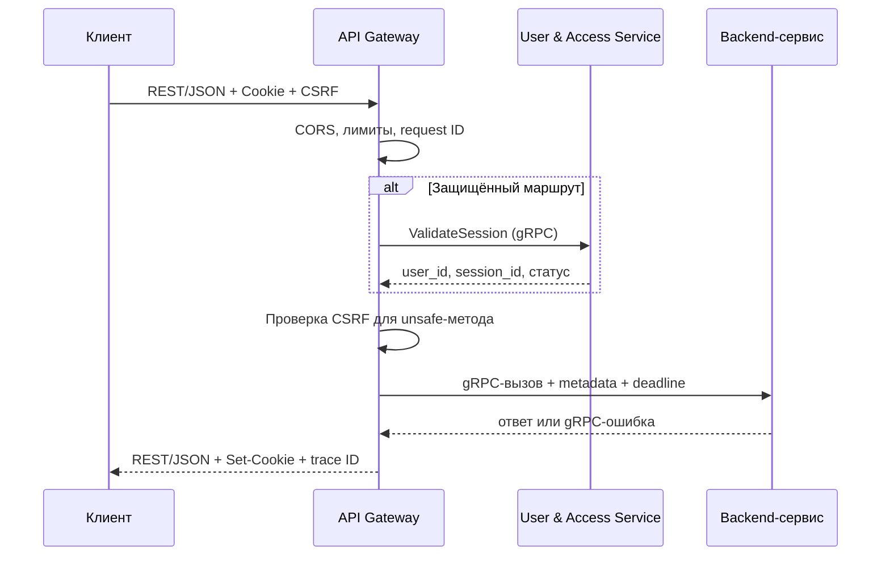

# Системная постановка: API Gateway
## «Диаграмма Ганта — проект SMART OATI»

**Версия документа:** 1.2  
**Дата:** 2026-10-28  
**Соответствует плану реализации:** версия 1.6  
**Соответствует бизнес-постановке:** версия 2.3  
**Соответствует архитектуре БД:** версия 1.7  
**Соответствует OpenAPI:** версия 1.2  
**Область:** только API Gateway. Постановки User & Access, Project / Diagram, Notification, Audit и Sync / Realtime оформляются отдельными документами.

---

## 1. Назначение

API Gateway — единственная публичная точка входа для frontend и внешних REST-клиентов приложения.

Gateway:

- принимает публичные REST/JSON-запросы;
- проверяет сессию пользователя через User & Access Service по gRPC;
- проверяет CSRF для изменяющих запросов;
- применяет ограничения частоты и размера запроса;
- маршрутизирует запрос в нужный backend-сервис по gRPC;
- транслирует gRPC-ответ и ошибки в REST/JSON;
- добавляет сквозные идентификаторы для трассировки;
- возвращает клиенту `Set-Cookie` от User & Access Service.

Gateway **не содержит бизнес-логики** и **не агрегирует данные** нескольких сервисов. Один REST-запрос соответствует одному gRPC-вызову.

---

## 2. Границы решения

### 2.1. Входит в решение

- публичный REST/JSON API;
- маршрутизация REST → gRPC;
- проверка сессии через User & Access Service;
- CSRF-защита double-submit cookie;
- CORS и работа с cookie;
- ограничение частоты запросов;
- ограничение размера тела запроса;
- таймауты, повторные попытки для безопасных методов, circuit breaker;
- преобразование ошибок gRPC в HTTP/RFC 7807;
- идентификаторы запроса и корреляции;
- технические логи, метрики и трассировка;
- health/readiness;
- graceful shutdown;
- горизонтальное масштабирование.

### 2.2. Не входит в решение

- бизнес-логика и проверка прав на уровне проекта;
- агрегация ответов нескольких сервисов;
- хранение пользовательских или проектных данных;
- база данных;
- WebSocket/SSE — клиенты подключаются напрямую к Sync / Realtime Service;
- аналитика — отдельный read-only контур;
- полный каталог REST-эндпоинтов — вынесен в OpenAPI-контракт;
- UI, PDF, экспортные формы и frontend-логика;
- SMTP, Telegram, брокер событий и outbox;
- аудит действий пользователя — его ведут User & Access и Audit Service.

---

## 3. Технологический стек

| Компонент | Решение |
|-----------|---------|
| Runtime | Node.js 22 LTS |
| Язык | JavaScript, без TypeScript |
| HTTP-фреймворк | Fastify 5.x |
| gRPC-клиент | `@grpc/grpc-js` |
| Контракты | protobuf |
| Публичный контракт | REST/JSON, OpenAPI 3.1 |
| Ограничение частоты | Redis |
| Логи | структурированный JSON |
| Метрики | Prometheus |
| Трассировка | OpenTelemetry |
| Контейнеризация | Docker |
| Оркестрация | Kubernetes |

Gateway не использует ORM и не подключается к PostgreSQL.

---

## 4. Архитектура и поток запроса



### 4.1. Порядок обработки

1. TLS завершается на Ingress.
2. Проверяется origin и CORS.
3. Принимается или генерируется `X-Request-ID`.
4. Проверяется размер тела и заголовков.
5. Применяется ограничение частоты.
6. Для защищённого маршрута сессия проверяется через User & Access Service по gRPC.
7. Для unsafe-метода проверяется CSRF.
8. Запрос транслируется в gRPC-вызов с дедлайном.
9. Ответ или ошибка преобразуются в REST/JSON.
10. `Set-Cookie` от User & Access передаётся клиенту.
11. Пишутся технические лог, метрика и span.
12. `X-Request-ID` возвращается клиенту.

### 4.2. Отказ от агрегации

- Gateway не объединяет ответы Project / Diagram, User & Access, Notification и Audit.
- Если экрану нужны данные нескольких сервисов, frontend выполняет несколько REST-запросов.
- Gateway не кэширует бизнес-ответы.
- Gateway не выполняет join, enrichment или вычисления.

---

## 5. Аутентификация, сессия и CSRF

### 5.1. Сессия

- Сессию создаёт, хранит и завершает User & Access Service.
- User & Access устанавливает HTTP-only cookies `__Host-session` и, при «запомнить меня», `__Host-remember`.
- Gateway не создаёт сессию и не хранит её.
- Gateway передаёт `Cookie` в gRPC-metadata при проверке сессии и восстановлении.
- Gateway передаёт `Set-Cookie` от User & Access клиенту без изменения.
- Gateway проверяет сессию на каждом защищённом запросе; кэш сессии в первой версии не используется.
- При недоступности User & Access защищённые запросы завершаются `503`; обход запрещён.
- Logout и отзыв сессии выполняет User & Access Service.

### 5.2. CSRF

- Используется схема double-submit cookie.
- Gateway выдаёт cookie `__Host-csrf` после успешного входа и при `GET /api/v1/auth/session`, если cookie отсутствует.
- Cookie `__Host-csrf`: `Secure`, `SameSite=Lax`, `Path=/`, без `Domain`, не `HttpOnly`.
- Клиент передаёт значение cookie в заголовке `X-CSRF-Token`.
- Gateway сравнивает заголовок и cookie за постоянное время.
- CSRF проверяется для `POST`, `PUT`, `PATCH`, `DELETE` на защищённых маршрутах.
- Публичные `register`, `login`, `verify-email`, `forgot-password`, `reset-password`, `restore` освобождены от CSRF и защищены усиленным rate limit.
- При несовпадении — `403` с кодом `csrf_invalid`.
- CSRF-токен перевыпускается после входа и выхода.

### 5.3. Авторизация

- Gateway проверяет аутентификацию и статус пользователя.
- Проверка роли в проекте выполняется в Project / Diagram Service через User & Access Service.
- Gateway не принимает решений о правах на проектные объекты.
- Gateway передаёт в gRPC-metadata:
  - `x-user-id`;
  - `x-session-id`;
  - `x-request-id`;
  - `x-correlation-id`;
  - `x-client-ip`;
  - `x-user-agent`;
  - `x-csrf-validated`;
  - сервисный токен/mTLS для внутренней аутентификации.

---

## 6. Публичный API

### 6.1. Базовые правила

- Базовый путь: `/api/v1`.
- Формат: JSON UTF-8.
- Даты и время: RFC 3339.
- Идентификаторы: UUID.
- Имена полей JSON: `camelCase`.
- Коды перечислений: латиница, значения из контракта.
- Неизвестные query-параметры: `400`.
- Неизвестный маршрут: `404`.
- Неподдерживаемый `Content-Type`: `415`.
- Тело больше лимита: `413`.
- Метод не разрешён: `405`.

### 6.2. Группы маршрутов

| Группа | Назначение | Сервис |
|--------|------------|--------|
| `/api/v1/auth/*` | Регистрация, вход, выход, подтверждение email, сброс пароля, текущая сессия | User & Access |
| `/api/v1/users/*` | Профили и административное управление пользователями | User & Access |
| `/api/v1/executors/*` | Каталог исполнителей | User & Access |
| `/api/v1/invitations/*` | Приглашения в проекты | User & Access |
| `/api/v1/projects/*` | Проекты, архив, восстановление | Project / Diagram |
| `/api/v1/projects/{projectId}/members/*` | Участники и роли проекта | User & Access |
| `/api/v1/diagrams/*` | Диаграммы и ревизии | Project / Diagram |
| `/api/v1/tasks/*` | Задачи и подзадачи | Project / Diagram |
| `/api/v1/dependencies/*` | Зависимости и стили связей | Project / Diagram |
| `/api/v1/comments/*` | Комментарии | Project / Diagram |
| `/api/v1/diagrams/{diagramId}/holidays` | Праздники и режим дней | Project / Diagram |
| `/api/v1/notifications/*` | Уведомления и настройки | Notification |
| `/api/v1/audit/*` | Просмотр аудита | Audit |
| `/api/v1/diagrams/{diagramId}/import` | Импорт JSON/CSV | Project / Diagram |
| `/api/v1/import-jobs/*` | Статус и отмена импорта | Project / Diagram |
| `/api/v1/diagrams/{diagramId}/export` | Экспорт JSON/CSV | Project / Diagram |

Маршрут однозначно определяется по подпути и обслуживается одним сервисом. Gateway не объединяет ответы Project / Diagram и User & Access в одном запросе.

Полный перечень методов, параметров и схем зафиксирован в OpenAPI-контракте `Исходные кодв\openapi\openapi.json`.

### 6.3. Публичные маршруты

Без действующей сессии доступны только:

- `POST /api/v1/auth/register`;
- `POST /api/v1/auth/login`;
- `POST /api/v1/auth/verify-email`;
- `POST /api/v1/auth/forgot-password`;
- `POST /api/v1/auth/reset-password`;
- `POST /api/v1/auth/restore` — только при наличии `__Host-remember`;
- `GET /health` — только внутри кластера;
- `GET /ready` — только внутри кластера.

### 6.4. Аналитика

- Аналитика не проходит через API Gateway.
- Она работает в отдельном read-only контуре.
- Gateway не содержит маршрутов `/analytics`.
- Read-only доступ реализуется отдельно, без права записи.

### 6.5. WebSocket/SSE

- Клиент подключается напрямую к Sync / Realtime Service.
- API Gateway не проксирует WebSocket/SSE.
- Sync Service сам проверяет сессию через User & Access Service по gRPC.
- Gateway не хранит состояние соединений.

### 6.6. Telegram webhook

- Webhook Telegram — прямой endpoint Notification Service.
- Это внешний callback, а не публичный REST приложения.
- Webhook не проходит через API Gateway и защищается секретом Telegram.

---

## 7. REST ↔ gRPC

### 7.1. Правила трансляции

- Один REST-запрос → один унарный gRPC-вызов.
- Path, query и body преобразуются в protobuf-сообщение.
- Заголовки, перечисленные в разделе 5.3, передаются в metadata.
- `Cookie` передаётся в metadata для проверки сессии.
- `Accept-Language` передаётся в metadata.
- `X-Request-ID` и `X-Correlation-ID` передаются в metadata.
- `Idempotency-Key` передаётся в metadata и в соответствующий gRPC-запрос.
- Streaming gRPC, server streaming и bidirectional streaming в первой версии не используются.
- Ответ gRPC преобразуется в JSON по OpenAPI-схеме.
- Gateway не изменяет бизнес-поля ответа.

### 7.2. Дедлайны

- Обычный запрос: 5 секунд.
- Импорт/экспорт: 30 секунд.
- Проверка сессии: 2 секунды.
- При превышении дедлайна — `504`.
- При недоступности сервиса — `503`.

### 7.3. Повторные попытки

- Повтор разрешён только для идемпотентных `GET`/`HEAD`.
- Максимум одна повторная попытка при ошибке соединения, если остался бюджет дедлайна.
- `POST`, `PUT`, `PATCH`, `DELETE` автоматически не повторяются.
- Повтор изменяющих запросов возможен только по `Idempotency-Key` на стороне сервиса.

### 7.4. Circuit breaker

- Отдельный circuit breaker для каждого backend-сервиса.
- Порог: 5 последовательных ошибок.
- Пауза: 30 секунд.
- После паузы — пробный запрос.
- При открытом circuit breaker — `503` с `Retry-After`.

---

## 8. Ошибки

### 8.1. Формат

Ошибки возвращаются в формате RFC 7807:

```json
{
  "type": "https://smart-oati.local/problems/validation",
  "title": "Ошибка валидации",
  "status": 400,
  "detail": "Поле name обязательно",
  "instance": "/api/v1/projects",
  "code": "validation_error",
  "traceId": "8f3c2f0e-...",
  "errors": [
    { "field": "name", "code": "required", "message": "Обязательное поле" }
  ]
}
```

Правила:

- `code` — стабильный машиночитаемый код;
- `traceId` — идентификатор запроса;
- стек, SQL, имена сервисов и внутренние детали не раскрываются;
- текст ошибки — на русском;
- для `429` добавляется `Retry-After`;
- для `503` добавляется `Retry-After`.

### 8.2. Маппинг gRPC → HTTP

| gRPC | HTTP |
|------|------|
| `INVALID_ARGUMENT` | 400 |
| `UNAUTHENTICATED` | 401 |
| `PERMISSION_DENIED` | 403 |
| `NOT_FOUND` | 404 |
| `ALREADY_EXISTS` | 409 |
| `ABORTED` | 409 |
| `FAILED_PRECONDITION` | 412 |
| `RESOURCE_EXHAUSTED` | 429 |
| `UNIMPLEMENTED` | 501 |
| `UNAVAILABLE` | 503 |
| `DEADLINE_EXCEEDED` | 504 |
| `INTERNAL` | 500 |

---

## 9. Пагинация, идемпотентность, версионирование

### 9.1. Пагинация

- `limit` — по умолчанию 50, максимум 200.
- `offset` — по умолчанию 0, неотрицательный.
- Ответ:

```json
{
  "items": [],
  "total": 0,
  "limit": 50,
  "offset": 0
}
```

- Курсорная пагинация в первой версии не используется.
- Сортировка и фильтры — по контракту конкретного эндпоинта.

### 9.2. Идемпотентность

- Для изменяющих запросов используется `Idempotency-Key`.
- Формат — UUID.
- Заголовок обязателен для `POST`/`PATCH`/`DELETE`, кроме публичных auth-маршрутов, restore и выхода.
- Gateway передаёт ключ в сервис.
- Сервис хранит ключ 24 часа и обеспечивает идемпотентность.
- Повтор с тем же ключом и телом возвращает тот же результат.
- Повтор с тем же ключом и другим телом — `409`.
- Запрос с тем же ключом в обработке — `409` с `Retry-After`.

### 9.3. Версионирование

- Версия в пути: `/api/v1`.
- Ломающие изменения — только в новой версии.
- Устаревшие версии сопровождаются заголовками `Deprecation` и `Sunset`.
- OpenAPI-схема версионируется вместе с API.

---

## 10. Лимиты и SLO

### 10.1. Ограничения

| Ограничение | Значение |
|-------------|----------|
| Запросы пользователя | 300/мин |
| Запросы анонимного IP | 60/мин |
| Login/registration/password reset/restore | 10/мин на IP |
| Тело обычного запроса | 10 МБ |
| Импорт JSON | 50 МБ |
| Заголовки запроса | 32 КБ |
| URL | 8 КБ |
| Дедлайн обычного запроса | 5 с |
| Дедлайн импорта/экспорта | 30 с |

- Лимиты хранятся в Redis.
- Ключи: `user:{id}`, `ip:{addr}`, `route:{route}:ip:{addr}`.
- При превышении — `429` и `Retry-After`.
- Заголовки ответа: `X-RateLimit-Limit`, `X-RateLimit-Remaining`, `X-RateLimit-Reset`.
- При недоступности Redis auth-маршруты и изменяющие запросы завершаются `503`.

### 10.2. SLO

- Доступность Gateway: 99,5% в месяц.
- p95 ответа Gateway без времени backend-сервиса: ≤ 300 мс.
- Доля ошибок 5xx: ≤ 1%.
- Горизонтальное масштабирование без sticky sessions.
- Graceful shutdown: 15 секунд.

---

## 11. Безопасность

- TLS завершается на Ingress; внутри кластера — HTTP/gRPC.
- HSTS, `X-Content-Type-Options: nosniff`, `Referrer-Policy`.
- Заголовок `Server` и `X-Powered-By` не раскрываются.
- CORS:
  - только origins из конфигурации;
  - `credentials: true`;
  - без `*` при credentials;
  - разрешённые заголовки: `Content-Type`, `X-CSRF-Token`, `Idempotency-Key`, `X-Request-ID`;
  - exposed headers: `X-Request-ID`, `X-RateLimit-*`, `Retry-After`.
- Cookie сессии: `Secure`, `HttpOnly`, `SameSite=Lax`.
- CSRF-cookie: `__Host-csrf`, `Secure`, `SameSite=Lax`, без `Domain`.
- Ограничение размера тела и заголовков.
- Отклонение подозрительных заголовков и hop-by-hop заголовков.
- Доверие `X-Forwarded-For` только от Ingress.
- Внутренние gRPC-порты не публикуются.
- Межсервисная аутентификация: mTLS и/или service-токены.
- Секреты — только из защищённого хранилища.
- В логах не пишутся cookie, токены, CSRF, пароли и тела запросов.
- Зависимости проверяются на уязвимости в CI.

---

## 12. Наблюдаемость

### 12.1. Логи

Структурированный JSON:

- timestamp;
- level;
- requestId;
- correlationId;
- method;
- route;
- status;
- durationMs;
- userId — если аутентифицирован;
- clientIp;
- upstreamService;
- grpcCode;
- errorCode.

Запрещено логировать:

- cookie;
- CSRF-токены;
- session ID;
- пароли;
- тела запросов и ответов;
- персональные данные.

### 12.2. Метрики

- количество запросов;
- latency histogram;
- 4xx/5xx;
- rate limit hits;
- circuit breaker state;
- upstream latency;
- количество активных соединений;
- ошибки gRPC по кодам.

### 12.3. Трассировка

- OpenTelemetry.
- `traceparent` и `X-Request-ID` передаются в gRPC metadata.
- Span создаётся на Gateway и связывается с upstream-span.

### 12.4. Health/readiness

- `GET /health` — liveness, без проверки зависимостей.
- `GET /ready` — readiness, проверяет конфигурацию и доступность обязательных зависимостей.
- Эндпоинты доступны только внутри кластера.

### 12.5. Аудит

- Gateway не отправляет события в Audit Service.
- Gateway пишет только технические логи и метрики.
- События входа, блокировки, ролей и изменений пользователей формируют User & Access Service и Audit Service.

---

## 13. Развёртывание и конфигурация

### 13.1. Развёртывание

- Docker-контейнер.
- Kubernetes Deployment, Service, Ingress.
- Минимум 2 реплики.
- HPA по CPU и RPS.
- Readiness/liveness probes.
- Graceful shutdown.
- Без собственной БД.
- Redis — для rate limit.

### 13.2. Конфигурация

Переменные окружения:

- `PORT`;
- `LOG_LEVEL`;
- `CORS_ORIGINS`;
- `USER_SERVICE_GRPC_ADDR`;
- `PROJECT_SERVICE_GRPC_ADDR`;
- `NOTIFICATION_SERVICE_GRPC_ADDR`;
- `AUDIT_SERVICE_GRPC_ADDR`;
- `REDIS_URL`;
- `SESSION_VALIDATE_TIMEOUT_MS`;
- `UPSTREAM_TIMEOUT_MS`;
- `IMPORT_EXPORT_TIMEOUT_MS`;
- `RATE_LIMIT_USER_PER_MIN`;
- `RATE_LIMIT_IP_PER_MIN`;
- `RATE_LIMIT_AUTH_PER_MIN`;
- `MAX_BODY_BYTES`;
- `MAX_IMPORT_BYTES`;
- `OTEL_EXPORTER_OTLP_ENDPOINT`.

Секреты и service-токены не хранятся в репозитории.

---

## 14. Обработка отказов

| Ситуация | Поведение |
|----------|-----------|
| User & Access недоступен | 503 для защищённых запросов; без обхода |
| Backend-сервис недоступен | 503 |
| Превышен дедлайн | 504 |
| Redis недоступен | 503 для auth и изменяющих запросов |
| Неверная сессия | 401 |
| Нет прав | 403 |
| CSRF не совпал | 403 |
| Rate limit | 429 |
| Ошибка валидации | 400 |
| Внутренняя ошибка | 500 без деталей |

---

## 15. Критерии приемки

1. Gateway принимает REST/JSON на `/api/v1`.
2. Gateway маршрутизирует запросы в backend-сервисы по gRPC.
3. Gateway не содержит бизнес-логики и не агрегирует ответы.
4. Gateway не подключается к PostgreSQL.
5. Сессию создаёт User & Access Service; Gateway проверяет её по gRPC.
6. Gateway передаёт `Set-Cookie` от User & Access Service.
7. CSRF проверяется по double-submit cookie.
8. Публичные auth-маршруты работают без сессии.
9. Защищённые маршруты без сессии возвращают 401.
10. CORS работает с credentials и разрешёнными origin.
11. Rate limit работает по пользователю и IP.
12. Login/registration/reset ограничены 10 запросами/мин на IP.
13. Тело 10 МБ и импорт 50 МБ ограничиваются.
14. Ошибки возвращаются в RFC 7807.
15. gRPC-коды корректно маппятся в HTTP.
16. Пагинация `limit/offset` работает.
17. `Idempotency-Key` передаётся в сервис.
18. `X-Request-ID` принимается или генерируется и возвращается.
19. Таймауты 5 с и 30 с соблюдаются.
20. Circuit breaker и повторные попытки для GET работают.
21. WebSocket/SSE не проходят через Gateway.
22. Аналитика не маршрутизируется через Gateway.
23. Логи не содержат cookie, токенов и тел запросов.
24. Метрики и трассировка доступны.
25. Health/readiness работают.
26. Gateway масштабируется горизонтально без sticky sessions.
27. Gateway корректно завершает работу.
28. OpenAPI-схема соответствует публичному API.

---

## 16. Открытые вопросы

Открытых вопросов по API Gateway нет.

Полный каталог REST-эндпоинтов, параметры и схемы зафиксированы в OpenAPI-контракте `Исходные кодв\openapi\openapi.json` и `openapi.yaml`.

---

*Документ описывает системные требования к API Gateway и не заменяет постановки backend-сервисов.*


