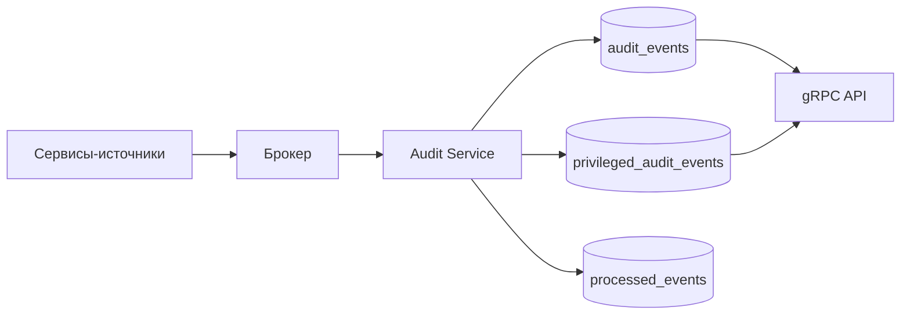

# Системная постановка: Audit Service
## «Диаграмма Ганта — проект SMART OATI»

**Версия документа:** 1.0  
**Дата:** 2026-10-28  
**Соответствует плану реализации:** версия 1.6  
**Соответствует бизнес-постановке:** версия 2.3  
**Соответствует архитектуре БД:** версия 1.7  
**Соответствует User & Access Service:** версия 1.3  
**Соответствует Project / Diagram Service:** версия 1.2  
**Соответствует Sync / Realtime Service:** версия 1.0  
**Соответствует API Gateway:** версия 1.2  
**Область:** только Audit Service.

---

## 1. Назначение

Audit Service — централизованный неизменяемый журнал действий.

Сервис:

- получает события от backend-сервисов;
- хранит общий журнал аудита;
- ведет отдельный журнал действий администраторов приложения;
- предоставляет поиск и просмотр аудита;
- разграничивает доступ администратора и владельца проекта;
- не хранит персональные данные;
- не предоставляет выгрузку журнала в первой версии;
- не имеет интерфейса — интерфейс будет описан отдельно в постановке frontend.

---

## 2. Границы решения

### 2.1. Входит в решение

- потребление событий из брокера;
- общий журнал аудита;
- отдельный привилегированный журнал;
- классификация действий;
- маскирование и отбрасывание ПДн;
- идемпотентная запись;
- поиск и просмотр;
- разграничение доступа;
- партиционирование и retention;
- API для frontend;
- метрики, логи и трассировка.

### 2.2. Не входит в решение

- интерфейс аудита — отдельная постановка frontend;
- выгрузка журнала — не реализуется в первой версии;
- изменение и удаление записей через API;
- хранение профилей, email, Telegram и иных ПДн;
- бизнес-логика проектов;
- API Gateway;
- уведомления;
- аналитика;
- полные proto-файлы.

### 2.3. Возможное расширение

- расширение каталога аудируемых действий;
- фильтрованная выгрузка в будущем;
- отдельные представления для внешнего аудита;
- более длительное хранение отдельных категорий.

---

## 3. Технологии и архитектура

| Компонент | Решение |
|-----------|---------|
| Runtime | Node.js 22 LTS |
| Язык | JavaScript, без TypeScript |
| API | gRPC/protobuf |
| БД | PostgreSQL 16 |
| Схемы | `audit`, `events`, `analytics`, `ext` |
| Потребление | брокер событий |
| Партиционирование | по месяцам |
| Трассировка | OpenTelemetry |

Audit Service не вызывает бизнес-сервисы для записи событий. Запись — только через consumer.

### 3.1. Поток

---

## 4. Журналы

### 4.1. Общий журнал

- таблица `audit.audit_events`;
- все аудируемые действия;
- срок хранения — 2 месяца;
- доступен администратору и владельцу проекта по своим проектам.

### 4.2. Привилегированный журнал

- таблица `audit.privileged_audit_events`;
- **все действия пользователей с ролью `app_admin`**, включая обычные правки задач;
- события также остаются в общем журнале;
- срок хранения — 2 года;
- доступен только администратору приложения;
- отдельный API;
- отдельный интерфейс — в постановке frontend.

### 4.3. Неизменяемость

- Записи не изменяются и не удаляются через API.
- Удаление — только по retention.
- Нет endpoint для редактирования или удаления события.
- Нет выгрузки всего журнала.

---

## 5. Что аудируется

### 5.1. Аутентификация и пользователи

- вход успешный;
- вход неудачный;
- выход;
- регистрация;
- подтверждение email;
- запрос и сброс пароля;
- смена пароля;
- блокировка и разблокировка;
- полное удаление пользователя;
- изменение профиля;
- изменение системных настроек.

### 5.2. Роли, участия и приглашения

- выдача и отзыв глобальной роли;
- добавление, изменение и удаление участия;
- создание, принятие, отзыв и переотправка приглашения;
- передача владения проектом.

### 5.3. Проекты и план

- создание, изменение, архивирование, восстановление и удаление проекта;
- очистка проекта;
- создание, изменение и удаление диаграммы;
- создание, изменение и удаление направления;
- создание, изменение и удаление задачи;
- изменение назначений;
- создание, изменение и удаление зависимости;
- создание, изменение и удаление комментария;
- изменение праздников;
- импорт и экспорт;
- завершение и ошибка импорта.

### 5.4. Уведомления

- создание уведомления;
- успешная доставка;
- ошибка доставки;
- изменение настроек уведомлений.

### 5.5. Не аудируется

- чтение и просмотр;
- навигация;
- фильтры;
- масштаб;
- presence;
- технические логи API Gateway;
- rate limit и CSRF отказы Gateway.

---

## 6. Модель данных

### 6.1. `audit_actions`

| Поле | Тип | Ограничения | Назначение |
|------|-----|-------------|------------|
| `code` | varchar(64) | PK | Код действия |
| `category` | varchar(32) | NOT NULL | Категория |
| `description` | varchar(200) | NOT NULL | Описание |
| `severity` | varchar(16) | `info/warning/critical` | Важность |

Каталог расширяемый.

### 6.2. `audit_events`

Партиционируется по `occurred_at` (месяц).

| Поле | Тип | Ограничения | Назначение |
|------|-----|-------------|------------|
| `id` | uuid | NOT NULL | ID события |
| `occurred_at` | timestamptz | NOT NULL | Время, ключ партиции |
| `actor_user_id` | uuid | NULL | Актор |
| `actor_type` | varchar(16) | `user/service/system` | Тип актора |
| `actor_roles` | jsonb | NULL | Роли на момент действия |
| `action_code` | varchar(64) | FK → audit_actions | Действие |
| `entity_type` | varchar(32) | NULL | Тип объекта |
| `entity_id` | uuid | NULL | ID объекта |
| `project_id` | uuid | NULL | Проект |
| `diagram_id` | uuid | NULL | Диаграмма |
| `request_id` | varchar(64) | NULL | ID запроса |
| `correlation_id` | varchar(64) | NULL | Корреляция |
| `ip` | inet | NULL | IP |
| `user_agent` | text | NULL | Клиент |
| `before_data` | jsonb | NULL | Состояние до |
| `after_data` | jsonb | NULL | Состояние после |
| `metadata` | jsonb | NULL | Дополнительно |
| `source_event_id` | uuid | NOT NULL | ID исходного события |
| `source_service` | varchar(32) | NOT NULL | Источник |
| `severity` | varchar(16) | `info/warning/critical` | Важность |
| `created_at` | timestamptz | NOT NULL | Запись |

Ограничения:

- PK `(id, occurred_at)` — требование партиционирования;
- `UNIQUE (source_event_id, occurred_at)` в пределах партиции;
- `INDEX (actor_user_id, occurred_at DESC)`;
- `INDEX (action_code, occurred_at DESC)`;
- `INDEX (project_id, occurred_at DESC)`;
- `INDEX (entity_type, entity_id)`;
- `INDEX (correlation_id)`.

### 6.3. `privileged_audit_events`

Структура аналогична `audit_events`.

Отличия:

- срок хранения — 2 года;
- партиционирование по месяцам;
- доступ только администратору;
- запись всех действий `app_admin`;
- события также пишутся в общий журнал.

Индексы:

- `(actor_user_id, occurred_at DESC)`;
- `(action_code, occurred_at DESC)`;
- `(project_id, occurred_at DESC)`;
- `(source_event_id)`.

### 6.4. `processed_events`

| Поле | Тип | Назначение |
|------|-----|------------|
| `consumer` | varchar(64) | Имя потребителя |
| `event_id` | uuid | ID события |
| `processed_at` | timestamptz | Время |

PK: `(consumer, event_id)`.

### 6.5. Before/after

- Критические действия: полные снимки `before` и `after` с маскированием.
- Частые изменения задач, направлений, зависимостей и комментариев: только измененные поля.
- Auth-события: без снимков, только metadata.
- Комментарии: текст не хранится; только ID, автор, сущность и служебные поля.
- Не хранятся:
  - пароли;
  - токены;
  - cookie;
  - email;
  - Telegram;
  - ФИО;
  - тела запросов;
  - текст комментариев.
- IP и user agent допустимы как технические атрибуты.

---

## 7. Прием событий

### 7.1. Источники

- User & Access;
- Project / Diagram;
- Notification;
- другие сервисы, публикующие аудируемые события.

API Gateway не публикует аудит.

### 7.2. Обработка

1. Consumer читает событие из брокера.
2. Проверяет `processed_events` по `event_id`.
3. Определяет `action_code`.
4. Определяет актора и роли.
5. Маскирует ПДн.
6. Формирует `before/after`.
7. В транзакции пишет общий журнал.
8. Если актор — `app_admin`, пишет привилегированный журнал.
9. Отмечает событие обработанным.
10. При ошибке — retry; после лимита — очередь ошибок.

### 7.3. Определение администратора

- Источник передает `actorRoles` в событии.
- Если роли отсутствуют, Audit Service запрашивает их у User & Access.
- При недоступности User & Access событие остается в обработке и повторяется.
- Если роль определить невозможно, событие пишется только в общий журнал и фиксируется метрика.

### 7.4. Идемпотентность

- `source_event_id` уникален.
- Повторная доставка не создает дубликат.
- At-least-once.

### 7.5. Ошибки

- Некорректный payload — событие в очередь ошибок, технический лог.
- Неизвестный `action_code` — `unknown` и метрика.
- Ошибка БД — retry.
- Audit Service не блокирует работу других сервисов.

---

## 8. Доступ

### 8.1. Администратор приложения

- видит все события общего журнала;
- видит все события привилегированного журнала;
- видит auth-события;
- видит настройки, роли и пользователей.

### 8.2. Владелец проекта

- видит только события своего проекта в общем журнале;
- не видит привилегированный журнал;
- не видит auth-события, роли приложения и настройки.

### 8.3. Остальные роли

- аудит не видят.

### 8.4. Проверка доступа

- Администратор — через глобальную роль.
- Владелец — через `CheckProjectPermission(project.audit.view)`.
- Проект определяется по `project_id` события.
- Для событий без проекта доступ только администратору.

### 8.5. Имена

- Audit хранит и возвращает только ID.
- Имена пользователей frontend получает через User & Access.
- Audit Service не хранит и не обогащает имена.

---

## 9. gRPC API

### 9.1. Общие правила

- Пакет: `smartoati.audit.v1`.
- Только унарные вызовы.
- Внутренняя аутентификация.
- Метаданные: `x-request-id`, `x-correlation-id`, `x-actor-user-id`.
- Списки — `limit/offset`, максимум 200.
- Сортировка — `occurred_at DESC`.
- Выгрузка не предусмотрена.

### 9.2. Методы

| Метод | Назначение | Доступ |
|-------|------------|--------|
| `ListAuditEvents` | Общий журнал | Админ, владелец проекта |
| `GetAuditEvent` | Событие общего журнала | Админ, владелец проекта |
| `ListPrivilegedAuditEvents` | Журнал администраторов | Только админ |
| `GetPrivilegedAuditEvent` | Событие привилегированного журнала | Только админ |
| `GetAuditActions` | Каталог действий | Админ |
| `GetAuditStats` | Краткая статистика | Админ |

### 9.3. Фильтры

- `from`, `to`;
- `actorUserId`;
- `actionCode`;
- `entityType`, `entityId`;
- `projectId`;
- `diagramId`;
- `severity`;
- `requestId`;
- `correlationId`.

### 9.4. Ответ

- `items`;
- `total`;
- `limit`;
- `offset`.

### 9.5. Ошибки

- `INVALID_ARGUMENT`;
- `UNAUTHENTICATED`;
- `PERMISSION_DENIED`;
- `NOT_FOUND`;
- `UNAVAILABLE`;
- `INTERNAL`.

Доменные коды:

- `audit.access_denied`;
- `audit.event_not_found`;
- `audit.invalid_filter`;
- `audit.privileged_only`;
- `audit.export_not_supported`.

---

## 10. Retention и партиционирование

| Журнал | Хранение | Партиции |
|--------|----------|----------|
| `audit_events` | 2 месяца | По месяцам |
| `privileged_audit_events` | 2 года | По месяцам |

- Старые партиции отсоединяются и удаляются.
- API удаления нет.
- Выгрузка отсутствует.
- Резервное копирование — ежедневно + WAL.
- Восстановление — по общей политике.

---

## 11. Безопасность

- Только TLS внутри кластера.
- Доступ к БД — только у Audit Service.
- Записи неизменяемы.
- ПДн не хранятся.
- Тексты комментариев не хранятся.
- Пароли и токены не хранятся.
- IP и user agent — технические атрибуты.
- Привилегированный журнал доступен только администратору.
- Владелец проекта ограничен своим проектом.
- Логи Audit Service не содержат payload и ПДн.
- Секреты — в защищенном хранилище.
- Резервные копии шифруются.

---

## 12. Нефункциональные требования

- Доступность 99,5%.
- p95 записи события ≤ 5 секунд от публикации.
- p95 поиска ≤ 300 мс.
- Партиционирование по месяцам.
- Индексы по актору, действию, проекту, сущности, корреляции.
- Горизонтальное масштабирование consumer.
- Consumer не блокирует источники.
- Очередь ошибок и retry.
- Метрики: события, ошибки, задержка, размер журналов.
- OpenTelemetry.
- Health/readiness.
- Graceful shutdown.

---

## 13. Сценарии

### 13.1. Администратор меняет настройки

1. User & Access публикует событие.
2. Audit определяет `app_admin`.
3. Пишет событие в общий журнал.
4. Пишет событие в привилегированный журнал.
5. Администратор видит его в обоих журналах.

### 13.2. Владелец проекта смотрит аудит

1. Владелец запрашивает общий журнал.
2. Audit проверяет `project.audit.view`.
3. Возвращает только события проекта.
4. Привилегированный журнал недоступен.

### 13.3. Неудачный вход

1. User & Access публикует `auth.login.failed`.
2. Audit сохраняет событие без пароля и токена.
3. Событие видно только администратору.

### 13.4. Retention

1. Партиция общего журнала старше 2 месяцев удаляется.
2. Партиция привилегированного журнала старше 2 лет удаляется.
3. API не позволяет удалить запись вручную.

---

## 14. Критерии приемки

1. Audit потребляет события из брокера.
2. Общий журнал хранится 2 месяца.
3. Привилегированный журнал хранится 2 года.
4. Все действия `app_admin` попадают в привилегированный журнал.
5. Эти же действия остаются в общем журнале.
6. Привилегированный журнал доступен только администратору.
7. Владелец проекта видит только свой проект.
8. Auth-события доступны только администратору.
9. ПДн не хранятся.
10. Тексты комментариев не хранятся.
11. Before/after маскируются.
12. Запись идемпотентна по `source_event_id`.
13. Повторная доставка не создает дубликат.
14. Ошибки не блокируют источники.
15. Есть очередь ошибок.
16. Поиск работает по фильтрам.
17. Пагинация работает.
18. Выгрузка отсутствует.
19. API возвращает только ID, без имен.
20. Партиции удаляются по retention.
21. Health/readiness работают.
22. Метрики и трассировка доступны.

---

## 15. Открытые вопросы

Открытых вопросов по Audit Service нет.

Выгрузка журнала и интерфейс аудита будут реализованы в дальнейшем. Интерфейс описывается отдельно в системной постановке frontend.

