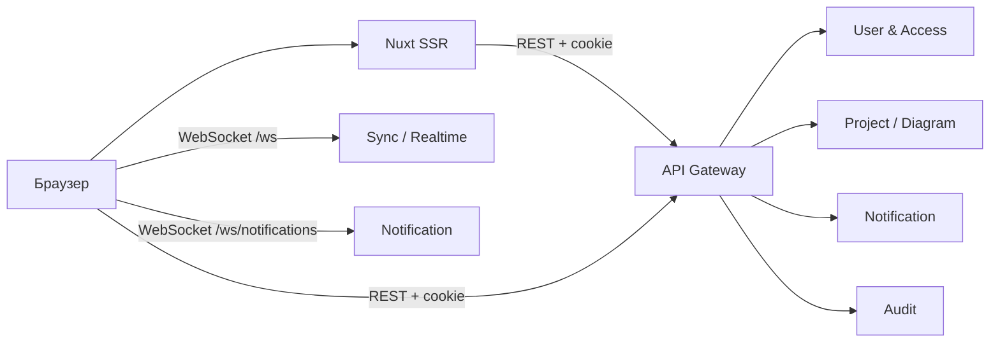

# Системная постановка: Frontend
## «Диаграмма Ганта — проект SMART OATI»

**Версия документа:** 1.0  
**Дата:** 2026-10-28  
**Соответствует плану реализации:** версия 1.6  
**Соответствует бизнес-постановке:** версия 2.3  
**Соответствует архитектуре БД:** версия 1.7  
**Соответствует API Gateway:** версия 1.2  
**Соответствует OpenAPI:** версия 1.2  
**Соответствует User & Access Service:** версия 1.3  
**Соответствует Project / Diagram Service:** версия 1.2  
**Соответствует Sync / Realtime Service:** версия 1.0  
**Соответствует Notification Service:** версия 1.1  
**Соответствует Audit Service:** версия 1.0  
**Соответствует Telegram Bot:** версия 1.0  
**Соответствует P0:** версия 1.0

---

## 1. Назначение

Frontend — отдельное приложение на Vue 3 + Nuxt 3 с SSR, которое предоставляет интерфейс для работы с проектами, диаграммами Ганта, участниками, уведомлениями и аудитом.

Frontend:

- работает через публичный REST API Gateway;
- подключается к Sync / Realtime Service по WebSocket для изменений диаграммы;
- подключается к Notification Service по отдельному WebSocket для уведомлений;
- не обращается к gRPC и базам данных напрямую;
- не содержит BFF;
- хранит только клиентское состояние и кратковременный кэш.

---

## 2. Границы решения

### 2.1. Входит

- Nuxt 3 SSR;
- Vue 3 Composition API;
- JavaScript без TypeScript;
- Pinia;
- Tailwind CSS 4;
- собственные Vue-компоненты;
- диаграмма Ганта;
- карточки задач, направлений и комментариев;
- проекты, участники и приглашения;
- исполнители;
- уведомления;
- аудит, включая привилегированный журнал;
- админка пользователей и системных настроек;
- импорт/экспорт;
- PDF/печать;
- WebSocket Sync и WebSocket уведомлений;
- обработка ошибок, конфликтов и ограничений;
- desktop-верстка;
- базовые accessibility-требования.

### 2.2. Не входит

- мобильное приложение;
- полноценная мобильная адаптация в первой версии;
- TypeScript;
- Vuetify, Nuxt UI и другие тяжёлые UI-библиотеки;
- собственный BFF;
- прямые gRPC-вызовы;
- серверный PDF;
- выгрузка аудита;
- офлайн-режим в полном объеме;
- маркетинговые и массовые рассылки.

---

## 3. Технологический стек

| Компонент | Решение |
|-----------|---------|
| Framework | Nuxt 3 |
| UI | Vue 3 Composition API |
| Язык | JavaScript, без TypeScript |
| SSR | Nuxt SSR |
| State | Pinia |
| HTTP | `$fetch`/ofetch |
| CSS | Tailwind CSS 4 + CSS variables |
| Компоненты | собственные Vue-компоненты |
| Иконки | Lucide/inline SVG |
| Графики | собственный Gantt-рендерер |
| WebSocket Sync | Sync / Realtime Service |
| WebSocket уведомлений | Notification Service |
| Тесты | Vitest + Vue Test Utils + Playwright |
| Runtime | Node.js 22 LTS |

---

## 4. Архитектура и SSR

### 4.1. Схема

### 4.2. SSR

SSR используется для:

- входа и регистрации;
- подтверждения email;
- сброса пароля;
- списка проектов;
- первичной загрузки проекта;
- аудита;
- уведомлений;
- админки.

Клиентские части:

- диаграмма Ганта;
- модалки;
- drag & drop;
- WebSocket;
- интерактивные фильтры.

### 4.3. Сессия на SSR

- Cookie `__Host-session` передается Nuxt SSR-сервером в API Gateway.
- При `401` SSR делает redirect на `/login`.
- При `403` — `/403`.
- Публичные страницы не требуют сессии.
- SSR не хранит токены в localStorage.

### 4.4. CSRF

- Клиент читает `__Host-csrf`.
- Для unsafe-запросов отправляет `X-CSRF-Token`.
- Если CSRF-cookie отсутствует, вызывается `GET /auth/session`.
- Ошибка `csrf_invalid` показывает повтор входа/обновления страницы.

---

## 5. Маршруты и экраны

| Путь | Экран | SSR |
|------|-------|-----|
| `/login` | Вход | Да |
| `/register` | Регистрация | Да |
| `/verify-email` | Подтверждение email | Да |
| `/forgot-password` | Запрос сброса | Да |
| `/reset-password` | Новый пароль | Да |
| `/projects` | Список проектов | Да |
| `/projects/[projectId]` | Проект и диаграммы | Да |
| `/projects/[projectId]/members` | Участники | Да |
| `/projects/[projectId]/settings` | Настройки проекта | Да |
| `/projects/[projectId]/audit` | Аудит проекта | Да |
| `/projects/[projectId]/diagrams/[diagramId]` | Гант | Нет |
| `/executors` | Каталог исполнителей | Да |
| `/notifications` | Центр уведомлений | Да |
| `/notifications/preferences` | Настройки уведомлений | Да |
| `/audit` | Общий аудит | Да |
| `/audit/privileged` | Привилегированный аудит | Да |
| `/admin/users` | Пользователи | Да |
| `/admin/users/[userId]` | Пользователь и роли | Да |
| `/admin/settings` | Системные настройки | Да |
| `/imports/[jobId]` | Статус импорта | Да |
| `/profile` | Профиль и сессии | Да |
| `/403` | Нет доступа | Да |
| `/404` | Не найдено | Да |
| `/500` | Ошибка | Да |
| `/offline` | Нет соединения | Да |
| `/session-expired` | Сессия истекла | Да |

Детальная поэкранная спецификация: `Поэкранная_спецификация_Frontend_SMART_OATI.md`.

---

## 6. Аутентификация и роли

### 6.1. Вход

- email и пароль;
- «запомнить меня»;
- restore по remember-cookie;
- ошибки: неверные данные, email не подтвержден, блокировка, лимит сессий.

### 6.2. Регистрация

- открытая регистрация;
- подтверждение email;
- пароль по системным настройкам;
- после регистрации — экран ожидания подтверждения.

### 6.3. Восстановление

- запрос сброса;
- письмо;
- новый пароль;
- все сессии отзываются.

### 6.4. Роли

- `app_admin`;
- `project_owner`;
- `project_manager`;
- `project_editor`;
- `project_participant`;
- `project_viewer`.

UI:

- скрывает недоступные действия;
- дополнительно получает `403` от сервера;
- не является источником истины по правам;
- route guard только для UX, серверная проверка обязательна.

### 6.5. Админ

Администратор может:

- создавать пользователей;
- блокировать и разблокировать;
- удалять;
- менять глобальные роли;
- редактировать системные настройки;
- видеть привилегированный аудит;
- видеть журнал доставки.

Нельзя снять последнего `app_admin`.

---

## 7. API-клиент

### 7.1. Правила

- базовый URL из `NUXT_PUBLIC_API_BASE`;
- `credentials: include`;
- `X-CSRF-Token` для unsafe;
- `Idempotency-Key` для mutations;
- `X-Request-ID` генерируется на клиенте;
- ошибки — RFC 7807;
- ответы не кэшируются вне Pinia.

### 7.2. Ошибки

- `400` — показать поля;
- `401` — restore/login;
- `403` — `/403`;
- `404` — empty/not found;
- `409` — конфликт версий;
- `412` — состояние проекта/импорта;
- `413` — файл слишком большой;
- `423` — аккаунт заблокирован;
- `429` — `Retry-After`;
- `500/503/504` — error state.

### 7.3. Идемпотентность

- ключ UUID на каждую mutation;
- при retry используется тот же ключ;
- после успеха ключ очищается;
- для auth-маршрутов не требуется.

---

## 8. Pinia

| Store | Содержимое |
|-------|------------|
| `auth` | пользователь, роли, сессия, CSRF |
| `projects` | проекты, текущий проект, участники |
| `diagram` | snapshot, ревизия, задачи, направления, связи, конфликты |
| `filters` | фильтры и масштаб |
| `notifications` | уведомления, unread, настройки |
| `audit` | фильтры, события, pagination |
| `admin` | пользователи, роли, настройки |
| `ui` | модалки, тосты, загрузка |

Правила:

- сервер — источник истины;
- локальный кэш — только для кратковременного обрыва;
- оптимистичные обновления только для статуса/прогресса;
- при ошибке — rollback;
- фильтры и сворачивание — локально.

---

## 9. Диаграмма Ганта

- переносится текущий кастомный рендерер;
- Vue-компонент с props/emits;
- отображение строк, баров, связей, шкалы, «Сегодня»;
- drag & drop, resize, сдвиг дат;
- зависимости и стили связей;
- критический путь и резервы;
- фильтры;
- сворачивание;
- карточки задач/направлений;
- комментарии;
- исполнители;
- рабочие дни и праздники;
- импорт/экспорт;
- PDF/печать на клиенте.

Ограничения:

- desktop 1024–2560 px;
- целевой диапазон 1280–2560 px;
- мобильная адаптация — позже;
- большие планы — виртуализация строк при необходимости;
- Gantt не рендерится на SSR.

---

## 10. Realtime

### 10.1. Sync WebSocket

- `wss://<host>/ws`;
- cookie `__Host-session`;
- подписка на диаграмму;
- `lastRevision`;
- `diagram.changed`;
- `snapshot_required`;
- reconnect с 1/2/5/10/30 секунд;
- close-коды;
- при `4401` — restore;
- при `snapshot_required` — REST snapshot.

### 10.2. Notification WebSocket

- `wss://<host>/ws/notifications`;
- отдельный от Sync;
- cookie `__Host-session`;
- сервер отправляет `notification.created` и `unread_count`;
- клиент отправляет только `ping`;
- reconnect с 1/2/5/10/30 секунд;
- после reconnect — `ListNotifications` и `GetUnreadCount`;
- при `4401` — restore;
- при недоступности — fallback REST при открытии центра.

### 10.3. Применение изменений

- `diagram.changed` применяется к store;
- ревизия проверяется;
- дубликаты игнорируются;
- при пропуске — backfill/snapshot;
- конфликт — модалка.

---

## 11. Уведомления

Экран `/notifications`:

- список;
- фильтр непрочитанных;
- отметка прочитанным;
- отметить все;
- переход к объекту;
- unread badge;
- WebSocket обновляет счетчик и список.

Настройки:

- события;
- каналы;
- тихие часы;
- часовой пояс;
- дайджест;
- отключение канала.

Auth-письма в интерфейсе не отображаются.

---

## 12. Аудит

### 12.1. Общий журнал

- доступен администратору и владельцу проекта;
- владелец видит только свой проект;
- фильтры: дата, актор, действие, проект, сущность;
- pagination;
- имена пользователей подгружаются через User API.

### 12.2. Привилегированный журнал

- только `app_admin`;
- отдельный маршрут;
- фильтры и pagination;
- нет выгрузки;
- события всех действий администраторов.

---

## 13. Админка

### 13.1. Пользователи

- список;
- создание;
- блокировка/разблокировка;
- удаление;
- глобальные роли;
- защита последнего администратора.

### 13.2. Системные настройки

- все ключи `system_settings`;
- типизированная валидация;
- подсказки;
- подтверждение опасных изменений;
- аудит;
- после изменения — обновление форм.

---

## 14. Импорт, экспорт, PDF

### 14.1. Импорт

- `multipart/form-data`;
- файл JSON/CSV до 50 МБ;
- `202` + `jobId`;
- экран статуса;
- polling статуса;
- отчёт: задачи без назначений, предупреждения;
- после завершения — переход к диаграмме;
- ошибка не меняет текущий план.

### 14.2. Экспорт

- JSON/CSV;
- скачивание файла;
- текущий вид не меняется;
- ошибка `413` — сообщение.

### 14.3. PDF

- текущий клиентский механизм;
- печать;
- фильтры и текущий масштаб учитываются.

---

## 15. Дизайн-система

- Tailwind CSS 4;
- CSS variables;
- текущая палитра статусов и приоритетов;
- собственные компоненты:

| Компонент | Назначение |
|-----------|------------|
| Button | действия |
| Input/Textarea | формы |
| Select/Combobox | выбор |
| DatePicker | даты |
| Modal/Drawer | карточки |
| Tabs | разделы |
| Table | списки |
| Badge | статусы |
| Toast | уведомления |
| Tooltip | подсказки |
| Dropdown | меню |
| Pagination | страницы |
| EmptyState | пусто |
| ErrorState | ошибки |
| ConfirmDialog | подтверждения |

- иконки Lucide/inline SVG;
- без тяжёлых UI-библиотек;
- desktop min 1024;
- target 1280–2560;
- breakpoints заложены на будущее;
- мобильная адаптация — отдельный этап.

---

## 16. Accessibility

- клавиатурная навигация;
- видимый focus;
- aria-label для иконок;
- role=dialog, aria-modal;
- ловушка фокуса в модалках;
- Escape закрывает;
- контраст;
- сообщения об ошибках связаны с полями;
- таблицы имеют заголовки;
- Gantt доступен через табличное представление/списки.

---

## 17. Производительность

- SSR для первичной загрузки;
- code splitting;
- Gantt только на клиенте;
- ленивые модалки;
- виртуализация больших списков при необходимости;
- минимизация bundle;
- кэш текущей диаграммы;
- debounce фильтров;
- request cancellation;
- изображения/иконки оптимизированы.

---

## 18. Безопасность

- cookie-сессия, без токенов в localStorage;
- CSRF header;
- экранирование HTML;
- никакого `v-html` для пользовательских данных;
- проверка redirect URL;
- SSR env не содержит публичных секретов;
- API base только из env;
- ошибки не раскрывают внутренние детали;
- WebSocket cookie/Origin;
- logout очищает store и кэш.

---

## 19. Тестирование

- Vitest + Vue Test Utils;
- Playwright E2E;
- contract-тесты OpenAPI;
- AsyncAPI WebSocket;
- accessibility-проверки;
- мок API/WS;
- сценарии:
  - вход/restore;
  - проект/диаграмма;
  - конфликт;
  - snapshot_required;
  - notification WS;
  - импорт;
  - аудит;
  - роли.

---

## 20. Развёртывание

- отдельный Nuxt SSR-сервис;
- Node.js 22;
- без BFF;
- env:
  - `NUXT_PUBLIC_API_BASE`;
  - `NUXT_PUBLIC_SYNC_WS`;
  - `NUXT_PUBLIC_NOTIFICATION_WS`;
  - `NUXT_SESSION_COOKIE_NAME`;
  - `NUXT_PUBLIC_APP_NAME`;
- SSR-сервер вызывает API Gateway;
- браузер — API Gateway и WebSocket;
- health/readiness;
- graceful shutdown;
- CSP/HSTS на Ingress.

---

## 21. Критерии приемки

1. SSR работает для auth, projects, audit, admin, notifications.
2. Gantt рендерится на клиенте.
3. Cookie-сессия работает на SSR.
4. CSRF отправляется.
5. Restore работает.
6. Роли скрывают недоступные действия.
7. Серверный `403` обрабатывается.
8. Gantt сохраняет функциональность версии 9.
9. Desktop 1024–2560 работает.
10. Sync WS подключается и применяет изменения.
11. Notification WS отдельный и работает.
12. Unread badge обновляется.
13. `snapshot_required` обрабатывается.
14. Конфликт показывается и разрешается.
15. Импорт показывает статус и отчёт.
16. Экспорт скачивает файл.
17. PDF/печать работают.
18. Аудит имеет общий и привилегированный журналы.
19. Админка управляет ролями и настройками.
20. Последний администратор защищен.
21. Уведомления настраиваются.
22. Ошибки RFC 7807 отображаются.
23. Accessibility-базис выполнен.
24. E2E проходит.
25. Нет токенов в localStorage.
26. Нет прямых gRPC/DB вызовов.

---

## 22. Открытые вопросы

Открытых вопросов по frontend нет.

Мобильная адаптация, полноценный offline и выгрузка аудита — отдельные этапы.

