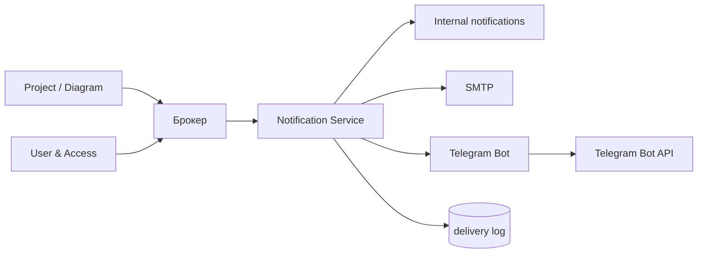

# Системная постановка: Notification Service
## «Диаграмма Ганта — проект SMART OATI»

**Версия документа:** 1.1  
**Дата:** 2026-10-28  
**Соответствует плану реализации:** версия 1.6  
**Соответствует бизнес-постановке:** версия 2.3  
**Соответствует архитектуре БД:** версия 1.7  
**Соответствует User & Access Service:** версия 1.3  
**Соответствует Project / Diagram Service:** версия 1.2  
**Соответствует Sync / Realtime Service:** версия 1.0  
**Соответствует Audit Service:** версия 1.0  
**Соответствует API Gateway:** версия 1.2  
**Соответствует Telegram Bot:** версия 1.0  
**Область:** Notification Service и модуль Telegram Bot. WebSocket уведомлений. Telegram Bot дополнительно описан отдельной постановкой.

---

## 1. Назначение

Notification Service отвечает за:

- внутренние уведомления;
- email;
- Telegram;
- auth-письма;
- настройки уведомлений;
- тихие часы и часовой пояс;
- дайджест;
- напоминания о сроках;
- доставку и повторные попытки;
- журнал доставки;
- связь с Telegram-ботом.

Сервис не хранит профили, email и Telegram: контакты получаются из User & Access Service по gRPC.

---

## 2. Границы решения

### 2.1. Входит в решение

- события Project / Diagram и User & Access;
- внутренние уведомления;
- email через SMTP;
- Telegram через бот;
- auth-письма по запросу User & Access;
- настройки пользователя;
- тихие часы;
- немедленные уведомления и ежедневный дайджест;
- напоминания «скоро срок» и «просрочено»;
- доставка с тремя попытками;
- журнал доставки;
- API для frontend;
- WebSocket уведомлений для frontend;
- события для Audit;
- отдельный журнал auth-писем.

### 2.2. Не входит в решение

- регистрация, сессии и пароли — User & Access;
- Telegram-бот как отдельный деплой — бот является модулем Notification;
- хранение email и Telegram — User & Access;
- интерфейс уведомлений — frontend;
- выгрузка уведомлений — не предусмотрена;
- группы Telegram;
- массовые рассылки;
- маркетинговые письма;
- аналитика.

---

## 3. Технологии и архитектура

| Компонент | Решение |
|-----------|---------|
| Runtime | Node.js 22 LTS |
| Язык | JavaScript, без TypeScript |
| API | gRPC/protobuf |
| БД | PostgreSQL 16 |
| Схемы | `notify`, `delivery`, `scheduler`, `bots`, `events`, `analytics`, `ext` |
| Email | SMTP |
| Telegram | Bot API, webhook |
| События | брокер, outbox |
| Трассировка | OpenTelemetry |

### 3.1. Поток

### 3.2. Источник истины

- Уведомления, настройки, доставки и напоминания — в Notification DB.
- Контакты — в User & Access.
- Бизнес-данные — в Project / Diagram.
- Notification не хранит email и Telegram.

---

## 4. Каналы и получатели

### 4.1. Каналы

- `internal` — всегда создается;
- `email` — через SMTP;
- `telegram` — через бота, только личные чаты.

Другие каналы не используются.

### 4.2. Получатели

| Событие | Получатели |
|---------|------------|
| Назначение/смена ответственного | Ответственный |
| Назначение/смена исполнителя | Исполнитель |
| Назначение/смена соисполнителей | Соисполнители |
| Приближение срока | Ответственный, исполнитель, соисполнители |
| Просрочка | Ответственный, исполнитель, соисполнители |
| Блокировка задачи | Ответственный, исполнитель, владелец |
| Завершение задачи | Ответственный, владелец |
| Новый комментарий | Автор и упомянутые пользователи |
| Упоминание | Упомянутый пользователь |
| Нарушение зависимости | Владелец, руководитель, ответственный |
| Изменение критического пути | Владелец, руководитель, ответственный |
| Приглашение в проект | Приглашенный — auth-письмо |
| Добавление в проект | Добавленный пользователь, владелец |
| Импорт | Инициатор |
| Ошибка импорта | Инициатор |

Правила:

- исполнитель без связанного пользователя не получает уведомление;
- вместо него уведомление получает ответственный;
- если ответственного нет — владелец проекта;
- автор действия не получает уведомление о своем действии, если это не упоминание;
- дубликаты получателей устраняются.

---

## 5. Настройки по умолчанию

### 5.1. Каналы

- внутренние — включены;
- email — включен для критических событий;
- Telegram — выключен до привязки.

Критические события:

- просрочка;
- блокировка;
- нарушение зависимости;
- изменение критического пути;
- ошибка импорта.

### 5.2. Тихие часы

- по умолчанию 22:00–08:00 по часовому поясу пользователя;
- критическое событие игнорирует тихие часы;
- остальные уведомления откладываются;
- после тихих часов — отправка или дайджест.

### 5.3. Дайджест

- критическое — немедленно;
- остальное — ежедневный дайджест в 09:00 по часовому поясу;
- еженедельный дайджест в первой версии не используется;
- пустой дайджест не отправляется.

### 5.4. Настройки пользователя

- события;
- каналы;
- тихие часы;
- часовой пояс;
- режим: немедленно или ежедневный дайджест;
- отключение канала.

---

## 6. Напоминания и планировщик

- «Скоро срок» — за 3 дня.
- Ежедневная проверка в 09:00 по часовому поясу.
- «Просрочено» — раз в день.
- Завершенные задачи не напоминают.
- При изменении сроков, статуса или назначений напоминания пересоздаются.
- При удалении/архивировании проекта напоминания отменяются.
- При удалении пользователя его напоминания удаляются.
- Дубликаты не создаются.

---

## 7. Доставка

### 7.1. Внутренние

- создаются сразу;
- отображаются в приложении;
- имеют статус прочитано/не прочитано;
- хранятся 2 месяца.

### 7.2. Email

- SMTP;
- шаблон и переменные;
- отправитель из конфигурации;
- HTML и текст;
- ссылки ведут на frontend;
- ошибки SMTP фиксируются;
- три попытки: сразу, через 1 минуту, через 15 минут.

### 7.3. Telegram

- через модуль Telegram Bot;
- только личные чаты;
- три попытки: сразу, через 1 минуту, через 15 минут;
- при ошибке — fallback на email/internal;
- при отсутствии привязки Telegram не используется.

### 7.4. Auth-письма

- User & Access вызывает `SendAuthEmail`;
- шаблоны: подтверждение email, сброс пароля, приглашение, активация;
- Notification рендерит и отправляет;
- отдельная таблица `auth_email_deliveries`;
- три попытки;
- идемпотентность по `jobId`;
- auth-письмо не является внутренним уведомлением.

### 7.5. После трех ошибок

- статус `failed`;
- запись в журнал;
- внутреннее уведомление, если канал email/Telegram недоступен;
- повторная автоматическая попытка не выполняется;
- пользователь может запросить повтор вручную через сценарий приложения, если это предусмотрено.

---

## 8. Модель данных

### 8.1. Таблицы

| Схема | Таблица | Назначение |
|-------|---------|------------|
| `notify` | `notification_preferences` | Настройки |
| `notify` | `notifications` | Внутренние уведомления |
| `delivery` | `notification_deliveries` | Доставка по каналам |
| `delivery` | `notification_delivery_attempts` | Попытки |
| `delivery` | `auth_email_deliveries` | Auth-письма |
| `scheduler` | `reminder_jobs` | Напоминания |
| `bots` | `telegram_updates` | Обработанные webhook-обновления |
| `events` | `outbox_events` | События |
| `events` | `processed_events` | Идемпотентность |
| `events` | `idempotency_keys` | Идемпотентность API |

### 8.2. `notification_preferences`

- `user_id`;
- `event_type`;
- `channel`;
- `enabled`;
- `quiet_hours_start`, `quiet_hours_end`;
- `timezone`;
- `digest_frequency`;
- `updated_at`.

Уникальность: `(user_id, event_type, channel)`.

### 8.3. `notifications`

- `id`;
- `recipient_user_id`;
- `project_id`, `diagram_id`;
- `event_type`;
- `title`, `body`;
- `entity_type`, `entity_id`;
- `payload`;
- `is_read`, `read_at`;
- `created_at`, `expires_at`.

### 8.4. `notification_deliveries`

- `id`;
- `notification_id`;
- `channel`;
- `status`;
- `attempt_count`;
- `next_attempt_at`;
- `sent_at`;
- `provider_message_id`;
- `last_error`;
- `created_at`, `updated_at`.

### 8.5. `notification_delivery_attempts`

- `delivery_id`;
- `attempt_no`;
- `status`;
- `provider_message_id`;
- `error_code`, `error_message`;
- `started_at`, `finished_at`.

### 8.6. `auth_email_deliveries`

- `id`;
- `job_id` — ID задания User & Access, уникальный;
- `user_id`, `invitation_id`;
- `recipient_email`;
- `template_code`;
- `status`;
- `attempt_count`;
- `provider_message_id`;
- `error_code`, `error_message`;
- `created_at`, `sent_at`, `expires_at`.

### 8.7. `reminder_jobs`

- `id`;
- `user_id`;
- `project_id`, `diagram_id`;
- `entity_type`, `entity_id`;
- `kind` — `due_soon/overdue`;
- `remind_at`;
- `status`;
- `dedupe_key`;
- `payload`;
- `created_at`, `sent_at`.

### 8.8. `telegram_updates`

- `update_id` — PK;
- `processed_at`;
- `status`;
- `error`.

Хранится 2 месяца.

---

## 9. API

### 9.1. gRPC

Пакет: `smartoati.notification.v1`.

| Метод | Назначение | Доступ |
|-------|------------|--------|
| `ListNotifications` | Свои уведомления | Пользователь |
| `GetUnreadCount` | Непрочитанные | Пользователь |
| `MarkRead` | Отметить прочитанным | Пользователь |
| `MarkAllRead` | Отметить все | Пользователь |
| `GetPreferences` | Настройки | Пользователь |
| `UpdatePreferences` | Изменить настройки | Пользователь |
| `SendAuthEmail` | Auth-письмо | User & Access |
| `GetAuthEmailStatus` | Статус auth-письма | User & Access |
| `GetDeliveryLog` | Журнал доставки | Администратор |
| `GetDeliveryStats` | Агрегаты | Администратор |

### 9.2. Правила

- пользователь видит только свои уведомления;
- администратор видит журнал доставки;
- владелец проекта не видит чужие уведомления;
- выгрузка не предусмотрена;
- списки — `limit/offset`, максимум 200;
- idempotency для `SendAuthEmail`.

### 9.3. Ошибки

- `INVALID_ARGUMENT`;
- `UNAUTHENTICATED`;
- `PERMISSION_DENIED`;
- `NOT_FOUND`;
- `RESOURCE_EXHAUSTED`;
- `UNAVAILABLE`;
- `INTERNAL`.

Доменные коды:

- `notification.access_denied`;
- `notification.not_found`;
- `notification.preferences_invalid`;
- `notification.channel_disabled`;
- `notification.delivery_failed`;
- `auth_email.duplicate`;
- `auth_email.invalid_template`;
- `telegram.not_linked`.

### 9.4. WebSocket уведомлений

Отдельный WebSocket, не связанный с Sync / Realtime.

- URL: `wss://<host>/ws/notifications`.
- Аутентификация: `__Host-session`.
- Проверка `Origin`.
- Сессия проверяется при подключении и каждые 60 секунд.
- Ping/pong не продлевает idle-сессию.
- Сервер отправляет:
  - `notification.created`;
  - `unread_count`;
  - `error`;
  - `pong`.
- Клиент отправляет только `ping`.
- Одно подключение на пользователя; при повторном — предыдущее закрывается.
- Лимит сообщения — 1 МБ.
- Heartbeat — 30 секунд.
- Close-коды:
  - `4401` — сессия истекла;
  - `4403` — доступ запрещен;
  - `4429` — превышен лимит;
  - `4503` — сервис недоступен.
- При отзыве сессии/блокировке/удалении пользователя соединение закрывается.
- Клиент не выполняет подписку на отдельные события; поток принадлежит пользователю.
- При потере соединения клиент переподключается с задержкой 1, 2, 5, 10, 30 секунд.
- После reconnect клиент запрашивает `ListNotifications` и `GetUnreadCount`.

---

## 10. События

### 10.1. Потребляемые

- `task.created`;
- `task.updated`;
- `task.assignments.changed`;
- `task.deleted`;
- `comment.created`;
- `dependency.created`;
- `dependency.updated`;
- `dependency.violated`;
- `diagram.critical_path.changed`;
- `diagram.import.completed`;
- `diagram.import.failed`;
- `project.member.added`;
- `project.deleted`;
- `project.archived`;
- `user.deleted`;
- `user.blocked`;
- `executor.updated`.

### 10.2. Публикуемые

- `notification.created`;
- `notification.delivery.sent`;
- `notification.delivery.failed`;
- `notification.preferences.updated`;
- `auth_email.sent`;
- `auth_email.failed`.

### 10.3. Правила

- outbox в той же транзакции;
- relay и брокер;
- идемпотентность по event_id;
- Audit получает события;
- при недоступности канала — повтор;
- при недоступности Notification бизнес-операции не блокируются.

---

## 11. Telegram Bot

- модуль в составе Notification Service;
- отдельная системная постановка;
- webhook;
- только личные чаты;
- `/start <код>` — привязка;
- `/stop` — отвязка;
- код привязки 10 минут;
- вызовы User & Access `LinkTelegram` и `UnlinkTelegram`;
- webhook не проходит через API Gateway;
- защита секретным токеном;
- обновления идемпотентны по `update_id`;
- нет групп, медиа и массовых рассылок.

---

## 12. Безопасность

- SMTP и Telegram-токены — в защищенном хранилище.
- Email и Telegram не хранятся в Notification DB.
- Контакты получаются из User & Access.
- Webhook защищен секретом.
- Только личные чаты.
- Логи не содержат email, Telegram ID, payload и токены.
- Доступ к уведомлениям — только владелец.
- Администратор видит только журнал доставки.
- Нет выгрузки.
- TLS внутри кластера.
- mTLS/service-токены для gRPC.

---

## 13. Нефункциональные требования

- WebSocket уведомлений: p95 доставки события ≤ 500 мс; до 5 соединений на пользователя; heartbeat 30 секунд; проверка сессии 60 секунд.

- Доступность 99,5%.
- p95 создания уведомления ≤ 1 с.
- p95 доставки email/Telegram ≤ 30 с без учета внешнего провайдера.
- Три попытки: сразу, 1 минута, 15 минут.
- Планировщик — раз в минуту, отправка по часовому поясу.
- Партиционирование доставок по месяцам при необходимости.
- Индексы по получателю, статусу, `next_attempt_at`, `remind_at`.
- Retention: уведомления, доставки, auth-доставки, Telegram-обновления — 2 месяца.
- Метрики: созданные, доставленные, ошибки, задержка, очередь.
- OpenTelemetry.
- Health/readiness, graceful shutdown.

---

## 14. Сценарии

### 14.1. Назначение задачи

1. Project публикует `task.assignments.changed`.
2. Notification создает внутреннее уведомление.
3. Для критического события отправляет email и Telegram.
4. При ошибке — три попытки.
5. После трех ошибок — fallback и журнал.

### 14.2. Приближение срока

1. Scheduler создает напоминание за 3 дня.
2. В 09:00 по часовому поясу создается уведомление.
3. Учитываются тихие часы и настройки.
4. Завершенные задачи пропускаются.

### 14.3. Auth-письмо

1. User & Access вызывает `SendAuthEmail`.
2. Notification рендерит шаблон.
3. Отправляет email.
4. Логирует доставку.
5. Повтор по тому же `jobId` не создает дубль.

### 14.4. Telegram-привязка

1. Пользователь получает код в приложении.
2. Отправляет `/start <код>` боту.
3. Бот вызывает `LinkTelegram` в User & Access.
4. Пользователь получает подтверждение.
5. Уведомления могут идти в Telegram.

---

## 15. Критерии приемки

1. Внутренние уведомления создаются.
2. Email отправляется через SMTP.
3. Telegram отправляется через бота.
4. Auth-письма отправляются через Notification.
5. Настройки каналов работают.
6. Тихие часы работают.
7. Критические события игнорируют тихие часы.
8. Ежедневный дайджест работает.
9. Напоминание за 3 дня работает.
10. Просрочка напоминает раз в день.
11. Завершенные задачи не напоминают.
12. Три попытки доставки.
13. После трех ошибок — `failed`.
14. Fallback работает.
15. Дубликаты не создаются.
16. Auth-письма идемпотентны по `jobId`.
17. Telegram-бот принимает webhook.
18. `/start` привязывает Telegram.
19. `/stop` отвязывает Telegram.
20. Только личные чаты.
21. Webhook защищен секретом.
22. Пользователь видит только свои уведомления.
23. Администратор видит журнал доставки.
24. Выгрузка отсутствует.
25. Retention 2 месяца.
26. События публикуются в outbox.
27. Health/readiness работают.
28. PII не попадает в логи.`r`n29. WebSocket уведомлений принимает соединение по сессии.`r`n30. WebSocket отправляет `notification.created` и `unread_count`.`r`n31. WebSocket закрывается при истечении сессии.`r`n32. WebSocket не зависит от Sync.

---

## 16. Открытые вопросы

Открытых вопросов по Notification Service нет.

Telegram Bot описан отдельной системной постановкой.

