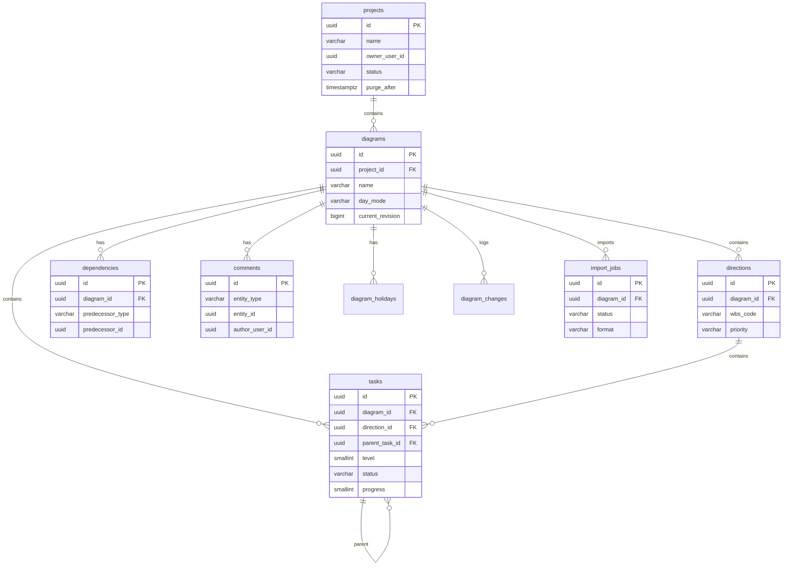

# Системная постановка: Project / Diagram Service
## «Диаграмма Ганта — проект SMART OATI»

**Версия документа:** 1.2  
**Дата:** 2026-10-28  
**Соответствует плану реализации:** версия 1.6  
**Соответствует бизнес-постановке:** версия 2.3  
**Соответствует архитектуре БД:** версия 1.7  
**Соответствует User & Access Service:** версия 1.3  
**Соответствует API Gateway:** версия 1.2  
**Соответствует Sync / Realtime Service:** версия 1.0  
**Область:** только Project / Diagram Service. Постановки User & Access, Notification, Audit и Sync / Realtime оформляются отдельными документами.

---

## 1. Назначение

Project / Diagram Service — владелец проектных данных:

- проекты;
- диаграммы;
- направления;
- задачи и подзадачи;
- назначения;
- зависимости и стили связей;
- комментарии;
- праздники и режим дней;
- признаки БП/СП;
- номер задачи Jira;
- ревизии и изменения;
- импорт и экспорт планов.

Сервис **не хранит** профили, имена, email, Telegram, роли, участников проектов и каталог исполнителей. В проектных таблицах хранятся только непрозрачные ID пользователей и исполнителей.

---

## 2. Границы решения

### 2.1. Входит в решение

- создание и ведение проектов;
- архивирование, удаление, восстановление и очистка проектов;
- несколько диаграмм в проекте;
- направления, задачи и подзадачи;
- сроки, статусы, проценты и приоритеты;
- назначения: ответственный, исполнитель, до двух соисполнителей;
- зависимости и стили связей;
- комментарии;
- рабочие дни и праздники;
- автоматический расчёт статусов, окончаний и критического пути;
- ревизии и разрешение конфликтов;
- экспорт JSON/CSV;
- асинхронный импорт JSON/CSV;
- проверка прав через User & Access;
- обогащение ответов именами через User & Access;
- события для Sync, Notification и Audit.

### 2.2. Не входит в решение

- пользователи, сессии, роли и участия;
- каталог исполнителей;
- приглашения;
- SMTP и Telegram;
- аудит;
- API Gateway;
- WebSocket/SSE;
- аналитика;
- PDF;
- UI;
- полные proto-файлы и OpenAPI — отдельный этап.

---

## 3. Технологии и архитектура

| Компонент | Решение |
|-----------|---------|
| Runtime | Node.js 22 LTS |
| Язык | JavaScript, без TypeScript |
| API | gRPC/protobuf |
| БД | PostgreSQL 16 |
| Схемы | `project`, `plan`, `jobs`, `events`, `analytics`, `ext` |
| События | outbox + брокер |
| Импорт | асинхронная очередь в PostgreSQL |
| Экспорт | синхронный |
| Пользовательские данные | не хранятся |

### 3.1. Взаимодействие

- API Gateway вызывает Project / Diagram по gRPC для публичного REST.
- Project / Diagram вызывает User & Access по gRPC для:
  - проверки доступа;
  - списка доступных проектов;
  - создания владельца проекта;
  - передачи владения;
  - проверки владения при удалении пользователя;
  - обогащения ответов именами.
- Notification и Audit получают события.
- Sync / Realtime получает события и ревизии; клиенты подключаются к Sync напрямую.

### 3.2. Источник истины

- Проектные данные — только в Project DB.
- Пользователи, роли и участия — только в User DB.
- Имена не дублируются; они запрашиваются у User & Access.
- Ревизии и изменения — в Project DB.
- Асинхронные задания импорта — в Project DB.

---

## 4. Доступ и права

### 4.1. Проверка доступа

- API Gateway аутентифицирует пользователя.
- Project / Diagram вызывает `CheckProjectPermission(userId, projectId, permission)`.
- User & Access возвращает роль и разрешение.
- Для `project_participant` дополнительно проверяется назначение на задачу.
- Проверка выполняется на каждую операцию; долгий кэш прав не используется.

### 4.2. Права на проекты

| Действие | Админ | Владелец | Руководитель | Редактор | Участник | Наблюдатель |
|----------|-------|----------|--------------|----------|----------|-------------|
| Просмотр | Да | Да | Да | Да | Да | Да |
| Создание проекта | Да | Да | Да | Да | Да | Да |
| Изменение проекта | Да | Да | Нет | Нет | Нет | Нет |
| Архивирование | Да | Да | Нет | Нет | Нет | Нет |
| Восстановление | Да | Да | Нет | Нет | Нет | Нет |
| Удаление | Да | Да | Нет | Нет | Нет | Нет |
| Передача владения | Да | Да | Нет | Нет | Нет | Нет |

### 4.3. Права на план

| Действие | Админ | Владелец | Руководитель | Редактор | Участник | Наблюдатель |
|----------|-------|----------|--------------|----------|----------|-------------|
| Просмотр | Да | Да | Да | Да | Да | Да |
| Создание/редактирование задач | Да | Да | Да | Да | Только назначенные | Нет |
| Удаление задач | Да | Да | Да | Нет | Нет | Нет |
| Зависимости | Да | Да | Да | Да | Нет | Нет |
| Импорт | Да | Да | Да | Нет | Нет | Нет |
| Экспорт | Да | Да | Да | Да | Нет | Да |
| Комментарии | Да | Да | Да | Да | Да | Нет |

### 4.4. Комментарии

- Автор может редактировать и удалять свой комментарий.
- Администратор, владелец и руководитель могут редактировать и удалять любой комментарий.
- Редактор и участник — только свой.
- Наблюдатель не может комментировать.
- Удаление комментария — мягкое.

### 4.5. Участник и назначенные задачи

- Участник может изменять задачу, если он указан в назначении как пользователь.
- Если назначение указано как исполнитель, Project / Diagram получает связь исполнитель → пользователь из User & Access.
- Если исполнитель не связан с пользователем, участник не получает доступ по этому назначению.
- Ответственный, исполнитель и соисполнители проверяются отдельно.

---

## 5. Модель данных

### 5.1. ERD

### 5.2. Основные таблицы

| Схема | Таблица | Назначение |
|-------|---------|------------|
| `project` | `projects` | Проекты |
| `project` | `diagrams` | Диаграммы |
| `plan` | `directions` | Направления |
| `plan` | `tasks` | Задачи и подзадачи |
| `plan` | `assignments` | Назначения |
| `plan` | `dependencies` | Зависимости |
| `plan` | `comments` | Комментарии |
| `plan` | `diagram_holidays` | Праздники |
| `plan` | `diagram_changes` | Ревизии |
| `jobs` | `import_jobs` | Асинхронный импорт |
| `events` | `outbox_events` | Исходящие события |
| `events` | `processed_events` | Идемпотентность |
| `events` | `idempotency_keys` | Идемпотентность команд |

### 5.3. `projects`

| Поле | Тип | Ограничения | Назначение |
|------|-----|-------------|------------|
| `id` | uuid | PK | ID проекта |
| `name` | varchar(200) | NOT NULL | Название |
| `description` | text | NULL | Описание |
| `owner_user_id` | uuid | NOT NULL | Владелец, ID из User DB |
| `status` | varchar(16) | `active/archived/deleted` | Статус |
| `settings` | jsonb | NOT NULL | Настройки |
| `created_by_user_id` | uuid | NOT NULL | Автор |
| `updated_by_user_id` | uuid | NULL | Редактор |
| `created_at` | timestamptz | NOT NULL | Создание |
| `updated_at` | timestamptz | NOT NULL | Изменение |
| `archived_at` | timestamptz | NULL | Архивирование |
| `deleted_at` | timestamptz | NULL | Удаление |
| `purge_after` | timestamptz | NULL | Очистка |

Правила:

- `active → archived → deleted`;
- удаление только из `archived`;
- после удаления `purge_after = deleted_at + 1 год`;
- восстановление до `purge_after` возвращает `archived`;
- хранится только последнее архивное состояние;
- после `purge_after` проект и связанные данные очищаются.

### 5.4. `diagrams`

| Поле | Тип | Ограничения | Назначение |
|------|-----|-------------|------------|
| `id` | uuid | PK | ID диаграммы |
| `project_id` | uuid | FK → projects, CASCADE | Проект |
| `name` | varchar(200) | NOT NULL | Название |
| `description` | text | NULL | Описание |
| `day_mode` | varchar(16) | `calendar/working` | Режим дней |
| `current_revision` | bigint | NOT NULL, default 0 | Текущая ревизия |
| `created_by_user_id` | uuid | NOT NULL | Автор |
| `updated_by_user_id` | uuid | NULL | Редактор |
| `created_at` | timestamptz | NOT NULL | Создание |
| `updated_at` | timestamptz | NOT NULL | Изменение |
| `archived_at` | timestamptz | NULL | Архивирование |
| `deleted_at` | timestamptz | NULL | Удаление |

### 5.5. `directions`, `tasks`

- `directions` — верхний уровень, WBS, порядок, название, описание, результат, приоритет, даты, Jira, БП/СП, версия.
- `tasks` — уровень 2 или 3, родительская задача, WBS, порядок, название, описание, результат, статус, прогресс, приоритет, даты, факт завершения, Jira, БП/СП, версия.
- Статус и процент направления вычисляются по задачам.
- Окончание направления — по самой поздней задаче.
- Окончание задачи с подзадачами — по самой поздней подзадаче.
- Максимум три уровня.
- WBS уникален в пределах диаграммы и типа сущности.

### 5.6. `assignments`

| Поле | Тип | Ограничения | Назначение |
|------|-----|-------------|------------|
| `id` | uuid | PK | ID назначения |
| `entity_type` | varchar(16) | `direction/task` | Тип |
| `entity_id` | uuid | NOT NULL | ID сущности |
| `role` | varchar(16) | `responsible/executor/co_executor` | Роль |
| `assignee_type` | varchar(16) | `user/executor` | Тип назначенного |
| `assignee_id` | uuid | NOT NULL | ID пользователя/исполнителя |
| `created_by_user_id` | uuid | NOT NULL | Автор |
| `created_at` | timestamptz | NOT NULL | Создание |

Правила:

- у направления — только ответственный;
- у задачи — ответственный, исполнитель и до двух соисполнителей;
- ответственный и исполнитель — по одному;
- соисполнителей — не более двух;
- ID проверяются через User & Access;
- имена не хранятся;
- при полном удалении пользователя назначения пользователя удаляются.

### 5.7. `dependencies`

- Один тип связи: `finish_to_start`.
- Стиль: цвет, штрих, форма.
- Связи на любом уровне.
- Запрещены самоссылка и дубликат.
- Циклы допускаются, но критический путь не рассчитывается и выводится предупреждение.
- Стиль хранится в строке связи.

### 5.8. `comments`

- Полиморфная ссылка на направление или задачу.
- Автор — ID пользователя.
- Текст, даты создания/изменения, мягкое удаление.
- `mentioned_user_ids` — ID упомянутых пользователей, проверяются через User & Access.
- Имя автора получается из User & Access.
- После удаления пользователя `author_user_id` и упоминания обнуляются.
- Событие `comment.created` содержит `mentionedUserIds`.

### 5.9. `diagram_changes`

- `(diagram_id, revision)` уникальна.
- Хранит тип сущности, ID, операцию, payload, автора.
- Используется Sync и восстановлением.
- Хранится 2 месяца.

### 5.10. `import_jobs`

| Поле | Тип | Ограничения | Назначение |
|------|-----|-------------|------------|
| `id` | uuid | PK | ID задания |
| `project_id` | uuid | NOT NULL | Проект |
| `diagram_id` | uuid | NOT NULL | Диаграмма |
| `initiator_user_id` | uuid | NOT NULL | Инициатор |
| `format` | varchar(16) | `json/csv` | Формат |
| `status` | varchar(16) | `queued/processing/completed/failed/cancelled` | Статус |
| `file_name` | varchar(255) | NULL | Имя файла |
| `size_bytes` | bigint | NOT NULL | Размер |
| `payload` | bytea | NULL | Исходные данные |
| `report` | jsonb | NULL | Отчёт |
| `error_code` | varchar(64) | NULL | Ошибка |
| `error_message` | text | NULL | Текст ошибки |
| `created_at` | timestamptz | NOT NULL | Создание |
| `started_at` | timestamptz | NULL | Старт |
| `finished_at` | timestamptz | NULL | Завершение |
| `expires_at` | timestamptz | NOT NULL | Очистка задания |

Правила:

- payload удаляется после завершения;
- метаданные задания хранятся 7 дней;
- одновременно один активный импорт на диаграмму;
- при импорте диаграмма недоступна для изменений;
- ошибка импорта не меняет текущую диаграмму.

---

## 6. Жизненный цикл проекта

### 6.1. Создание

1. Project / Diagram генерирует `project_id`.
2. Вызывает `EnsureProjectOwner(projectId, ownerUserId)`.
3. User & Access создает участие владельца.
4. Project / Diagram создает проект.
5. При ошибке создания проекта выполняется компенсация участия.
6. При ошибке `EnsureProjectOwner` проект не создается.

### 6.2. Архивирование

- Проект переводится в `archived`.
- Архивный проект доступен только для чтения.
- Хранится только последнее архивное состояние.

### 6.3. Удаление

- Только из `archived`.
- `deleted_at` и `purge_after`.
- Публикуется `project.deleted`.
- User & Access отзывает участия и приглашения.
- Notification отменяет напоминания.

### 6.4. Восстановление

- В течение 1 года.
- Проект возвращается в `archived`.
- `deleted_at` и `purge_after` очищаются.
- Публикуется `project.restored`.
- User & Access восстанавливает участия с причиной `project_deleted`.

### 6.5. Очистка

- После `purge_after`.
- Удаляются назначения и комментарии сущностей проекта.
- Удаляется проект; диаграммы и план — каскадно.
- Публикуется `project.purged`.

### 6.6. Передача владения

- Инициирует Project / Diagram.
- Вызывает `SetProjectOwnerMembership` в User & Access.
- Обновляет `owner_user_id`.
- При ошибке откатывает изменение владельца.
- Публикует событие.

### 6.7. Проверка владения при удалении пользователя

- User & Access вызывает `CheckUserOwnsProjects(userId)`.
- Если есть проекты — удаление пользователя отклоняется.
- Сначала требуется передача владения.

---

## 7. План и расчёты

### 7.1. Структура

- Направление → задача → подзадача.
- Максимум три уровня.
- WBS пересчитывается при изменении вложенности.
- Порядок направлений и задач хранится.

### 7.2. Сроки

- Плановые даты начала и окончания.
- Календарный и рабочий режимы.
- Праздники диаграммы.
- При перетаскивании сохраняется длительность.
- Окончание направления — по самой поздней задаче.
- Окончание задачи с подзадачами — по самой поздней подзадаче.

### 7.3. Статусы

- Задача: «Запланировано», «В работе», «Выполнено», «Заблокировано».
- Направление рассчитывается автоматически.
- Процент направления — по длительности задач.
- 100% только при полной готовности.

### 7.4. Критический путь

- Рассчитывается по зависимостям и длительностям.
- При цикле не рассчитывается, возвращается предупреждение.
- Резервы рассчитываются на чтение.
- Результаты не хранятся как бизнес-данные.

---

## 8. Ревизии и конфликты

### 8.1. Модель

- `diagrams.current_revision` — текущая ревизия.
- `directions.version` и `tasks.version` — версия строки.
- `diagram_changes` — журнал изменений.

### 8.2. Изменение

1. Клиент передает `baseRevision` и версию строки.
2. Сервис проверяет права.
3. В одной транзакции:
   - обновляет сущность с `WHERE version = expected`;
   - увеличивает версию;
   - увеличивает `current_revision`;
   - пишет `diagram_changes`;
   - пишет outbox.
4. При несовпадении — `ABORTED` и текущее состояние.
5. Клиент разрешает конфликт явно.

### 8.3. Синхронизация

- Sync получает изменения по ревизиям.
- При переподключении клиент передает последнюю ревизию.
- Если история сокращена — загружается полный snapshot.
- `diagram_changes` хранится 2 месяца.

---

## 9. Импорт и экспорт

### 9.1. Экспорт

Формат: P0/12_Формат_импорта_экспорта.md, contracts/import-export/project-export.v2.schema.json. Export всегда v2.

- Синхронный.
- JSON — полный план.
- CSV — таблица.
- Включает ID и имена ответственных и исполнителей.
- Имена получаются из User & Access.
- Если имя недоступно — `null`.
- Экспорт не меняет план.
- Лимит ответа — 50 МБ, дедлайн 30 секунд.

### 9.2. Импорт

Импорт принимает v2 и legacy v9/v1; правила — в P0/12_Формат_импорта_экспорта.md.

1. Пользователь с правом импорта загружает JSON/CSV до 50 МБ.
2. Создается `import_jobs` в статусе `queued`.
3. Возвращается `jobId` и `202`.
4. Worker берет задание.
5. Проверяет формат и структуру.
6. Сопоставляет ID, затем имена.
7. Неизвестные исполнители **не создаются**; задача остается без назначения.
8. Формируется отчёт: задачи без назначений, причины, предупреждения.
9. План заменяется только при успешной проверке.
10. Payload удаляется; задание получает `completed` или `failed`.
11. Инициатор получает внутреннее уведомление.
12. Событие фиксируется в аудите.

### 9.3. Отчёт импорта

Содержит:

- количество направлений, задач и подзадач;
- количество назначений;
- задачи без ответственного;
- задачи без исполнителя;
- задачи без соисполнителей;
- неизвестные ID и имена;
- предупреждения;
- ошибки, если импорт не выполнен.

### 9.4. Ограничения

- Один активный импорт на диаграмму.
- Во время импорта изменения диаграммы запрещены.
- Ошибка импорта не меняет текущий план.
- Payload хранится до завершения, затем удаляется.
- Метаданные задания — 7 дней.

---

## 10. gRPC API

### 10.1. Общие правила

- Пакет: `smartoati.project.v1`.
- Только унарные вызовы.
- Внутренняя аутентификация: mTLS/service-токен.
- Метаданные: `x-request-id`, `x-correlation-id`, `x-actor-user-id`, `x-client-ip`.
- Списки — `limit/offset`, максимум 200.
- Ответы с именами обогащаются через User & Access.
- При недоступности User & Access имена могут быть `null`; операция чтения не должна возвращать чужие данные.

### 10.2. Проекты

| Метод | Назначение |
|-------|------------|
| `CreateProject` | Создать проект |
| `GetProject` | Получить проект |
| `ListProjects` | Доступные проекты |
| `UpdateProject` | Изменить проект |
| `ArchiveProject` | Архивировать |
| `UnarchiveProject` | Вернуть в активные |
| `DeleteProject` | Удалить из архива |
| `RestoreProject` | Восстановить |
| `TransferProjectOwner` | Передать владение |
| `CheckUserOwnsProjects` | Проверка для удаления пользователя |
| `PurgeExpiredProjects` | Очистка по сроку, внутренний |

`ListProjects` получает доступные ID через User & Access `ListAccessibleProjectIds`.

### 10.3. Диаграммы

| Метод | Назначение |
|-------|------------|
| `CreateDiagram` | Создать диаграмму |
| `GetDiagram` | Получить диаграмму |
| `ListDiagrams` | Список диаграмм проекта |
| `UpdateDiagram` | Название, описание, режим дней |
| `DeleteDiagram` | Удалить диаграмму |
| `GetDiagramSnapshot` | Полный план |
| `ListDiagramChanges` | Изменения с ревизии |

### 10.4. Направления и задачи

| Метод | Назначение |
|-------|------------|
| `CreateDirection` | Создать направление |
| `UpdateDirection` | Изменить направление |
| `DeleteDirection` | Удалить направление |
| `ReorderDirections` | Изменить порядок |
| `CreateTask` | Создать задачу/подзадачу |
| `GetTask` | Получить задачу |
| `UpdateTask` | Изменить задачу |
| `DeleteTask` | Удалить задачу |
| `MoveTask` | Сменить родителя/порядок |
| `UpdateTaskProgress` | Статус и процент |
| `SetTaskAssignments` | Назначения |

### 10.5. Зависимости, комментарии, праздники

| Метод | Назначение |
|-------|------------|
| `CreateDependency` | Создать связь |
| `UpdateDependency` | Изменить стиль/концы |
| `DeleteDependency` | Удалить связь |
| `ListDependencies` | Список связей |
| `CreateComment` | Добавить комментарий |
| `UpdateComment` | Изменить комментарий |
| `DeleteComment` | Удалить комментарий |
| `ListComments` | Комментарии сущности |
| `GetHolidays` | Праздники |
| `UpdateHolidays` | Изменить праздники |

### 10.6. Импорт и экспорт

| Метод | Назначение |
|-------|------------|
| `StartImport` | Создать задание импорта |
| `GetImportStatus` | Статус и отчёт |
| `CancelImport` | Отменить задание |
| `ExportDiagram` | Экспорт JSON/CSV |

`StartImport`: `diagramId`, `format`, `fileName`, `bytes`, `idempotencyKey`; возвращает `jobId`, `status=queued`.

### 10.7. Ошибки

Доменные коды:

- `project.not_found`;
- `project.archived`;
- `project.deleted`;
- `project.delete_requires_archive`;
- `project.import_in_progress`;
- `project.ownership_required`;
- `diagram.revision_conflict`;
- `diagram.import_in_progress`;
- `task.invalid_parent`;
- `task.level_limit`;
- `assignment.limit`;
- `assignment.invalid_assignee`;
- `dependency.self_reference`;
- `dependency.duplicate`;
- `dependency.cycle`;
- `comment.forbidden`;
- `import.invalid_format`;
- `import.too_large`;
- `import.failed`;
- `export.too_large`;
- `permission.denied`.

gRPC-коды:

| Ситуация | gRPC |
|----------|------|
| Неверные данные | `INVALID_ARGUMENT` |
| Нет прав | `PERMISSION_DENIED` |
| Не найдено | `NOT_FOUND` |
| Конфликт версий | `ABORTED` |
| Архив/импорт/состояние | `FAILED_PRECONDITION` |
| Превышен лимит | `RESOURCE_EXHAUSTED` |
| Дубликат | `ALREADY_EXISTS` |
| User & Access недоступен | `UNAVAILABLE` |
| Внутренняя ошибка | `INTERNAL` |

---

## 11. События

### 11.1. Публикуемые

- `project.created`;
- `project.updated`;
- `project.archived`;
- `project.unarchived`;
- `project.deleted`;
- `project.restored`;
- `project.purged`;
- `project.owner.transferred`;
- `diagram.created`;
- `diagram.updated`;
- `diagram.changed` — ревизия, тип сущности, ID, операция, полный payload;
- `diagram.deleted`;
- `direction.created`;
- `direction.updated`;
- `direction.deleted`;
- `task.created`;
- `task.updated`;
- `task.deleted`;
- `task.assignments.changed`;
- `dependency.created`;
- `dependency.updated`;
- `dependency.deleted`;
- `dependency.violated`;
- `diagram.critical_path.changed`;
- `comment.created` — с `mentionedUserIds`;
- `comment.updated`;
- `comment.deleted`;
- `holidays.updated`;
- `diagram.import.started`;
- `diagram.import.completed`;
- `diagram.import.failed`.

### 11.2. Потребляемые

- `user.deleted` — удалить назначения пользователя, обнулить автора комментариев и упоминания.

### 11.3. Правила

- События пишутся в outbox в той же транзакции.
- Публикация через relay и брокер.
- Потребители идемпотентны.
- Audit получает все события.
- Notification получает события задач, назначений, комментариев и импорта.
- Sync получает изменения диаграмм.

---

## 12. Нефункциональные требования

- Доступность 99,5%.
- p95 чтения ≤ 300 мс без времени User & Access.
- p95 изменения ≤ 500 мс.
- Импорт до 50 МБ; экспорт до 50 МБ.
- Один worker на диаграмму; параллельность по разным диаграммам.
- Горизонтальное масштабирование; без локального состояния.
- PostgreSQL — источник истины.
- Индексы по diagram_id, direction_id, status, assignee, revision, import status.
- Outbox relay и worker импорта — отдельные процессы.
- Логи без тел запросов и персональных данных.
- Метрики Prometheus, трассировка OpenTelemetry.
- Health/readiness, graceful shutdown.
- Резервное копирование; RPO ≤ 24 ч, RTO ≤ 4 ч.
- `diagram_changes` — 2 месяца; `import_jobs` — 7 дней; проект — 1 год после удаления.

---

## 13. Сценарии

### 13.1. Создание проекта

1. Пользователь создает проект.
2. Project / Diagram генерирует ID.
3. Вызывает `EnsureProjectOwner`.
4. Создает проект.
5. Владелец получает доступ.

### 13.2. Архивирование и удаление

1. Владелец архивирует проект.
2. Проект становится read-only.
3. Владелец удаляет проект из архива.
4. Проект хранится 1 год.
5. В течение года владелец восстанавливает проект в архив.
6. После года проект очищается.

### 13.3. Импорт

1. Пользователь загружает JSON.
2. Получает `jobId`.
3. Worker проверяет файл.
4. Неизвестные исполнители не создаются.
5. Задачи без назначений попадают в отчёт.
6. План заменяется.
7. Инициатор получает уведомление.

### 13.4. Совместное редактирование

1. Два пользователя открывают задачу.
2. Первый сохраняет.
3. Второй получает конфликт версий.
4. Загружает актуальное состояние.
5. Разрешает конфликт.

### 13.5. Удаление пользователя

1. User & Access вызывает `CheckUserOwnsProjects`.
2. Если проекты есть — удаление отклоняется.
3. После передачи владения пользователь удаляется.
4. Project / Diagram удаляет назначения и обнуляет автора комментариев.

---

## 14. Критерии приемки

1. Проект создается с владельцем.
2. Проект архивируется, удаляется только из архива.
3. Удаленный проект восстанавливается в течение 1 года.
4. После 1 года проект очищается.
5. Хранится только последнее архивное состояние.
6. Список проектов строится по доступным ID.
7. Диаграмма содержит направления, задачи и подзадачи.
8. Максимум три уровня.
9. WBS пересчитывается.
10. Статус и процент направления рассчитываются.
11. Окончание задачи с подзадачами рассчитывается.
12. Критический путь рассчитывается.
13. Цикл зависимостей блокирует расчёт и дает предупреждение.
14. Назначения поддерживают до двух соисполнителей.
15. Участник изменяет только назначенные задачи.
16. Комментарии работают по правам.
17. Ревизии и конфликты работают.
18. Изменения синхронизируются через события.
19. Экспорт JSON/CSV содержит ID и имена.
20. Импорт асинхронный.
21. Импорт возвращает `jobId`.
22. Отчёт импорта содержит задачи без назначений.
23. Неизвестные исполнители не создаются.
24. Ошибка импорта не меняет план.
25. Payload удаляется после импорта.
26. Импорт создает внутреннее уведомление.
27. `user.deleted` удаляет назначения и автора комментариев.
28. `CheckUserOwnsProjects` блокирует удаление владельца.
29. Права проверяются через User & Access.
30. Имена обогащаются через User & Access.
31. Проектные таблицы не содержат имен, email и Telegram.
32. События пишутся в outbox.
33. Health/readiness работают.
34. Сервис масштабируется горизонтально.

---

## 15. Открытые вопросы

Открытых вопросов по Project / Diagram Service нет.

Полные proto-файлы и точные поля запросов/ответов будут подготовлены отдельным этапом.

