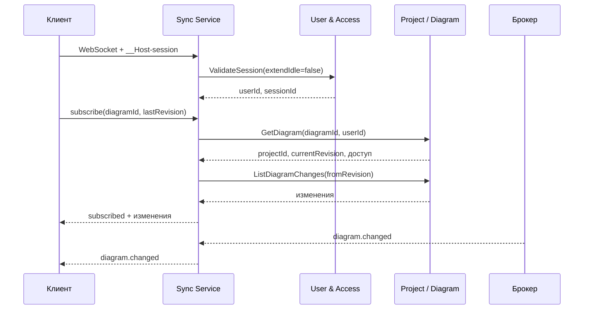

# Системная постановка: Sync / Realtime Service
## «Диаграмма Ганта — проект SMART OATI»

**Версия документа:** 1.0  
**Дата:** 2026-10-28  
**Соответствует плану реализации:** версия 1.6  
**Соответствует бизнес-постановке:** версия 2.3  
**Соответствует архитектуре БД:** версия 1.7  
**Соответствует User & Access Service:** версия 1.3  
**Соответствует Project / Diagram Service:** версия 1.2  
**Соответствует API Gateway:** версия 1.2  
**Область:** только Sync / Realtime Service.

---

## 1. Назначение

Sync / Realtime Service обеспечивает доставку изменений диаграммы подключенным клиентам в режиме, близком к реальному времени.

Сервис:

- принимает WebSocket-подключения;
- проверяет сессию через User & Access Service;
- проверяет доступ к диаграмме через Project / Diagram Service;
- подписывает клиента на изменения диаграммы;
- получает события `diagram.changed` из брокера;
- рассылает изменения подписчикам;
- поддерживает восстановление после переподключения по ревизии;
- не хранит бизнес-данные;
- не проксируется через API Gateway.

---

## 2. Границы решения

### 2.1. Входит в решение

- WebSocket-подключения;
- проверка сессии;
- проверка доступа к диаграмме;
- подписка и отписка от диаграммы;
- доставка `diagram.changed`;
- начальная синхронизация по `lastRevision`;
- backfill через Project / Diagram;
- `snapshot_required` при разрыве истории;
- heartbeat и закрытие соединений;
- лимиты подключений и размеров сообщений;
- горизонтальное масштабирование;
- метрики, логи и трассировка.

### 2.2. Не входит в решение

- SSE;
- presence;
- хранение бизнес-данных;
- snapshot диаграммы — клиент получает через REST API Gateway;
- API Gateway и публичный REST;
- аутентификация пользователя — User & Access;
- права на проект — Project / Diagram и User & Access;
- уведомления;
- аудит;
- аналитика;
- UI.

---

## 3. Технологии и архитектура

| Компонент | Решение |
|-----------|---------|
| Runtime | Node.js 22 LTS |
| Язык | JavaScript, без TypeScript |
| Транспорт | WebSocket |
| HTTP-сервер | Fastify |
| WebSocket | `ws` |
| БД | нет |
| Redis | реестр соединений и подписок |
| Брокер | NATS JetStream или RabbitMQ |
| Внутренние вызовы | gRPC |
| Трассировка | OpenTelemetry |

Сервис не подключается к PostgreSQL.

### 3.1. Поток



### 3.2. Источник истины

- Бизнес-данные — в Project DB.
- Сессии — в User DB.
- Sync хранит только эфемерное состояние соединений и подписок.
- История изменений — в Project DB, срок 2 месяца.
- Sync не восстанавливает данные после перезапуска; клиент переподключается и получает изменения или snapshot.

---

## 4. Подключение и сессия

### 4.1. Подключение

- Только `wss://`.
- Адрес: `/ws`.
- Аутентификация — cookie `__Host-session`.
- Токен в query-параметре не используется.
- Проверяется `Origin` по allowlist.
- CSRF не применяется к WebSocket.
- TLS завершается на Ingress.

### 4.2. Проверка сессии

- При подключении вызывается `ValidateSession(sessionToken, extendIdle=false)`.
- Сессия проверяется повторно каждые 60 секунд.
- Ping/pong не продлевает idle-сессию.
- HTTP-запросы к API продлевают idle-сессию, WebSocket — нет.
- При истечении, отзыве или блокировке сессии соединение закрывается с кодом `4401`.
- Клиент восстанавливает сессию через API и переподключается.

### 4.3. Лимиты

| Ограничение | Значение |
|-------------|----------|
| WebSocket-подключений на пользователя | 5 |
| Подключений на одну сессию | 2 |
| Размер сообщения | 1 МБ |
| Heartbeat | 30 секунд |
| Нет pong | 60 секунд |
| Проверка сессии | 60 секунд |

- При превышении лимита — закрытие `4429`.
- При превышении размера — закрытие `1009`.
- При отсутствии pong — закрытие `1001`.

---

## 5. Подписка и доступ

### 5.1. Подписка

Клиент отправляет:

```json
{
  "type": "subscribe",
  "requestId": "uuid",
  "diagramId": "uuid",
  "lastRevision": 42
}
```

Сервис:

1. проверяет соединение и сессию;
2. вызывает Project / Diagram `GetDiagram(diagramId, userId)`;
3. Project / Diagram проверяет доступ через User & Access;
4. получает `projectId`, `currentRevision`, статус;
5. проверяет `lastRevision`;
6. отправляет `subscribed`;
7. догружает изменения с `lastRevision + 1`;
8. добавляет соединение в подписку.

### 5.2. Ответ

```json
{
  "type": "subscribed",
  "requestId": "uuid",
  "diagramId": "uuid",
  "projectId": "uuid",
  "currentRevision": 42
}
```

### 5.3. Отказ

- Нет сессии — `4401`.
- Нет доступа — `4403`.
- Диаграмма не найдена — `4404`.
- Проект удален — `4404`.
- Слишком много подключений — `4429`.
- Project / Diagram недоступен — `4503`.

### 5.4. Отписка

```json
{
  "type": "unsubscribe",
  "requestId": "uuid",
  "diagramId": "uuid"
}
```

Ответ — `unsubscribed`.

---

## 6. Протокол сообщений

### 6.1. Формат

- JSON UTF-8.
- Конверт:

```json
{
  "type": "diagram.changed",
  "version": 1,
  "diagramId": "uuid",
  "revision": 43,
  "entityType": "task",
  "entityId": "uuid",
  "operation": "update",
  "payload": {},
  "actorUserId": "uuid",
  "occurredAt": "2026-10-28T10:00:00Z"
}
```

- `version` — версия протокола.
- `revision` — монотонная ревизия диаграммы.
- `payload` — полный измененный объект.
- Максимальный размер сообщения — 1 МБ.
- Если `payload` превышает лимит, сервер отправляет `snapshot_required`.

### 6.2. Типы серверных сообщений

| Тип | Назначение |
|-----|------------|
| `subscribed` | Подписка активна |
| `unsubscribed` | Подписка снята |
| `diagram.changed` | Изменение диаграммы |
| `snapshot_required` | Нужно получить snapshot через REST |
| `error` | Ошибка |
| `pong` | Ответ на ping |

### 6.3. Типы клиентских сообщений

| Тип | Назначение |
|-----|------------|
| `subscribe` | Подписка |
| `unsubscribe` | Отписка |
| `ping` | Проверка соединения |

### 6.4. Ошибка

```json
{
  "type": "error",
  "requestId": "uuid",
  "code": "snapshot_required",
  "message": "История изменений недоступна",
  "recoverable": true
}
```

---

## 7. Начальная синхронизация и backfill

### 7.1. Snapshot

- Клиент получает snapshot диаграммы через REST API Gateway.
- Snapshot содержит `currentRevision`.
- Клиент подключается к Sync с `lastRevision = snapshot.currentRevision`.

### 7.2. Backfill

- Sync вызывает `ListDiagramChanges(diagramId, fromRevision, limit)`.
- Изменения отправляются по порядку ревизий.
- Если история есть — клиент догоняет состояние.
- Если истории нет или разрыв слишком большой — `snapshot_required`.
- После backfill клиент получает live-события.

### 7.3. Разрыв ревизий

- Если пришло событие с `revision > last + 1`, Sync запрашивает backfill.
- Если backfill не удался — `snapshot_required`.
- Клиент не применяет событие с пропуском.

### 7.4. Переподключение

- Новое соединение с `lastRevision`.
- Sync повторяет проверку сессии, доступа и backfill.
- Клиент дедуплицирует события по `diagramId + revision`.

---

## 8. События и рассылка

### 8.1. Потребляемые события

- `diagram.changed`;
- `project.member.removed`;
- `project.member.role_changed`;
- `project.deleted`;
- `project.archived`;
- `user.deleted`;
- `user.blocked`.

### 8.2. Реакция

| Событие | Действие |
|---------|----------|
| `diagram.changed` | Разослать подписчикам |
| `project.member.removed` | Закрыть подписки пользователя на проект |
| `project.member.role_changed` | Закрыть подписки для переподключения |
| `project.deleted` | Закрыть подписки на диаграммы проекта |
| `project.archived` | Закрыть подписки на диаграммы проекта |
| `user.deleted` | Закрыть соединения пользователя |
| `user.blocked` | Закрыть соединения пользователя |

### 8.3. Рассылка

- Событие содержит полный объект.
- Sync рассылает его всем подписчикам диаграммы.
- Событие не хранится.
- При отсутствии подписчиков событие отбрасывается.
- При отставании клиента — backfill или `snapshot_required`.
- Порядок по `revision` обязателен.

### 8.4. Горизонтальное масштабирование

- Каждый инстанс Sync получает копию события из брокера.
- Соединения и подписки хранятся в Redis.
- Sticky sessions не требуются.
- Redis используется для реестра, не для бизнес-данных.
- При перезапуске инстанса клиенты переподключаются.

---

## 9. Redis

### 9.1. Ключи

| Ключ | Тип | TTL | Назначение |
|------|-----|-----|------------|
| `sync:conn:{connectionId}` | hash | 120 с | `userId`, `sessionId`, `connectedAt` |
| `sync:user:{userId}` | set | 120 с | ID соединений |
| `sync:session:{sessionId}` | set | 120 с | ID соединений |
| `sync:diagram:{diagramId}` | set | 120 с | ID соединений |
| `sync:sub:{connectionId}` | set | 120 с | ID диаграмм |

TTL продлевается heartbeat.

### 9.2. Правила

- Redis не является источником бизнес-данных.
- Если Redis недоступен, новые подключения отклоняются `4503`; существующие продолжают работу до следующей проверки.
- При перезапуске Redis клиенты переподключаются.
- Presence не хранится.

---

## 10. Внутренние вызовы

### 10.1. User & Access

- `ValidateSession(sessionToken, extendIdle=false)` — проверка сессии.
- `GetUsersByIds` — не используется Sync; имена не нужны.

### 10.2. Project / Diagram

- `GetDiagram(diagramId, userId)` — доступ, `projectId`, `currentRevision`, статус.
- `ListDiagramChanges(diagramId, fromRevision, limit)` — backfill.
- `GetDiagramSnapshot` — не используется; snapshot получает клиент через REST.

### 10.3. Ошибки зависимостей

- User & Access недоступен — `4503`, новые подключения и проверки не проходят.
- Project / Diagram недоступен — `4503`, подписка не создается.
- Брокер недоступен — live-события не доставляются; клиенты переподключаются и делают backfill.

---

## 11. Безопасность

- Только `wss://`.
- Cookie `__Host-session`: `Secure`, `HttpOnly`, `SameSite=Lax`.
- Проверка `Origin` по allowlist.
- Токен не передается в query.
- Максимальный размер сообщения 1 МБ.
- JSON-схема входящих сообщений.
- Проверка сессии и доступа.
- Закрытие при отзыве доступа.
- Логи не содержат payload, cookie и токены.
- Внутренние gRPC-порты не публикуются.
- mTLS/service-токены для внутренних вызовов.
- Redis не содержит бизнес-данных.
- Лимиты подключений и частоты сообщений.

---

## 12. Наблюдаемость и SLO

- Доступность 99,5%.
- p95 доставки события от брокера до клиента ≤ 500 мс.
- p95 установки подписки ≤ 1 с без времени Project / Diagram.
- Метрики:
  - активные соединения;
  - подписки;
  - входящие/исходящие сообщения;
  - backfill;
  - ошибки;
  - закрытия по кодам;
  - задержка доставки.
- Логи структурированные, без payload.
- Трассировка OpenTelemetry.
- Health/readiness.
- Graceful shutdown с закрытием соединений.
- Горизонтальное масштабирование.

---

## 13. Развёртывание и конфигурация

- Docker, Kubernetes.
- Минимум 2 реплики.
- HPA по CPU и соединениям.
- Ingress с TLS.
- Без PostgreSQL.
- Redis и брокер.
- Переменные:
  - `PORT`;
  - `LOG_LEVEL`;
  - `REDIS_URL`;
  - `BROKER_URL`;
  - `USER_SERVICE_GRPC_ADDR`;
  - `PROJECT_SERVICE_GRPC_ADDR`;
  - `ALLOWED_ORIGINS`;
  - `MAX_CONNECTIONS_PER_USER`;
  - `MAX_CONNECTIONS_PER_SESSION`;
  - `MAX_MESSAGE_BYTES`;
  - `HEARTBEAT_SECONDS`;
  - `SESSION_CHECK_SECONDS`;
  - `OTEL_EXPORTER_OTLP_ENDPOINT`.

---

## 14. Обработка отказов

| Ситуация | Действие |
|----------|----------|
| Сессия истекла | `4401` |
| Нет доступа | `4403` |
| Диаграмма не найдена | `4404` |
| Превышен лимит соединений | `4429` |
| Слишком большое сообщение | `1009` |
| Нет pong | `1001` |
| User & Access недоступен | `4503` |
| Project / Diagram недоступен | `4503` |
| Redis недоступен | новые подключения `4503` |
| История изменений недоступна | `snapshot_required` |
| Разрыв ревизий | backfill или `snapshot_required` |

---

## 15. Сценарии

### 15.1. Подключение

1. Клиент открывает WebSocket с cookie.
2. Sync проверяет Origin и сессию.
3. Клиент подписывается с `lastRevision`.
4. Sync проверяет доступ.
5. Sync отправляет `subscribed`.
6. Sync догружает изменения.
7. Клиент получает live-события.

### 15.2. Изменение задачи

1. Пользователь меняет задачу через REST.
2. Project / Diagram публикует `diagram.changed`.
3. Sync получает событие.
4. Sync рассылает полный объект подписчикам.
5. Клиенты применяют изменение.

### 15.3. Разрыв истории

1. Клиент подключается с устаревшей ревизией.
2. Sync не может догрузить изменения.
3. Sync отправляет `snapshot_required`.
4. Клиент получает snapshot через REST.
5. Переподключается с новой ревизией.

### 15.4. Отзыв доступа

1. User & Access публикует `project.member.removed`.
2. Sync закрывает подписки пользователя.
3. Клиент получает `4403` и не восстанавливает подписку.

### 15.5. Истечение сессии

1. Sync проверяет сессию каждые 60 секунд.
2. Сессия истекла.
3. Sync закрывает соединение `4401`.
4. Клиент восстанавливает сессию и переподключается.

---

## 16. Критерии приемки

1. WebSocket подключается только с валидной сессией.
2. Origin проверяется.
3. Сессия проверяется при подключении и каждые 60 секунд.
4. Ping/pong не продлевает idle-сессию.
5. Истекшая сессия закрывает соединение `4401`.
6. Подписка проверяет доступ к диаграмме.
7. Нет доступа — `4403`.
8. `lastRevision` используется для backfill.
9. При недоступной истории — `snapshot_required`.
10. Событие `diagram.changed` содержит полный объект.
11. Ревизии соблюдают порядок.
12. Дубликаты дедуплицируются клиентом.
13. Лимит 5 подключений на пользователя.
14. Лимит 2 подключения на сессию.
15. Превышение — `4429`.
16. Размер сообщения 1 МБ.
17. Heartbeat 30 секунд.
18. Нет pong 60 секунд — `1001`.
19. Отзыв доступа закрывает подписки.
20. Удаление/архивирование проекта закрывает подписки.
21. Блокировка пользователя закрывает соединения.
22. События рассылаются всем подписчикам.
23. Sync не хранит бизнес-данные.
24. Redis хранит только реестр.
25. Горизонтальное масштабирование без sticky sessions.
26. Health/readiness работают.
27. Логи не содержат payload и cookie.
28. Метрики и трассировка доступны.

---

## 17. Открытые вопросы

Открытых вопросов по Sync / Realtime Service нет.

Точные proto-контракты и схема WebSocket-сообщений будут зафиксированы отдельным этапом.


