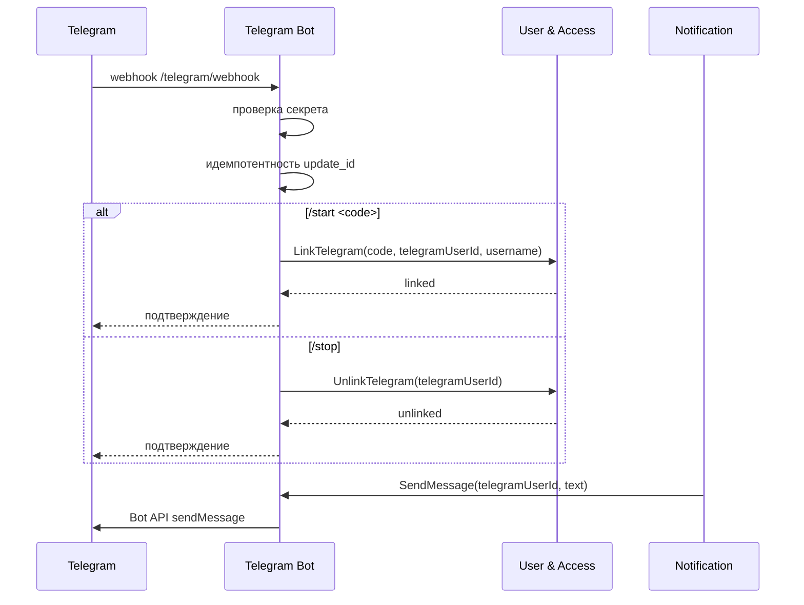

# Системная постановка: Telegram Bot
## «Диаграмма Ганта — проект SMART OATI»

**Версия документа:** 1.0  
**Дата:** 2026-10-28  
**Соответствует плану реализации:** версия 1.6  
**Соответствует бизнес-постановке:** версия 2.3  
**Соответствует архитектуре БД:** версия 1.7  
**Соответствует Notification Service:** версия 1.0  
**Соответствует User & Access Service:** версия 1.3  
**Соответствует API Gateway:** версия 1.2  
**Область:** Telegram-бот как модуль Notification Service.

---

## 1. Назначение

Telegram Bot обеспечивает:

- привязку Telegram к пользователю;
- отвязку Telegram;
- отправку уведомлений в личные чаты;
- получение команд пользователя;
- защиту webhook;
- идемпотентную обработку обновлений.

Бот является **модулем Notification Service**. Отдельного деплоя нет.

---

## 2. Границы решения

### 2.1. Входит

- webhook Telegram;
- команды `/start` и `/stop`;
- код привязки 10 минут;
- вызовы User & Access `LinkTelegram` и `UnlinkTelegram`;
- отправка текстовых уведомлений;
- личные чаты;
- идемпотентность по `update_id`;
- защита секретом;
- журнал обработанных обновлений;
- ошибки и передача статуса в Notification.

### 2.2. Не входит

- группы и каналы;
- медиа, файлы, стикеры;
- массовые рассылки;
- маркетинговые сообщения;
- собственный UI;
- отдельная БД;
- отдельный деплой;
- хранение email и профилей — User & Access;
- бизнес-логика проектов.

---

## 3. Архитектура

### 3.1. Размещение

- модуль Notification Service;
- отдельный HTTP endpoint `/telegram/webhook`;
- прямой доступ через Ingress, не через API Gateway;
- защита секретным заголовком Telegram;
- TLS обязателен.

---

## 4. Webhook

### 4.1. Endpoint

- `POST /telegram/webhook`.
- Content-Type: `application/json`.
- Проверка `X-Telegram-Bot-Api-Secret-Token`.
- При неверном секрете — `403`.
- Webhook не принимает пользовательские REST-запросы.

### 4.2. Идемпотентность

- `update_id` уникален.
- Таблица `bots.telegram_updates`.
- Повторное обновление не обрабатывается.
- `update_id` хранится 2 месяца.

### 4.3. Ограничения

- Только `message` с текстом.
- Игнорируются edited_message, callback_query, channel_post, group/supergroup.
- Личные чаты: `chat.type = private`.
- Размер текста — до 4096 символов Telegram API.
- Входящие сообщения — только команды.

---

## 5. Команды

### 5.1. `/start`

Без кода:

- бот отправляет инструкцию;
- сообщает, что код выдается в приложении;
- не создает привязку.

С кодом `/start <code>`:

1. Проверяется формат кода.
2. Вызывается User & Access `LinkTelegram`.
3. Код одноразовый, срок 10 минут.
4. При успехе — подтверждение.
5. При ошибке — понятное сообщение.
6. Повторное использование кода отклоняется.

### 5.2. `/stop`

1. Вызывается `UnlinkTelegram(telegramUserId)`.
2. При успехе — подтверждение.
3. Если привязки нет — сообщение об этом.
4. После отвязки уведомления в Telegram не отправляются.

### 5.3. Другие сообщения

- Игнорируются или получают короткую подсказку.
- Команды настройки уведомлений в боте не реализуются; настройки — в приложении.

---

## 6. Отправка уведомлений

- Notification Service вызывает внутренний метод бота `SendMessage`.
- Только личный чат.
- Текст до 4096 символов.
- HTML/Markdown не используются или проходят безопасное экранирование.
- Ссылки ведут на frontend.
- Telegram ID берется из User & Access; бот не хранит привязку.
- Ошибки:
  - `403` — пользователь заблокировал бота;
  - `429` — превышен лимит, учитывается `retry_after`;
  - `5xx` — временная ошибка.
- Notification выполняет три попытки: сразу, через 1 минуту, через 15 минут.
- При ошибке — fallback на email/internal.

---

## 7. Данные

### 7.1. `telegram_updates`

| Поле | Тип | Назначение |
|------|-----|------------|
| `update_id` | bigint | PK, ID обновления |
| `processed_at` | timestamptz | Время обработки |
| `status` | varchar(16) | `processed/ignored/failed` |
| `error` | text | Ошибка |

Срок хранения — 2 месяца.

### 7.2. Привязка

- хранится в User & Access (`telegram_links`);
- бот не хранит Telegram ID и username;
- код привязки хранится в User & Access.

---

## 8. Безопасность

- Секрет webhook — в защищенном хранилище.
- Токен бота — только в секретах.
- Проверка секретного заголовка.
- Только личные чаты.
- Игнорирование групп и каналов.
- Нет приема файлов и медиа.
- Нет команд, изменяющих проектные данные.
- Логи без Telegram ID, кода и текста сообщений.
- Rate limit на webhook.
- TLS.
- Ошибки не раскрывают внутренние детали.

---

## 9. Ошибки и поведение

| Ситуация | Поведение |
|----------|-----------|
| Неверный секрет | 403 |
| Неизвестный update | ignored |
| Повторный update | ignored |
| Неверный код | сообщение пользователю |
| Код истек | сообщение пользователю |
| Код уже использован | сообщение пользователю |
| User & Access недоступен | сообщение о временной ошибке, retry |
| Telegram 429 | учесть `retry_after` |
| Telegram 403 | доставка невозможна, fallback |
| Групповой чат | ignored |

---

## 10. Нефункциональные требования

- p95 обработки webhook ≤ 500 мс без внешних вызовов.
- p95 отправки сообщения ≤ 2 с без Telegram API.
- Идемпотентность 100%.
- Webhook доступен 99,5%.
- Логи структурированные.
- Метрики: обновления, команды, привязки, отправки, ошибки.
- Трассировка OpenTelemetry.
- Health/readiness Notification Service.
- Graceful shutdown.

---

## 11. Сценарии

### 11.1. Привязка

1. Пользователь получает код в приложении.
2. Отправляет `/start <код>`.
3. Бот проверяет секрет и update_id.
4. Вызывает `LinkTelegram`.
5. Подтверждает привязку.

### 11.2. Отвязка

1. Пользователь отправляет `/stop`.
2. Бот вызывает `UnlinkTelegram`.
3. Подтверждает отвязку.

### 11.3. Уведомление

1. Notification вызывает `SendMessage`.
2. Бот отправляет текст в личный чат.
3. При 429 учитывает `retry_after`.
4. При 403 сообщает Notification об ошибке.
5. Notification делает fallback.

---

## 12. Критерии приемки

1. Webhook защищен секретом.
2. Повторный `update_id` не обрабатывается.
3. `/start <код>` привязывает Telegram.
4. Код действует 10 минут.
5. `/stop` отвязывает Telegram.
6. Группы игнорируются.
7. Медиа игнорируются.
8. Уведомления отправляются только в личные чаты.
9. Ошибка Telegram возвращается в Notification.
10. Три попытки выполняет Notification.
11. Fallback работает.
12. `telegram_updates` хранится 2 месяца.
13. Логи не содержат Telegram ID и коды.
14. Токен и секрет не попадают в логи.
15. Health/readiness Notification работают.

---

## 13. Открытые вопросы

Открытых вопросов по Telegram Bot нет.

