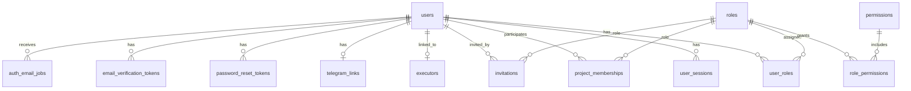

# Системная постановка: User & Access Service
## «Диаграмма Ганта — проект SMART OATI»

**Версия документа:** 1.3  
**Дата:** 2026-10-28  
**Соответствует плану реализации:** версия 1.6  
**Соответствует бизнес-постановке:** версия 2.3  
**Соответствует архитектуре БД:** версия 1.7  
**Соответствует постановке API Gateway:** версия 1.2  
**Область:** только User & Access Service. Постановки Project / Diagram, Notification, Audit и Sync / Realtime оформляются отдельными документами.

---

## 1. Назначение

User & Access Service — единственный владелец пользовательских данных и прав доступа.

Сервис отвечает за:

- регистрацию и вход;
- подтверждение email;
- сессии, включая «запомнить меня»;
- пароли, блокировки и восстановление доступа;
- профили пользователей;
- глобальные роли и права;
- участников проектов и роли в проектах;
- приглашения в проекты;
- каталог исполнителей;
- связь пользователя с исполнителем;
- контакты email и Telegram;
- системные настройки;
- задания на отправку auth-писем;
- проверку сессии и прав по gRPC.

Сервис **не хранит** проекты, диаграммы, задачи, зависимости и комментарии. Эти данные принадлежат Project / Diagram Service.

---

## 2. Границы решения

### 2.1. Входит в решение

- гибридная регистрация: самостоятельная регистрация + приглашения в проекты;
- подтверждение email;
- вход и выход;
- обычные и persistent-сессии;
- «запомнить меня»;
- восстановление и смена пароля;
- блокировка после неудачных попыток;
- административная блокировка и разблокировка;
- полное удаление пользователя;
- роли и права;
- участие в проектах;
- приглашения;
- каталог исполнителей;
- связь пользователя с исполнителем;
- Telegram-привязка;
- системные настройки;
- auth-письма через Notification Service;
- gRPC API для API Gateway и внутренних сервисов;
- события для Audit и других сервисов.

### 2.2. Не входит в решение

- проекты, диаграммы, задачи и комментарии;
- SMTP и Telegram-бот — принадлежат Notification Service;
- хранение аудита — Audit Service;
- публичный REST — API Gateway;
- CSRF — API Gateway;
- rate limit — API Gateway;
- WebSocket/SSE — Sync / Realtime Service;
- аналитика — отдельный read-only контур;
- UI и frontend;
- полные proto-файлы и OpenAPI — отдельный этап.

---

## 3. Технологии и архитектура

| Компонент | Решение |
|-----------|---------|
| Runtime | Node.js 22 LTS |
| Язык | JavaScript, без TypeScript |
| API | gRPC/protobuf |
| БД | PostgreSQL 16 |
| Схемы | `access`, `jobs`, `settings`, `events`, `analytics`, `ext` |
| События | outbox + брокер |
| Пароли | Argon2id |
| Токены | криптографически стойкие, в БД только хеш |
| Кэш сессий | не используется; источник истины — PostgreSQL |
| Аудит | события в Audit Service |
| Почта | через Notification Service по gRPC |

### 3.1. Взаимодействие

- API Gateway вызывает User & Access по gRPC для входа, сессии, профилей, ролей и настроек.
- Project / Diagram Service вызывает User & Access по gRPC для проверки прав и участия.
- Sync / Realtime Service вызывает User & Access `ValidateSession` с `extendIdle=false`.
- Notification Service вызывает User & Access по gRPC для получения контактов и привязки Telegram.
- Audit Service получает события User & Access.
- User & Access вызывает Project / Diagram Service по gRPC только для проверки владения проектами перед удалением пользователя.
- User & Access вызывает Notification Service по gRPC для отправки auth-писем.

### 3.2. Источник истины

- Пользователи, сессии, роли, участия, приглашения и исполнители — только в БД User & Access.
- Project / Diagram Service хранит только ID пользователей и исполнителей.
- Пароли и токены хранятся только в виде хешей.
- Сессия проверяется по PostgreSQL на каждом запросе; кэш сессии не используется.

---

## 4. Роли и права

### 4.1. Роли

| Код | Область | Назначение |
|-----|---------|------------|
| `app_admin` | Приложение | Администратор приложения |
| `project_owner` | Проект | Владелец проекта |
| `project_manager` | Проект | Руководитель проекта |
| `project_editor` | Проект | Редактор |
| `project_participant` | Проект | Участник |
| `project_viewer` | Проект | Наблюдатель |

Роли фиксированные. Пользовательские роли не создаются.

### 4.2. Матрица прав

| Действие | Админ | Владелец | Руководитель | Редактор | Участник | Наблюдатель |
|----------|-------|----------|--------------|----------|----------|-------------|
| Просмотр плана | Да | Да | Да | Да | Да | Да |
| Создание/редактирование задач | Да | Да | Да | Да | Только назначенные | Нет |
| Удаление задач | Да | Да | Да | Нет | Нет | Нет |
| Управление зависимостями | Да | Да | Да | Да | Нет | Нет |
| Комментарии | Да | Да | Да | Да | Да | Нет |
| Импорт плана | Да | Да | Да | Нет | Нет | Нет |
| Экспорт и PDF | Да | Да | Да | Да | Нет | Да |
| Управление участниками | Да | Да | Нет | Нет | Нет | Нет |
| Настройки проекта | Да | Да | Нет | Нет | Нет | Нет |
| Архивирование проекта | Да | Да | Нет | Нет | Нет | Нет |
| Восстановление проекта | Да | Да | Нет | Нет | Нет | Нет |
| Удаление проекта | Да | Да | Нет | Нет | Нет | Нет |
| Аудит | Да | Да | Нет | Нет | Нет | Нет |

### 4.3. Каталог исполнителей

- Управлять каталогом могут **администратор приложения и владелец проекта**.
- Связывать исполнителя с пользователем может **только администратор приложения**.
- Руководитель, редактор, участник и наблюдатель каталог не изменяют.
- Удаление исполнителя не удаляет задачи; Project / Diagram Service сохраняет ID.
- Пользователь и исполнитель — разные сущности; связь хранится в User & Access.

### 4.4. Проверка прав

- API Gateway проверяет аутентификацию.
- Project / Diagram Service перед операцией вызывает `CheckProjectPermission`.
- User & Access проверяет участие, роль и активный статус пользователя.
- Результат проверки не кэшируется на стороне User & Access.
- При исключении из проекта доступ прекращается при следующей проверке.

---

## 5. Модель данных

### 5.1. ERD

### 5.2. Состав таблиц

| Схема | Таблица | Назначение |
|-------|---------|------------|
| `access` | `users` | Пользователи, профиль, статус, блокировки |
| `access` | `user_sessions` | Обычные и persistent-сессии |
| `access` | `roles` | Роли |
| `access` | `permissions` | Права |
| `access` | `role_permissions` | Связь ролей и прав |
| `access` | `user_roles` | Глобальные роли |
| `access` | `project_memberships` | Участие в проектах |
| `access` | `invitations` | Приглашения в проекты |
| `access` | `executors` | Каталог исполнителей |
| `access` | `telegram_links` | Привязка Telegram |
| `access` | `password_reset_tokens` | Сброс пароля |
| `access` | `email_verification_tokens` | Подтверждение email |
| `settings` | `system_settings` | Системные настройки |
| `jobs` | `auth_email_jobs` | Очередь auth-писем |
| `events` | `outbox_events` | Исходящие события |
| `events` | `processed_events` | Идемпотентность потребителя |
| `events` | `idempotency_keys` | Идемпотентность gRPC-команд |

### 5.3. `users`

| Поле | Тип | Ограничения | Назначение |
|------|-----|-------------|------------|
| `id` | uuid | PK | ID |
| `email` | citext | NOT NULL, UNIQUE | Логин |
| `password_hash` | text | NOT NULL | Argon2id-хеш |
| `status` | varchar(16) | `active/blocked` | Статус |
| `email_verified_at` | timestamptz | NULL | Подтверждение email |
| `display_name` | varchar(200) | NOT NULL | Отображаемое имя |
| `last_name` | varchar(100) | NULL | Фамилия |
| `first_name` | varchar(100) | NULL | Имя |
| `middle_name` | varchar(100) | NULL | Отчество |
| `position` | varchar(200) | NULL | Должность |
| `timezone` | varchar(64) | NOT NULL | Часовой пояс |
| `locale` | varchar(16) | NOT NULL | Язык |
| `failed_login_attempts` | smallint | NOT NULL, default 0 | Неудачные попытки |
| `lockout_level` | smallint | NOT NULL, default 0 | Уровень блокировки |
| `locked_until` | timestamptz | NULL | Временная блокировка |
| `last_login_at` | timestamptz | NULL | Последний вход |
| `created_at` | timestamptz | NOT NULL | Создание |
| `updated_at` | timestamptz | NOT NULL | Изменение |

Правила:

- `email` сравнивается без учета регистра.
- `status=blocked` — постоянная блокировка; снять может только администратор.
- `locked_until` — временная блокировка.
- Счётчик и уровень сбрасываются после успешного входа, после истечения блокировки и при административной разблокировке.
- Полное удаление пользователя удаляет запись и связанные пользовательские данные.

### 5.4. `user_sessions`

Одна строка — один слот сессии. У пользователя не более двух активных слотов.

| Поле | Тип | Ограничения | Назначение |
|------|-----|-------------|------------|
| `id` | uuid | PK | ID слота |
| `user_id` | uuid | FK → users, CASCADE | Пользователь |
| `session_token_hash` | char(64) | NOT NULL, UNIQUE | Хеш обычного токена |
| `absolute_expires_at` | timestamptz | NOT NULL | Абсолютный срок сессии |
| `idle_expires_at` | timestamptz | NOT NULL | Idle-срок |
| `remember_token_hash` | char(64) | NULL, UNIQUE | Хеш remember-токена |
| `remember_absolute_expires_at` | timestamptz | NULL | Абсолютный срок remember |
| `remember_idle_expires_at` | timestamptz | NULL | Idle-срок remember |
| `last_seen_at` | timestamptz | NULL | Активность |
| `user_agent` | text | NULL | Устройство |
| `ip` | inet | NULL | IP |
| `revoked_at` | timestamptz | NULL | Отзыв |
| `created_at` | timestamptz | NOT NULL | Создание |

Правила:

- Обычная сессия: 1 час абсолютный срок, 10 минут idle.
- Remember-токен: 30 дней абсолютный срок, 7 дней idle.
- Remember-токен и его обычная сессия относятся к одному слоту.
- При третьем входе без завершения другой сессии — отказ `session_limit_reached`.
- При restore оба токена ротируются в том же слоте.
- `ValidateSession` продлевает только idle-срок, не абсолютный.
- Завершение слота отзывает обычный токен и remember-токен.

### 5.5. `system_settings`

| Поле | Тип | Ограничения | Назначение |
|------|-----|-------------|------------|
| `key` | varchar(100) | PK | Ключ |
| `value` | jsonb | NOT NULL | Значение |
| `description` | text | NULL | Описание |
| `updated_by_user_id` | uuid | NULL | Кто изменил |
| `updated_at` | timestamptz | NOT NULL | Когда |

Значения по умолчанию:

| Ключ | Значение |
|------|----------|
| `password_min_length` | 8 |
| `password_max_length` | 128 |
| `password_require_complexity` | false |
| `max_failed_attempts` | 5 |
| `first_lockout_minutes` | 10 |
| `second_lockout_minutes` | 60 |
| `third_lockout_permanent` | true |
| `session_absolute_minutes` | 60 |
| `session_idle_minutes` | 10 |
| `max_sessions` | 2 |
| `remember_me_absolute_days` | 30 |
| `remember_me_idle_days` | 7 |
| `email_verification_hours` | 24 |
| `password_reset_hours` | 1 |
| `invitation_days` | 7 |
| `telegram_link_code_minutes` | 10 |

Правила:

- Настройки меняет только администратор приложения.
- Новые парольные правила применяются к новым паролям и сбросам.
- Новые TTL применяются к новым сессиям; существующие не продлеваются.
- Настройки блокировок применяются сразу.
- Изменения фиксируются в аудите.

### 5.6. `auth_email_jobs`

| Поле | Тип | Ограничения | Назначение |
|------|-----|-------------|------------|
| `id` | uuid | PK | ID задания |
| `user_id` | uuid | FK → users, NULL | Пользователь |
| `invitation_id` | uuid | FK → invitations, NULL | Приглашение |
| `recipient_email` | citext | NOT NULL | Получатель |
| `template_code` | varchar(64) | NOT NULL | Шаблон |
| `variables` | jsonb | NOT NULL | Данные шаблона |
| `status` | varchar(16) | `pending/sending/sent/failed` | Статус |
| `attempts` | integer | NOT NULL, default 0 | Попытки |
| `next_attempt_at` | timestamptz | NULL | Следующая попытка |
| `last_error` | text | NULL | Ошибка |
| `created_at` | timestamptz | NOT NULL | Создание |
| `sent_at` | timestamptz | NULL | Отправка |

Правила:

- Письмо формируется по `template_code` и `variables`.
- Отправка выполняется через Notification Service по gRPC.
- При недоступности Notification задание остается в очереди и повторяется.
- Регистрация, сброс пароля и приглашение не откатываются из-за недоступности почты.
- Максимум 8 попыток в течение 24 часов; затем `failed` и технический лог.
- Одинаковые задания дедуплицируются по ключу.

### 5.7. Остальные таблицы

- `roles`, `permissions`, `role_permissions`, `user_roles` — роли и права.
- `project_memberships` — участие в проектах, роль, статус, причина отзыва.
- `invitations` — приглашение в проект, email, роль, токен, срок.
- `executors` — каталог исполнителей, связь с пользователем.
- `telegram_links` — Telegram ID и username.
- `password_reset_tokens`, `email_verification_tokens` — одноразовые токены.
- `outbox_events`, `processed_events`, `idempotency_keys` — события и идемпотентность.

---

## 6. Аутентификация и сессии

### 6.1. Регистрация

1. Пользователь отправляет email, пароль и отображаемое имя.
2. Проверяются парольные требования и уникальность email.
3. Создается пользователь с неподтвержденным email.
4. Создается задание на письмо подтверждения.
5. Пользователь получает успешный ответ без сессии.
6. Вход до подтверждения email запрещен.
7. После подтверждения email пользователь может войти.

Регистрация открытая. Отдельных приглашений «в приложение» нет. В проекты — только по приглашению.

### 6.2. Вход

1. Пользователь отправляет email и пароль.
2. Проверяются статус, подтверждение email, блокировка и пароль.
3. При успехе:
   - сбрасываются неудачные попытки и уровень блокировки;
   - создается слот сессии;
   - при `rememberMe` создается remember-токен;
   - возвращаются `Set-Cookie` и профиль;
   - фиксируется событие входа.
4. При ошибке увеличивается счетчик неудачных попыток.
5. После 5 неудач:
   - первая блокировка — 10 минут;
   - вторая — 1 час;
   - третья — постоянная блокировка.
6. Постоянную блокировку снимает только администратор.
7. При достижении лимита двух слотов новый вход отклоняется с `session_limit_reached`.

### 6.3. Обычная сессия

- Абсолютный срок: 1 час.
- Idle timeout: 10 минут.
- Cookie `__Host-session`: `Secure`, `HttpOnly`, `SameSite=Lax`, `Path=/`, без `Domain`.
- `ValidateSession` проверяет хеш токена, абсолютный и idle-срок, отзыв и статус пользователя.
- При успехе обновляется idle-срок.
- Абсолютный срок не продлевается.

### 6.4. «Запомнить меня»

- Создается отдельный remember-токен.
- Абсолютный срок: 30 дней.
- Idle timeout: 7 дней.
- Cookie `__Host-remember`: `Secure`, `HttpOnly`, `SameSite=Lax`, `Path=/`.
- Remember-токен и его обычная сессия занимают один слот из двух.
- При истечении обычной сессии клиент вызывает `RestoreSession` с remember-токеном.
- `RestoreSession` проверяет сроки, статус, отзывает старые токены и ротирует оба токена в том же слоте.
- Восстановление не создает новый слот.
- Logout отзывает обычный и remember-токен текущего слота.

### 6.5. Выход

- `Logout` отзывает текущий слот.
- `LogoutAll` отзывает все слоты пользователя.
- `ListMySessions` показывает активные слоты без токенов.
- `RevokeMySession` отзывает выбранный слот.
- После выхода cookie очищаются.

### 6.6. Подтверждение email

- Токен одноразовый, срок 24 часа.
- Повторная отправка доступна пользователю.
- Токен хранится только в виде хеша.
- После подтверждения выставляется `email_verified_at`.
- Подтверждение не создает сессию.

### 6.7. Сброс и смена пароля

- Запрос сброса всегда возвращает одинаковый ответ, чтобы не раскрывать наличие email.
- Токен сброса одноразовый, срок 1 час.
- Сброс пароля отзывает все сессии и remember-токены.
- Сброс снимает временную блокировку и сбрасывает счетчик, но не снимает постоянную блокировку.
- Смена пароля отзывает все сессии, кроме текущей.
- Новый пароль проверяется по актуальным системным настройкам.
- Письмо уходит через `auth_email_jobs` и Notification Service.

### 6.8. Блокировка и удаление

- Временная блокировка снимается автоматически по `locked_until`.
- Постоянную блокировку снимает только администратор приложения.
- При блокировке все сессии отзываются.
- Полное удаление выполняет только администратор приложения.
- Перед удалением проверяется отсутствие проектов во владении через Project / Diagram Service.
- Если пользователь владеет проектами, удаление отклоняется с `ownership_transfer_required`.
- Удаление необратимо; в аудите может остаться технический UUID без персональных данных.

---

## 7. Проекты, роли и приглашения

### 7.1. Создание владельца проекта

1. Project / Diagram Service генерирует `project_id`.
2. Вызывает `EnsureProjectOwner(projectId, ownerUserId)`.
3. User & Access проверяет пользователя.
4. Создает или обновляет участие с ролью `project_owner`.
5. Вызов идемпотентен.
6. Project / Diagram Service создает проект только после успешного вызова.
7. При ошибке проект не создается.

### 7.2. Передача владения

- Передачу инициирует Project / Diagram Service.
- User & Access синхронно обновляет участия:
  - старый владелец становится `project_manager`;
  - новый владелец становится `project_owner`.
- Project / Diagram Service обновляет `owner_user_id`.
- Операция идемпотентна и фиксируется в аудите.
- При ошибке Project / Diagram Service откатывает изменение владельца.

### 7.3. Приглашения

- Приглашение создает администратор приложения или владелец проекта.
- Приглашение содержит email, проект и роль.
- Срок действия — 7 дней.
- Одно активное приглашение на email в проекте.
- Приглашение можно переотправить и отозвать.
- Принятие требует входа.
- Email текущего пользователя должен совпадать с email приглашения.
- Если пользователь не зарегистрирован, он регистрируется, подтверждает email и принимает приглашение.
- Принятие создает участие с указанной ролью.
- Повторное принятие не создает дубликат.
- Приглашение не может выдать роль выше прав приглашающего.

### 7.4. События проекта

User & Access потребляет:

- `project.deleted` — участия переводятся в `revoked` с причиной `project_deleted`, приглашения отзываются;
- `project.restored` — участия с причиной `project_deleted` возвращаются в `active`;
- `project.purged` — участия и приглашения проекта удаляются.

Участия с причиной `member_removed` при восстановлении проекта не возвращаются.

### 7.5. Каталог исполнителей

- Просмотр — все авторизованные пользователи.
- Создание, изменение и удаление — администратор приложения и владелец проекта.
- Связывание с пользователем — только администратор.
- ФИО уникально без учета регистра.
- Удаление — мягкое; Project / Diagram Service сохраняет ID.
- Связанный пользователь используется для уведомлений.
- При удалении исполнителя связь с пользователем обнуляется.

---

## 8. gRPC API

### 8.1. Общие правила

- Пакет: `smartoati.user.v1`.
- Только унарные вызовы.
- Внутренняя аутентификация: mTLS и/или service-токен.
- Метаданные: `x-request-id`, `x-correlation-id`, `x-actor-user-id`, `x-client-ip`.
- Публичные методы вызываются только через API Gateway.
- Ошибки — стандартные gRPC-коды и машиночитаемый `error_code`.
- Списки — `limit/offset`, максимум 200.
- Команды — идемпотентны по `Idempotency-Key`.

### 8.2. Аутентификация

| Метод | Назначение | Доступ |
|-------|------------|--------|
| `Register` | Регистрация | Публичный через Gateway |
| `VerifyEmail` | Подтверждение email | Публичный через Gateway |
| `ResendEmailVerification` | Повторное письмо | Публичный через Gateway |
| `Login` | Вход | Публичный через Gateway |
| `RestoreSession` | Восстановление по remember | Публичный через Gateway |
| `ValidateSession` | Проверка сессии | Gateway, Sync |
| `Logout` | Выход текущего слота | Gateway |
| `LogoutAll` | Выход всех слотов | Gateway |
| `ListMySessions` | Мои сессии | Gateway |
| `RevokeMySession` | Отозвать свою сессию | Gateway |
| `RequestPasswordReset` | Запрос сброса | Публичный через Gateway |
| `ResetPassword` | Сброс пароля | Публичный через Gateway |
| `ChangePassword` | Смена пароля | Gateway |
| `GetCurrentUser` | Текущий профиль | Gateway |

Основные поля:

- `Register`: `email`, `password`, `displayName`, `timezone`, `locale`.
- `Login`: `email`, `password`, `rememberMe`, `userAgent`, `ip`.
- `Login` возвращает: `user`, `setCookie[]`, `sessionExpiresAt`, `idleExpiresAt`, `rememberExpiresAt`.
- `ValidateSession`: `sessionToken`, `extendIdle` (по умолчанию `true`); возвращает `userId`, `sessionId`, `globalRoles`, `expiresAt`, `idleExpiresAt`.
- Sync / Realtime вызывает `ValidateSession` с `extendIdle=false`, чтобы ping/pong не продлевал idle-сессию.
- `RestoreSession`: `rememberToken`, `userAgent`, `ip`; возвращает новые `setCookie[]`.
- `Logout`: `sessionToken`; возвращает `setCookie[]` для очистки.
- `RequestPasswordReset`: `email`; всегда успешный ответ.
- `ResetPassword`: `token`, `newPassword`.

### 8.3. Пользователи

| Метод | Назначение | Доступ |
|-------|------------|--------|
| `GetUser` | Профиль по ID | Gateway, внутренние |
| `GetUsersByIds` | Пакетное получение | Project, Notification, Audit |
| `ListUsers` | Список пользователей | Админ |
| `AdminCreateUser` | Создание пользователя | Админ |
| `SetUserGlobalRoles` | Заменить набор глобальных ролей | Админ |
| `UpdateUserProfile` | Свой профиль | Пользователь |
| `BlockUser` | Блокировка | Админ |
| `UnblockUser` | Разблокировка | Админ |
| `DeleteUser` | Полное удаление | Админ |

`AdminCreateUser` создает пользователя и задание на активационное письмо. Пароль задается пользователем по ссылке.

`SetUserGlobalRoles` заменяет весь набор глобальных ролей пользователя. Только администратор. Нельзя снять роль `app_admin` с последнего администратора. Действие фиксируется в аудите.

### 8.4. Роли и доступ

| Метод | Назначение | Доступ |
|-------|------------|--------|
| `GetRoles` | Список ролей | Gateway, внутренние |
| `GetPermissions` | Список прав | Gateway, внутренние |
| `GetProjectAccess` | Роль и права в проекте | Project |
| `ListAccessibleProjectIds` | ID доступных проектов и роли | Project |
| `CheckProjectPermission` | Проверка одного права | Project |
| `EnsureProjectOwner` | Создать владельца | Project |
| `SetProjectOwnerMembership` | Передать владение | Project |
| `ListProjectMembers` | Участники | Project, Gateway |
| `UpdateProjectMemberRole` | Сменить роль | Project, Gateway |
| `RemoveProjectMember` | Исключить | Project, Gateway |

### 8.5. Приглашения

| Метод | Назначение | Доступ |
|-------|------------|--------|
| `CreateInvitation` | Создать приглашение | Владелец, админ |
| `ResendInvitation` | Переотправить | Владелец, админ |
| `RevokeInvitation` | Отозвать | Владелец, админ |
| `AcceptInvitation` | Принять | Пользователь |
| `ListProjectInvitations` | Список | Владелец, админ |

### 8.6. Исполнители

| Метод | Назначение | Доступ |
|-------|------------|--------|
| `ListExecutors` | Список | Авторизованные |
| `GetExecutorsByIds` | Пакетное получение | Project, Notification |
| `CreateExecutor` | Создать | Админ, владелец |
| `UpdateExecutor` | Изменить | Админ, владелец |
| `DeleteExecutor` | Удалить | Админ, владелец |
| `LinkExecutorUser` | Связать с пользователем | Админ |
| `UnlinkExecutorUser` | Разорвать связь | Админ |

### 8.7. Контакты и Telegram

| Метод | Назначение | Доступ |
|-------|------------|--------|
| `GetNotificationContacts` | Email и Telegram | Notification |
| `CreateTelegramLinkCode` | Код привязки | Пользователь |
| `LinkTelegram` | Привязать Telegram | Notification |
| `UnlinkTelegram` | Отвязать Telegram | Пользователь, админ |

### 8.8. Системные настройки

| Метод | Назначение | Доступ |
|-------|------------|--------|
| `GetSystemSettings` | Получить настройки | Админ, внутренние |
| `UpdateSystemSettings` | Изменить настройки | Админ |

### 8.9. Ошибки

Доменные коды:

- `auth.invalid_credentials`;
- `auth.email_not_verified`;
- `auth.account_locked`;
- `auth.account_blocked`;
- `auth.session_limit_reached`;
- `auth.session_expired`;
- `auth.invalid_token`;
- `auth.password_policy_violation`;
- `project.access_denied`;
- `project.member_exists`;
- `project.owner_required`;
- `invitation.expired`;
- `invitation.email_mismatch`;
- `invitation.already_accepted`;
- `executor.not_found`;
- `executor.user_already_linked`;
- `settings.invalid_value`;
- `ownership_transfer_required`.

Соответствие gRPC-кодов:

| Ситуация | gRPC |
|----------|------|
| Неверный пароль/токен | `UNAUTHENTICATED` |
| Нет прав | `PERMISSION_DENIED` |
| Email не подтвержден | `FAILED_PRECONDITION` |
| Временная блокировка | `FAILED_PRECONDITION` |
| Постоянная блокировка | `PERMISSION_DENIED` |
| Лимит сессий | `ABORTED` |
| Не найдено | `NOT_FOUND` |
| Дубликат | `ALREADY_EXISTS` |
| Неверные данные | `INVALID_ARGUMENT` |
| Внутренняя ошибка | `INTERNAL` |
| Недоступность зависимости | `UNAVAILABLE` |

---

## 9. События

### 9.1. Публикуемые события

- `user.created`;
- `user.updated`;
- `user.email_verified`;
- `user.password_changed`;
- `user.blocked`;
- `user.unblocked`;
- `user.deleted`;
- `user.roles.updated`;
- `auth.login.succeeded`;
- `auth.login.failed`;
- `auth.session.restored`;
- `auth.logout`;
- `project.member.added`;
- `project.member.role_changed`;
- `project.member.removed`;
- `executor.created`;
- `executor.updated`;
- `executor.deleted`;
- `executor.linked`;
- `executor.unlinked`;
- `invitation.created`;
- `invitation.resent`;
- `invitation.accepted`;
- `invitation.revoked`;
- `telegram.linked`;
- `telegram.unlinked`;
- `settings.updated`.

### 9.2. Потребляемые события

- `project.deleted`;
- `project.restored`;
- `project.purged`.

### 9.3. Правила

- События пишутся в `outbox_events` в той же транзакции.
- Публикация — через relay и брокер.
- Потребители идемпотентны через `processed_events`.
- Audit Service получает все события.
- Notification Service получает события, влияющие на уведомления.
- При ошибке публикации — повтор; после лимита — очередь ошибок.

---

## 10. Интеграции

### 10.1. Notification Service

- `SendAuthEmail` — отправка письма по шаблону.
- `GetNotificationContacts` — User & Access отдает email и Telegram.
- `LinkTelegram` — бот вызывает User & Access для привязки.
- Notification Service не хранит профиль; только контакты, полученные по gRPC.

### 10.2. Project / Diagram Service

- `EnsureProjectOwner` — создание владельца.
- `CheckProjectPermission` — проверка прав.
- `GetProjectAccess` — роль и права.
- `ListAccessibleProjectIds` — проекты, доступные пользователю.
- `SetProjectOwnerMembership` — передача владения.
- `GetExecutorsByIds`, `GetUsersByIds` — пакетное обогащение.

### 10.3. API Gateway

- Вызывает auth-методы и методы профиля.
- Передает `Set-Cookie` от User & Access.
- CSRF проверяет Gateway.
- Gateway не хранит сессии.

### 10.4. Audit Service

- Получает события через брокер.
- User & Access не хранит аудит.

---

## 11. Безопасность

- Пароли — только Argon2id.
- Токены сессий, remember, email и сброса — только в виде хеша SHA-256.
- Сессионные cookie: `Secure`, `HttpOnly`, `SameSite=Lax`, `Path=/`.
- CSRF — на API Gateway.
- Парольная политика — из `system_settings`.
- Блокировки — по правилам из `system_settings`.
- Все сессии отзываются при блокировке, сбросе пароля и удалении.
- При смене пароля отзываются все сессии, кроме текущей.
- В логах нет паролей, токенов, cookie, email и Telegram.
- PII — только в User DB.
- Внутренние gRPC-порты не публикуются.
- mTLS/service-токены для внутренних вызовов.
- Секреты — в защищенном хранилище.
- Резервное копирование БД; проверка восстановления.
- RPO ≤ 24 ч, RTO ≤ 4 ч (уточняются).

---

## 12. Нефункциональные требования

- Доступность 99,5%.
- p95 `ValidateSession` ≤ 50 мс.
- p95 `Login` ≤ 500 мс с учетом Argon2id.
- p95 остальных методов ≤ 200 мс.
- Горизонтальное масштабирование; сервис без локального состояния.
- PostgreSQL — источник истины; кэш сессий не используется.
- Индексы по email, session_token_hash, remember_token_hash, project_id/user_id, invitation email.
- Очередь auth-писем обрабатывается отдельным worker-процессом.
- Ретраи писем: экспоненциальная задержка, максимум 8 попыток / 24 часа.
- Логи структурированные; метрики Prometheus; трассировка OpenTelemetry.
- Health/readiness.
- Graceful shutdown.
- Аудит и журналы — 2 месяца; проект — 1 год после удаления.

---

## 13. Сценарии

### 13.1. Регистрация

1. Пользователь отправляет email, пароль и имя.
2. Создается пользователь без подтверждения.
3. Создается задание на письмо.
4. Notification отправляет письмо.
5. Пользователь подтверждает email.
6. Входит в систему.

### 13.2. Вход с «запомнить меня»

1. Пользователь вводит email и пароль, включает «запомнить меня».
2. Создается слот с обычной сессией и remember-токеном.
3. Возвращаются cookie.
4. Через час обычная сессия истекает.
5. Клиент вызывает `RestoreSession`.
6. Токены ротируются в том же слоте.
7. Пользователь продолжает работу.

### 13.3. Блокировка после неудачных попыток

1. Пользователь 5 раз вводит неверный пароль.
2. Первая блокировка — 10 минут.
3. После истечения счетчик сбрасывается.
4. Повторные 5 неудач — блокировка 1 час.
5. Третьи 5 неудач — постоянная блокировка.
6. Снять постоянную блокировку может только администратор.

### 13.4. Приглашение в проект

1. Владелец создает приглашение.
2. Notification отправляет письмо.
3. Пользователь переходит по ссылке.
4. Если не зарегистрирован — регистрируется и подтверждает email.
5. Принимает приглашение.
6. Получает роль в проекте.

### 13.5. Создание проекта

1. Project / Diagram Service генерирует `project_id`.
2. Вызывает `EnsureProjectOwner`.
3. User & Access создает участие владельца.
4. Project / Diagram Service создает проект.
5. Владелец получает доступ.

### 13.6. Удаление пользователя

1. Администратор проверяет владение проектами.
2. При наличии проектов требует передачу владения.
3. После передачи подтверждает удаление.
4. User & Access удаляет пользовательские данные.
5. Project / Diagram, Notification и Audit обрабатывают событие.

---

## 14. Критерии приемки

1. Пользователь регистрируется самостоятельно.
2. Вход без подтверждения email запрещен.
3. Подтверждение email работает по одноразовому токену.
4. Пароль хранится только в виде Argon2id-хеша.
5. Пароль проверяется по системным настройкам.
6. Вход создает обычную сессию.
7. «Запомнить меня» создает remember-токен.
8. Обычная сессия живет 1 час и 10 минут idle.
9. Remember-токен живет 30 дней и 7 дней idle.
10. Максимум две сессии на пользователя.
11. Третий вход возвращает `session_limit_reached`.
12. Пользователь может посмотреть и отозвать свои сессии.
13. Logout отзывает текущий слот.
14. LogoutAll отзывает все слоты.
15. Пять неудачных попыток блокируют вход на 10 минут.
16. Вторая блокировка — 1 час.
17. Третья блокировка — постоянная.
18. Постоянную блокировку снимает только администратор.
19. Счетчик сбрасывается после успешного входа и истечения блокировки.
20. Сброс пароля отзывает все сессии.
21. Смена пароля отзывает остальные сессии.
22. Приглашение действует 7 дней.
23. Приглашение принимается только пользователем с совпадающим email.
24. Владелец проекта создается синхронно.
25. Проверка прав в проекте работает по gRPC.
26. Участия отзываются при удалении проекта.
27. Участия восстанавливаются при восстановлении проекта.
28. Участия и приглашения удаляются при очистке проекта.
29. Каталог исполнителей доступен администратору и владельцу.
30. Связывание исполнителя с пользователем доступно только администратору.
31. Telegram-привязка работает через Notification Service.
32. Auth-письма отправляются через Notification Service.
33. При недоступности Notification письмо повторяется.
34. Системные настройки изменяет только администратор.
35. Изменения настроек применяются по заданным правилам.
36. Полное удаление пользователя доступно только администратору.
37. Удаление пользователя с проектами отклоняется.
38. События публикуются через outbox.
39. Потребляемые события идемпотентны.
40. PII не попадает в логи.
41. Health/readiness работают.
42. Сервис масштабируется горизонтально.

---

## 15. Открытые вопросы

Открытых вопросов по User & Access Service нет.

Полные proto-файлы, точные поля запросов/ответов и OpenAPI-описание публичного REST будут подготовлены отдельным этапом после согласования постановок всех сервисов.

---

*Документ описывает системные требования к User & Access Service и не заменяет постановки других сервисов.*

